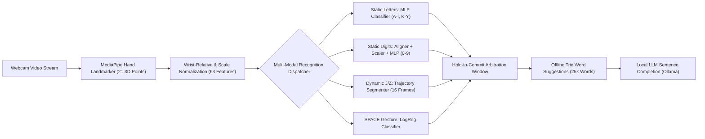

# NhanDienCuChi: Real-Time Hand Gesture Sign Language Recognition System

A high-performance American Sign Language (ASL), digit, and gesture recognition system powered by Google MediaPipe Hand Landmarker, calibrated scikit-learn classifiers, and local language intelligence.

[](https://github.com/phan-the-vinh/nhandienngonngu)
[](LICENSE)
[](environment.yml)
[](https://drive.google.com/drive/u/0/folders/11dG6JtCcgB_fniRazOeujuJPRiJl9m10)

---

## 1. Overview & Architecture

**NhanDienCuChi** captures video from a standard webcam, tracks 21 3D hand landmarks in real time, normalizes them against hand size and position, and classifies them into characters, numbers, and words with sub-second latency.



> [!NOTE]
> **Batteries-Included Open Source Distribution:**
> This repository is fully self-contained for real-time inference. It includes all Python source code, pre-trained model checkpoints (ABC letters, Digits 0–9, Dynamic J/Z, SPACE), MediaPipe task bundles, scalers, word suggestion dictionaries, reproduction manifests, and test suites.
> Heavy raw training datasets (source videos, extracted image archives, raw landmark coordinates) are hosted externally on **[Google Drive Dataset Archive](https://drive.google.com/drive/u/0/folders/11dG6JtCcgB_fniRazOeujuJPRiJl9m10)**.
> For details on licensing and attribution, please read **[MODEL_DISTRIBUTION.md](docs/MODEL_DISTRIBUTION.md)** and **[THIRD_PARTY_NOTICES.md](THIRD_PARTY_NOTICES.md)**.

### Supported Gestures
- **Static ASL Letters (24 classes):** `A–I`, `K–Y` recognized using calibrated Multi-Layer Perceptron (MLP) classifiers.
- **Static Digits (10 classes):** `0–9` recognized with a 2D-alignment pipeline and specialized MLP model.
- **Dynamic Letters (2 classes):**
  - **`J`**: Curved pinky-hook motion trajectory.
  - **`Z`**: Three-stroke zig-zag motion with index finger extension.
  - Features motion segmentation (First16Segmenter), wrist-relative trajectory normalization, and ratio-gated validation.
- **SPACE Gesture:** Open-palm static posture with thumb extension to separate words naturally.

### Language Intelligence
- **Hold-to-Commit:** Temporal smoothing window (~3 seconds hold confirmation) prevents false triggers during hand transitions.
- **Offline Word Suggestions:** Instant prefix search (<1 ms) powered by a 25,000-word Trie dictionary (`data/dictionary/english_words_25k.tsv`).
- **Contextual Sentence Completion:** Local LLM ranking and completion powered by [Ollama](https://ollama.com) (`qwen3:4b`), functioning completely offline without sending data to external APIs.

---

## 2. Project Structure

```
D:\NhanDienCuChi\
├── app/               # Application runtime and real-time inference pipelines
│   ├── camera/        # Camera loops, rendering, and unified multi-modal coordinator
│   ├── inference/     # Predictors (letter_inference, digit_inference, dynamic_jz, space)
│   └── suggestion/    # Trie dictionary prefix search and Ollama LLM integration
├── src/               # Public architectural APIs and clean model wrappers
├── ai/                # Hand landmark utilities, geometric features, normalization
├── models/            # Production model weights and MediaPipe task bundles
│   ├── mediapipe/     # Google MediaPipe hand_landmarker.task (Apache 2.0)
│   ├── letters/       # ASL letter MLP models (uvw_medium_model.joblib, scaler)
│   ├── digits/        # Static digit production models (digits_final.joblib)
│   └── space/         # Calibrated SPACE gesture classifier (final_space_model.joblib)
├── data/
│   ├── dictionary/    # 25,000 English word dictionary (SUBTLEX-US, CC BY-SA 4.0)
│   ├── processed/     # Extracted frozen landmark feature datasets
│   └── experiments/   # Dynamic J/Z binary baseline pipeline and metadata
├── configs/           # JSON runtime configurations (space.json, letters.json, digits.json)
├── tools/             # Utilities (download_models.py, camera diagnostic tools)
├── docs/              # Technical documentation (dataset.md, MODEL_DISTRIBUTION.md)
├── tests/             # Unit and integration test suite
├── THIRD_PARTY_NOTICES.md  # Upstream license notices and attribution
├── run.py             # Primary entry point (one-click launch)
├── requirements.txt   # Pip dependencies
└── environment.yml    # Conda environment definition
```

---

## 3. Quick Start & Installation

### Step 1: Clone the Repository
```bash
git clone https://github.com/phan-the-vinh/nhandienngonngu.git
cd nhandienngonngu
```

### Step 2: Environment Setup

#### Option A: Using Conda (Recommended)
```bash
conda env create -f environment.yml
conda activate nhandiencuchi
```

#### Option B: Using Python venv
```bash
python -m venv .venv

# On Windows:
.venv\Scripts\activate

# On Linux/macOS:
source .venv/bin/activate

pip install --upgrade pip
pip install -r requirements.txt
```

### Step 3: Model Verification & Optional Dataset Access

1. **Verify All Production Model Checkpoints:**
   All required pre-trained model weights, scalers, and the MediaPipe landmarker are pre-packaged in the repository. Verify their integrity at any time:
   ```bash
   python tools/download_models.py --check-only
   ```
   If `models/mediapipe/hand_landmarker.task` is missing or needs re-downloading, run:
   ```bash
   python tools/download_models.py
   ```

2. **Accessing Raw Training Datasets (Optional):**
   If you wish to inspect raw data, review extraction pipelines, or retrain the models from scratch:
   - Access the complete dataset package on the [Google Drive Dataset Archive](https://drive.google.com/drive/u/0/folders/11dG6JtCcgB_fniRazOeujuJPRiJl9m10).
   - Datasets include raw ASL video recordings, static alphabet frames, digit captures, and landmark parquet/JSON manifests as documented in [docs/dataset.md](docs/dataset.md).

---

## 4. Running the Application

### One-Click Launch (Default Unified Mode)
Execute `run.py` to launch the complete multi-modal recognition system:
```bash
python run.py
```
This automatically initiates:
- Static ASL (`A–Y` except `J`/`Z`) + Static Digits (`0–9`) recognition
- Dynamic `J` and `Z` trajectory recognition
- `SPACE` gesture recognition
- Offline Trie word suggestions + local Ollama completion (if available)

### Preflight Non-Camera Check
Verify that all model artifacts, configurations, and pipelines initialize correctly without opening the webcam:
```bash
python run.py --check-only
```

### Dedicated Recognition Modes & Options
```bash
# Letters only mode
python run.py --mode letters

# Letters check-only mode
python run.py --mode letters --check-only

# Digits only mode
python run.py --mode digits

# Specify a different webcam index (e.g., external USB camera)
python run.py --camera-index 1

# Disable experimental J/Z dynamic recognition
python run.py --disable-experimental-jz

# Disable SPACE gesture detection
python run.py --disable-space

# Disable word suggestion bar
python run.py --disable-word-suggestion
```

---

## 5. Operating Instructions & Gesture Tips

1. **Camera Framing & Lighting:**
   - Position the webcam approximately 50–80 cm away with even, ambient lighting.
   - Avoid harsh backlighting or cluttered backgrounds containing hand-like shapes.
2. **Holding for Commitment (Green Ring):**
   - When signing a static letter or digit, hold the gesture steady inside the frame.
   - A green confirmation ring will fill up (~3 seconds) before committing the character to the composition buffer.
3. **Inserting a Space:**
   - Form an open palm gesture facing the camera to trigger the SPACE classifier.
4. **Signing Dynamic Letters (J & Z):**
   - **Letter J:** Extend the pinky finger and sweep downwards and upwards in a smooth 'J' shape curve.
   - **Letter Z:** Extend the index finger and draw a three-stroke 'Z' pattern in the air.
5. **Word Suggestions & Auto-Complete:**
   - As characters accumulate, candidate words from the Trie dictionary appear on the UI.
6. **Exit Application:**
   - Press `q` or `ESC` in the OpenCV display window to gracefully exit the application.

---

## 6. Troubleshooting Common Issues

| Issue / Error Message | Root Cause | Solution |
|---|---|---|
| `camera_index 0 failed to open` | Webcam is busy or OS permissions denied | 1. Close Zoom, Teams, Discord, or browser tabs using the camera.<br>2. Check camera privacy settings in Windows Settings > Privacy > Camera.<br>3. Try alternative camera index: `python run.py --camera-index 1`. |
| `Missing required pre-trained model file(s)` | Model checkpoints not yet downloaded | Download `.joblib` model files from [Google Drive](https://drive.google.com/drive/u/0/folders/11dG6JtCcgB_fniRazOeujuJPRiJl9m10) into `models/`, then run `python tools/download_models.py --check-only`. |
| `Missing hand_landmarker.task` | MediaPipe model bundle missing | Run `python tools/download_models.py` to automatically fetch it from Google Cloud Storage. |
| `InconsistentVersionWarning: Trying to unpickle...` | Minor scikit-learn version difference | Benign scikit-learn warning. Does not affect inference results. Ensure `scikit-learn>=1.4.0` is installed. |
| `Ollama connection error / fallback` | Ollama service not running | Optional feature. The application gracefully degrades to instant offline Trie dictionary suggestions without raising an error. |
| Low recognition accuracy on live camera | Framing, distance, or mirroring issue | Ensure your hand occupies 30-50% of the frame height. Use normal right hand signing; the system automatically handles display mirroring. |

---

## 7. Verification & Automated Testing

Execute the core integration validation test:
```bash
python -m unittest tests/test_stage13_integration.py -v
```

Run preflight checks across all modules:
```bash
python tools/download_models.py --check-only
python run.py --check-only
python run.py --mode letters --check-only
```

---

## 8. License & Attribution

- **NhanDienCuChi Source Code:** Licensed under the [MIT License](LICENSE).
- **Google MediaPipe:** Licensed under the [Apache License 2.0](https://www.apache.org/licenses/LICENSE-2.0).
- **Third-Party Data & Models:** Detailed attribution and license acknowledgments for Arda Mavi Digits, ASL-HG Mendeley, SUBTLEX-US, SigNN Team, and Kaggle ASL Alphabet are documented in **[THIRD_PARTY_NOTICES.md](THIRD_PARTY_NOTICES.md)**.
- **Dataset Documentation:** See **[docs/dataset.md](docs/dataset.md)** for data composition, splits, and Google Drive links.
- **Model Distribution Policy:** See **[docs/MODEL_DISTRIBUTION.md](docs/MODEL_DISTRIBUTION.md)** for model provenance and deployment policies.
