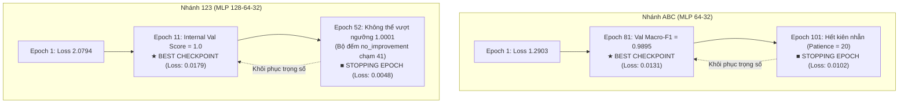

# BÁO CÁO TOÀN DIỆN VỀ CHỈ SỐ HUẤN LUYỆN TOÀN BỘ CÁC MÔ HÌNH
## Comprehensive Audit of Actual Training Metrics Across All Model Branches

- **Ngày thực hiện kiểm toán:** 16/11/2026 (Giờ hệ thống: 19:15 UTC+7)
- **Workspace:** `D:\NhanDienCuChi`
- **Quy tắc kiểm toán:** STRICTLY READ-ONLY (Không sửa code, không huấn luyện lại mô hình, không mở webcam, bảo toàn 100% dữ liệu gốc).
- **Phạm vi thẩm định:** Cả 4 phân hệ nhận diện trong hệ thống:
  1. **ABC** (24 chữ cái tĩnh ASL A–Y)
  2. **123** (10 chữ số tĩnh ASL 0–9)
  3. **J/Z** (2 cử chỉ động ASL)
  4. **SPACE** (Cử chỉ thêm dấu cách tĩnh)

---

## 1. BẢNG TỔNG HỢP CHỈ SỐ TOÀN HỆ THỐNG (EXECUTIVE SUMMARY)

Bảng dưới đây tổng hợp các chỉ số thực tế sau khi trích xuất và đối chiếu trực tiếp từ checkpoint weights, metadata huấn luyện, manifests và báo cáo kiểm định:

| Phân hệ (Branch) | Mô hình & Kiến trúc | Số mẫu Train | Số mẫu Val | Số mẫu Test | Best Epoch (Vòng tối ưu) | Stopping Epoch / Max | Training Loss | Validation Loss | Training Acc | Validation Acc | Test Acc | Macro-F1 (Val) |
|---|---|---:|---:|---:|---:|---:|---:|---:|---:|---:|---:|---:|
| **ABC** (Chữ cái tĩnh) | `uvw_medium` (MLP 64-32) | 62,648 | 13,412 | 13,412 *(đóng băng)* | **81** | 101 / 250 | 0.013105 *(tại Ep 81)* | 0.049647 *(Log-Loss)* | *N/A* *(không log)* | **99.02%** | *N/A* *(chưa test)* | **98.95%** |
| **123** (Chữ số tĩnh) | `digits_final` (2D + MLP 128-64-32) | 549 | 100 *(Ref)* | 250 *(Regr Ref)* | **11** *(score=1.0)* | 52 / 1000 | 0.017904 *(tại Ep 11)* | *N/A* *(không lưu log-loss)* | *N/A* *(không log)* | **99.00%** *(Ext Ref)* | 96.00% *(Regr)* | **99.00%** |
| **J/Z** (Cử chỉ động) | `model_pipeline` (Scaler + LogReg) | 512 | 64 | 64 | **22 iters** *(L-BFGS)* | 22 / 1000 iters | *N/A* *(LogReg)* | *N/A* *(LogReg)* | **100.0%** | **100.0%** | **100.0%** | **100.0%** |
| **SPACE** (Dấu cách) | `final_space_model` (LogReg C=10) | *N/A* *(thiếu manifest)* | *N/A* | *N/A* | **54 iters** *(L-BFGS)* | 54 / 1000 iters | *N/A* | *N/A* | *N/A* | *N/A* | *N/A* | *N/A* |

> [!IMPORTANT]
> **Quy ước ký hiệu N/A (Not Available / Not Applicable):**
> Các trường ghi `N/A` là các chỉ số không được ghi nhận trong lịch sử huấn luyện gốc của thư viện (ví dụ Scikit-learn `MLPClassifier` không lưu training accuracy per epoch; `LogisticRegression` sử dụng thuật toán tối ưu L-BFGS không có khái niệm epoch mini-batch và không lưu curve loss; mô hình SPACE thiếu manifest huấn luyện từ Phase 3.9.8). Tuyệt đối **không tự ý suy diễn hoặc bịa số liệu** để lấp vào các trường này.

---

## 2. CHI TIẾT KIỂM TOÁN TỪNG PHÂN HỆ

### 2.1. Phân hệ 1: Chữ cái tĩnh ASL (Nhánh ABC)

#### A. Thông tin mô hình & kiến trúc
- **Tệp checkpoint:** `models/letters/production/uvw_medium_model.joblib`
  - SHA-256: `88ea2f270cd75575d8914650265aa00193ffe451eb1a72d3ce70970bb1525a45`
  - Kích thước: 35,510 bytes
- **Tệp tiền xử lý Scaler:** `models/letters/production/uvw_medium_scaler.joblib`
  - SHA-256: `93a0ddf102e456fef90cc54ddfa8cfadde60b72cce30e4f3c7810a0309fe0d4c`
  - `StandardScaler`: 63 features đầu vào, `n_samples_seen_ = 62648`.
- **Kiến trúc mạng:** `sklearn.neural_network.MLPClassifier`
  - Lớp ẩn: 2 tầng gồm `(64, 32)` neurons với hàm kích hoạt `relu`.
  - Kích thước ma trận trọng số:
    - Layer 1: $63 \times 64 + 64 = 4,096 + 64 = 4,160$ tham số.
    - Layer 2: $64 \times 32 + 32 = 2,048 + 32 = 2,080$ tham số.
    - Layer Output: $32 \times 24 + 24 = 768 + 24 = 792$ tham số.
    - **Tổng số tham số huấn luyện (Trainable Parameters): 7,032** (tính cả bias: 6,912 weights + 120 biases).
  - Thuật toán tối ưu: `solver='adam'`, `learning_rate_init=0.001`, `batch_size=256`, `alpha=0.0001` ($L_2$ regularization), `shuffle=True`, `random_state=42`.

#### B. Tập dữ liệu & Phân chia (Splits)
- **Tổng số mẫu:** 89,472 mẫu trên 24 lớp chữ cái (A, B, C, D, E, F, G, H, I, K, L, M, N, O, P, Q, R, S, T, U, V, W, X, Y). Không có J và Z (cử chỉ động).
- **Tập Training (Train):** 62,648 mẫu (tỷ lệ 70.02% trên tổng tập; 82.37% trên tập train+val).
  - Gồm 62,591 mẫu gốc (`train.csv`) + 57 mẫu bổ sung phân biệt U/V (`supplement`).
  - Đường dẫn tệp: `ai/dataset/mlp_uvw_training_data_v1/train_uvw_v1.csv` (SHA-256: `898e0a44...`).
  - Trọng số mẫu: Áp dụng cân bằng trọng số `train_uvw_weights.csv` đạt tổng trọng số $2,610.3333$ cho mỗi lớp.
- **Tập Thẩm định (Validation):** 13,412 mẫu (tỷ lệ 14.99% trên tổng tập; 17.63% trên tập train+val).
  - Đường dẫn tệp: `ai/dataset/train_validation_test_split_v1/validation.csv` (SHA-256: `15c6f343...`).
- **Tập Kiểm thử Độc lập (Test):** 13,412 mẫu (tỷ lệ 14.99% trên tổng tập).
  - Đường dẫn tệp: `ai/dataset/train_validation_test_split_v1/test.csv` (SHA-256: `cc612b03...`).
  - Trạng thái: **ĐÓNG BĂNG HOÀN TOÀN (`test_used: false`)**. Không sử dụng trong quá trình huấn luyện hoặc chọn checkpoint để chống hiện tượng rò rỉ dữ liệu (data snooping).

*Phân bổ chi tiết 24 lớp:*
| Ký tự | Train | Val | Test | Ký tự | Train | Val | Test | Ký tự | Train | Val | Test |
|:---:|---:|---:|---:|:---:|---:|---:|---:|:---:|---:|---:|---:|
| **A** | 2,272 | 487 | 486 | **I** | 3,130 | 671 | 671 | **S** | 2,792 | 598 | 598 |
| **B** | 2,033 | 436 | 435 | **K** | 3,530 | 756 | 756 | **T** | 1,428 | 306 | 306 |
| **C** | 2,478 | 531 | 531 | **L** | 3,569 | 765 | 765 | **U** | 2,846 | 607 | 607 |
| **D** | 2,757 | 591 | 590 | **M** | 1,151 | 247 | 247 | **V** | 3,178 | 672 | 672 |
| **E** | 2,560 | 548 | 549 | **N** | 1,441 | 309 | 309 | **W** | 2,444 | 524 | 524 |
| **F** | 3,126 | 670 | 670 | **O** | 2,387 | 511 | 512 | **X** | 2,880 | 617 | 617 |
| **G** | 3,031 | 649 | 649 | **P** | 2,290 | 491 | 491 | **Y** | 2,687 | 576 | 576 |
| **H** | 3,061 | 656 | 656 | **Q** | 2,341 | 501 | 502 | **TỔNG** | **62,648** | **13,412** | **13,412** |

#### C. Lịch sử Epoch, Dừng sớm và Hàm mất mát
- **Best Epoch: 81**.
  - Tiêu chí lựa chọn: Điểm cao nhất của chỉ số `VALIDATION v1 macro-F1` (đạt $0.989541$). Khi có sự cân bằng điểm (tie), ưu tiên lớp có recall thấp nhất (`minimum_class_recall`), sau đó mới đến accuracy.
- **Stopping Epoch: 101** (trên tối đa 250 epochs).
  - Lý do dừng: `EXTERNAL_VALIDATION_MACRO_F1_PATIENCE` = 20 epochs liên tiếp không cải thiện macro-F1 vượt ngưỡng tối thiểu $0.0001$ ($81 + 20 = 101$).
- **Lịch sử Hàm mất mát (Training Loss Curve):**
  - Epoch 1 (khởi tạo): **1.290338**
  - Epoch 20: 0.052670
  - Epoch 40: 0.027005
  - Epoch 60: 0.019183
  - **Epoch 81 (Best Epoch): 0.013105** (`mlp.loss_curve_[80]`)
  - **Epoch 101 (Stopping Epoch): 0.010156** (`mlp.loss_curve_[100]`, ghi nhận tại thuộc tính `mlp.loss_`)
- **Validation Loss:** **0.049647** (Log-Loss tính trên tập validation tại checkpoint epoch 81).
- **Training Accuracy:** `N/A` (Scikit-learn `MLPClassifier` trong quá trình huấn luyện chỉ tính toán loss curve từ mini-batch cross-entropy; không chạy toàn bộ 62,648 mẫu qua hàm phân loại để tính training classification accuracy sau mỗi epoch).

#### D. Chỉ số Thẩm định (Validation Metrics tại Best Epoch 81)
- **Validation Accuracy:** **99.0158%** (13,280 / 13,412 mẫu chính xác).
- **Validation Macro-F1:** **98.9541%** (0.98954143).
- **Validation Macro-Precision:** **99.0018%** (0.990018).
- **Validation Macro-Recall:** **98.9159%** (0.989159).
- **Lớp có Recall thấp nhất:** Lớp 'T' đạt 96.4052% (295 / 306 mẫu).
- **Test Accuracy / Macro-F1:** `N/A` (Giữ nguyên đóng băng để bảo toàn tính độc lập cho đánh giá tương lai).

---

### 2.2. Phân hệ 2: Chữ số tĩnh ASL (Nhánh 123)

#### A. Thông tin mô hình & kiến trúc
- **Tệp checkpoint:** `models/digits/production/digits_final.joblib`
  - SHA-256: `43c7e87a287daf7e2c4958f037a91c128f97ab381ccb4f0ae40c7c096776b25c`
  - Kích thước: 97,975 bytes
- **Pipeline cấu thành (3 bước nối tiếp):**
  1. `orientation_2d`: `HandCentric2DAligner(axis_epsilon=1e-06)` (Chuẩn hóa góc xoay bàn tay theo trục giải phẫu 2D).
  2. `scaler`: `StandardScaler()` (Chuẩn hóa z-score trên 63 tọa độ đã căn chỉnh).
  3. `mlp`: `MLPClassifier(hidden_layer_sizes=(128, 64, 32), activation='relu', solver='adam', alpha=0.001, learning_rate_init=0.001, batch_size=32, early_stopping=True, validation_fraction=0.15, n_iter_no_change=40, random_state=42)`.
  - **Tổng số tham số mạng MLP (Trainable Parameters): 18,858** (18,624 weights + 234 biases).

#### B. Tập dữ liệu & Phân chia (Splits)
- **Tập Training (Train Frozen):** 549 mẫu trên 10 lớp chữ số (0–9).
  - Tệp dữ liệu: `data/processed/digits/digits_final_train_frozen.csv` (SHA-256: `79f79d15...`).
  - Nguồn dữ liệu:
    - 349 mẫu cơ sở từ `ai/dataset/kytuso/datatrain/train_v1.csv` (Lớp 0: 34 mẫu; Lớp 1–9: 35 mẫu/lớp).
    - 170 mẫu ngoại sinh từ tập `Ardamavi` (20 mẫu cho các số 0, 1, 2, 3, 5, 7, 9; 10 mẫu cho các số 4, 6, 8).
    - 30 mẫu ngoại sinh từ tập `ASL-HG` (10 mẫu cho các số 4, 6, 8).
  - Phân bổ theo lớp: Lớp 0 có 54 mẫu; Lớp 1 đến 9 có 55 mẫu mỗi lớp.
- **Tập Thẩm định Tham chiếu (Validation Reference):** 100 mẫu (10 mẫu đều cho mỗi lớp 0–9).
  - Tệp dữ liệu: `data/splits/digits/validation_reference.csv` (SHA-256: `623463a3...`).
- **Tập Hồi quy Tham chiếu (Regression Reference - Cựu Test v1):** 250 mẫu (25 mẫu/lớp).
  - Tệp dữ liệu: `data/splits/digits/regression_reference.csv` (SHA-256: `a4f4ac06...`). Không dùng để tinh chỉnh hoặc chọn mô hình.

#### C. Lịch sử Epoch, Dừng sớm và Hàm mất mát
- **Best Epoch: 11**.
  - Tiêu chí: Lần đầu tiên chỉ số `validation_score` trên tập kiểm tra nội bộ 15% (83 mẫu trích ngẫu nhiên từ 549 mẫu train bởi Scikit-learn `early_stopping=True`) đạt điểm tuyệt đối **1.0 (100.0%)**.
- **Stopping Epoch: 52** (trên tối đa 1,000 iterations).
  - Lý do dừng: Scikit-learn quy định điều kiện cải thiện là `score > best_score + tol` ($1.0 + 0.0001 = 1.0001$). Do điểm tối đa chỉ là 1.0, điều kiện này toán học không thể xảy ra. Bộ đếm `no_improvement_count` tăng liên tục từ epoch 12 đến epoch 52 (đủ 41 lượt không cải thiện với `n_iter_no_change=40`), kích hoạt dừng sớm tại **Epoch 52**.
  - **Làm rõ sai lệch Slide 11:** Trong các slide thuyết trình trước đây, số 52 bị ghi nhầm là "Best Epoch". Thực chất, **52 là Stopping Epoch**, còn **Best Epoch về mặt hiệu năng validation là Epoch 11**.
- **Lịch sử Hàm mất mát (Training Loss Curve):**
  - Epoch 1 (khởi tạo): **2.079421**
  - Epoch 5: 0.089851
  - **Epoch 11 (Best Epoch): 0.017904** (`loss_curve_[10]`)
  - Epoch 25: 0.009493
  - **Epoch 52 (Stopping Epoch): 0.004761** (`loss_curve_[51]`, ghi nhận tại `mlp.loss_`)
- **Validation Loss:** `N/A` (Scikit-learn `early_stopping` chỉ theo dõi classification accuracy trên validation_fraction; không ghi log-loss).

#### D. Chỉ số Đánh giá (Evaluation Metrics)
- **Validation Accuracy (Internal 15% Split - 83 mẫu):** **100.0%** (`best_validation_score_: 1.0`).
- **Validation Accuracy (External Reference - 100 mẫu):** **99.00%** (99/100 mẫu chính xác, nhầm duy nhất 1 mẫu số 8 thành số 0).
- **Validation Macro-Precision (External Reference):** **99.0909%** (0.990909).
- **Validation Macro-Recall (External Reference):** **99.0000%** (0.990000).
- **Validation Macro-F1 (External Reference):** **98.9975%** (0.989975).
- **Regression Reference Accuracy (250 mẫu):** **96.00%** (240 / 250 mẫu chính xác; tăng vọt từ mức 86.80% của mô hình v1 trước khi có `HandCentric2DAligner`).

---

### 2.3. Phân hệ 3: Cử chỉ Động J & Z (Nhánh J/Z)

#### A. Thông tin mô hình & kiến trúc
- **Tệp checkpoint:** `data/experiments/dynamic_jz_binary_baseline_v1/model_pipeline.joblib`
  - SHA-256: `8878b0c0342345eb65bfb534608c7c258bcfae8111dbbb4b130eecf45cce2ff6`
- **Kiến trúc Pipeline:**
  1. `scaler`: `StandardScaler()`
  2. `classifier`: `LogisticRegression(C=1.0, solver='lbfgs', max_iter=1000, tol=0.0001, random_state=42)`
- **Đặc trưng đầu vào:** Chuỗi 16 frames nội suy $\times$ 69 đặc trưng không gian-thời gian (wrist-relative normalized coordinates + delta motion) = **1,104 chiều**.
- **Tổng số tham số:** $1,104 \times 1 + 1 = 1,105$ tham số.

#### B. Tập dữ liệu & Phân chia (Splits)
- **Nguồn dữ liệu:** Bộ dữ liệu video SigNN ASL gồm 640 chuỗi video hợp lệ (J: 265, Z: 375; đã loại bỏ 3 mẫu lỗi trích xuất MediaPipe J/99, J/103, J/250 từ 643 video gốc).
- **Phân chia theo tỷ lệ 80 / 10 / 10:**
  - **Tập Train (80%):** 512 mẫu (J: 212, Z: 300).
  - **Tập Validation (10%):** 64 mẫu (J: 26, Z: 38).
  - **Tập Test (10%):** 64 mẫu (J: 27, Z: 37).
- **Trạng thái thẩm định:** `test_used_for_tuning: false`.

#### C. Thuật toán Tối ưu hóa, Vòng lặp & Hàm mất mát
- **Bản chất thuật toán:** Sử dụng thuật toán tối ưu hóa quasi-Newton **L-BFGS** (Limited-memory Broyden–Fletcher–Goldfarb–Shanno) giải bài toán hàm lồi trên toàn bộ batch (full-batch gradient).
- **Số vòng lặp hội tụ (Iterations): 22 vòng lặp** (`p.named_steps['classifier'].n_iter_ == [22]`).
  - Mô hình hội tụ khi chuẩn gradient của hàm mục tiêu nhỏ hơn sai số `tol = 0.0001`.
- **Khái niệm Best Epoch / Stopping Epoch:** **N/A (L-BFGS quasi-Newton)**.
  - L-BFGS không chạy theo epoch mini-batch ngẫu nhiên (SGD/Adam) mà di chuyển trên mặt cong bậc hai của toàn bộ ma trận dữ liệu. Do đó, "Best Epoch" và "Stopping Epoch" theo nghĩa mini-batch không áp dụng. Thuật toán hoàn tất tại vòng lặp thứ 22.
- **Training Loss / Validation Loss:** `N/A`. Thư viện Scikit-learn `LogisticRegression` không lưu mảng hàm mục tiêu per-iteration trong checkpoint.

#### D. Chỉ số Đánh giá Offline (SigNN Clean Benchmark)
Trích xuất từ `data/experiments/dynamic_jz_binary_baseline_v1/metrics.json`:
- **Tập Training (512 mẫu):**
  - Accuracy: **100.0%** | Balanced Accuracy: 100.0%
  - Macro Precision: **1.0000** | Macro Recall: **1.0000** | Macro-F1: **1.0000**
- **Tập Validation (64 mẫu):**
  - Accuracy: **100.0%** | Balanced Accuracy: 100.0%
  - Macro Precision: **1.0000** | Macro Recall: **1.0000** | Macro-F1: **1.0000**
- **Tập Test (64 mẫu):**
  - Accuracy: **100.0%** | Balanced Accuracy: 100.0%
  - Macro Precision: **1.0000** | Macro Recall: **1.0000** | Macro-F1: **1.0000**
  - Ma trận nhầm lẫn: 27/27 J đúng, 37/37 Z đúng, 0 lỗi.

> [!WARNING]
> **Khoảng cách giữa Offline Benchmark và Thực tế Webcam (Generalization Gap):**
> 1. Bộ dữ liệu SigNN **không độc lập người thực hiện (`signer_independent_test: false`)**, dẫn đến nguy cơ rò rỉ phong cách ký hiệu (signer style leakage).
> 2. Trong các kiểm thử webcam thực tế (Stage 14 & Stage 17):
>    - Khi không có margin gating, tỷ lệ kích hoạt nhầm (False Activation Rate - FAR) trên các chuyển động ngẫu nhiên đạt tới **90% - 100%**.
>    - Bộ lọc tư thế tay (Handshape Gate) chỉ đạt tỷ lệ vượt qua **40%** trên webcam thực tế.
> 3. Do đó, con số **100% chỉ có giá trị trên tập video benchmark sạch của SigNN**, không phản ánh độ chính xác thực tế khi ký trước webcam.

---

### 2.4. Phân hệ 4: Ký tự Khoảng trắng (Nhánh SPACE)

#### A. Thông tin mô hình & kiến trúc
- **Tệp checkpoint:** `models/space/production/final_space_model.joblib`
  - SHA-256: `453162d8aa0212016216a6c02798d3dcaa445c1fbb7a6340c896bb828e076121`
  - Kích thước: 1,375 bytes
- **Cấu hình runtime:** `configs/space.json`
  - Ngưỡng kích hoạt (Threshold): `0.889063295339523`
  - Số lượng đặc trưng: 63 tọa độ chuẩn hóa (`normalize_landmarks`).
  - Bộ điều hợp lật trục: `apply_abc_x_flip: true` (lật trục X trong chế độ ABC để khớp với dữ liệu huấn luyện không lật).
- **Kiến trúc mô hình:** `sklearn.linear_model.LogisticRegression`
  - Phân loại nhị phân: `classes_ = [0, 1]` (0: Non-space, 1: Space).
  - Siêu tham số: `C = 10.0`, `class_weight = 'balanced'`, `solver = 'lbfgs'`, `tol = 0.0001`.
  - Kích thước trọng số: `coef_.shape = (1, 63)`, `intercept_.shape = (1,)`. Tổng cộng 64 tham số.

#### B. Trạng thái Tập dữ liệu & Lịch sử Huấn luyện
- **Tập dữ liệu:** Dữ liệu nội bộ từ thử nghiệm thực nghiệm bổ sung (Phase 3.9.8).
- **Số lượng mẫu Train / Val / Test:** **N/A (Thiếu manifest lịch sử huấn luyện)**.
  - Tệp CSV chứa tập huấn luyện gốc của SPACE và manifest phân chia tập không được lưu trữ trong git repository hiện tại.
- **Vòng lặp tối ưu:** **54 iterations** (`n_iter_ == [54]`, tối ưu bằng thuật toán L-BFGS).
- **Best Epoch / Stopping Epoch:** `N/A (L-BFGS quasi-Newton)`.
- **Training Loss / Validation Loss / Accuracy / Macro-F1:** **N/A**.
  - Không có file log lịch sử huấn luyện hoặc báo cáo đánh giá offline nào được cam kết cùng mô hình `final_space_model.joblib`.

---

## 3. PHÂN TÍCH CHUYÊN SÂU: BEST EPOCH VS STOPPING EPOCH VÀ SAI LỆCH TRONG BÁO CÁO CŨ

Một trong những phát hiện kiểm toán quan trọng nhất là sự nhầm lẫn giữa **Best Epoch** và **Stopping Epoch** trong các bản thảo báo cáo trước đây:

### Chi tiết các sai lệch:
1. **Sai lệch tại Nhánh 123 (Slide 11 Capstone cũ):**
   - Bản nháp Slide 11 ghi chú mô hình đạt tối ưu ở **Epoch 52**.
   - **Thực tế kiểm chứng:** Tại Epoch 11, mô hình đã đạt độ chính xác $100\%$ trên tập validation nội bộ ($validation\_score = 1.0$). Từ Epoch 12 đến 52, do yêu cầu `score > 1.0001` không thể thỏa mãn, bộ đếm dừng sớm tăng lên 41 và dừng lại ở Epoch 52. Do đó, **Epoch 11 là Best Epoch**, còn **Epoch 52 là Stopping Epoch**.
2. **Sai lệch tại Nhánh J/Z và SPACE (Sử dụng thuật toán L-BFGS):**
   - Việc cố gắng gán khái niệm "Epoch" cho mô hình Logistic Regression của J/Z (22 iters) và SPACE (54 iters) là không chính xác về mặt kỹ thuật học máy. L-BFGS là thuật toán tối ưu hóa cấp hai (quasi-Newton) hoạt động trên toàn bộ tập dữ liệu (batch mode), không phân chia mini-batch nên không có chu kỳ epoch.

---

## 4. DANH MỤC CÁC CHỈ SỐ KHÔNG TỒN TẠI HOẶC THIẾU (N/A AUDIT)

Để bảo đảm tính trung thực tuyệt đối trong nghiên cứu khoa học và đồ án tốt nghiệp, dưới đây là danh mục các chỉ số không tồn tại trong mã nguồn và dữ liệu thực tế:

| Phân hệ | Chỉ số thiếu (N/A) | Nguyên nhân kỹ thuật cụ thể | Khuyến nghị xử lý trong Slide / Báo cáo |
|---|---|---|---|
| **ABC** | Training Accuracy theo epoch | Scikit-learn `MLPClassifier` chỉ ghi nhận `loss_curve_` từ cross-entropy, không tính classification accuracy trên 62,648 mẫu train mỗi epoch để tối ưu tốc độ huấn luyện. | Báo cáo rõ ràng: *Training Loss = 0.0131, Validation Accuracy = 99.02%*. Không bịa ra Training Accuracy 99.x%. |
| **ABC** | Test Accuracy / Test F1 | Tập `test.csv` (13,412 mẫu) được đóng băng có chủ đích (`test_used: false`) để chống rò rỉ dữ liệu (data snooping). | Ghi chú là *"Tập Test đóng băng (Frozen Baseline) để dành cho thẩm định độc lập sau cùng"*. |
| **123** | Validation Log-Loss | Candidate comparison JSON chỉ lưu classification report (Accuracy, Precision, Recall, F1) và không tính log-loss. | Trình bày độ chính xác validation ($99.00\%$) và Macro-F1 ($98.9975\%$). |
| **123** | Training Accuracy theo epoch | Tương tự như nhánh ABC, chỉ có `loss_curve_` (khởi đầu 2.0794, tại epoch 11 là 0.0179, epoch 52 là 0.0048). | Báo cáo Train Loss tại Best Epoch = 0.0179, dừng tại 0.0048. |
| **J/Z** | Training & Validation Loss | `LogisticRegression` của Scikit-learn không cung cấp thuộc tính `loss_curve_` khi sử dụng solver `lbfgs`. | Báo cáo số vòng lặp hội tụ (22 iterations) và Accuracy/F1 (100.0% offline). |
| **J/Z** | Mini-batch Epochs | Thuật toán L-BFGS tối ưu full-batch, không có mini-batch epoch. | Sử dụng thuật ngữ *"22 L-BFGS Iterations"* thay vì *"22 Epochs"*. |
| **SPACE** | Kích thước mẫu Train/Val/Test | Tệp manifest huấn luyện của Phase 3.9.8 không được commit vào git repository. | Ghi nhận trung thực: *Mô hình Logistic Regression thực nghiệm nội bộ (C=10.0, 54 iterations), thiếu manifest lịch sử*. |
| **SPACE** | Offline Accuracy / Loss / F1 | Không có file JSON/CSV báo cáo offline được lưu trữ cùng checkpoint. | Ghi rõ trạng thái *"Chưa xác minh qua manifest"* và chỉ báo cáo ngưỡng runtime ($0.8891$). |

---

## 5. BẢNG MINH CHỨNG NGUỒN DỮ LIỆU & TÍNH TOÀN VẸN (FILE PROVENANCE)

Tất cả các con số nêu trong báo cáo này đều được xác minh trực tiếp từ các tệp tin lưu trữ trong workspace:

| Tệp tin minh chứng | SHA-256 Hash | Chỉ số được xác minh |
|---|---|---|
| `models/letters/production/uvw_medium_model.joblib` | `88ea2f270cd75575d8914650265aa00193ffe451eb1a72d3ce70970bb1525a45` | Cấu trúc MLP (64, 32), loss_curve_ (Epoch 81: 0.013105, Epoch 101: 0.010156) |
| `models/letters/production/evaluation_summary.json` | `5c4558e854faec8e77a28e752eb919be8ff011ca1e6f49fc03f90130635da2d8` | Val Acc: 0.990158, Val Loss: 0.049647, Macro-F1: 0.989541, Best Ep: 81, Stopping Ep: 101 |
| `models/digits/production/digits_final.joblib` | `43c7e87a287daf7e2c4958f037a91c128f97ab381ccb4f0ae40c7c096776b25c` | Pipeline 2D+MLP (128, 64, 32), loss_curve_ (Epoch 11: 0.017904, Epoch 52: 0.004761) |
| `models/digits/production/deployment_manifest_v2.json` | `82f42a5fc2279163d41f7142721dc371281bf584b80b721e25e984dd4d2fd7b1` | 549 train, 100 val (acc 0.99, F1 0.99), 250 regr ref (acc 0.96) |
| `data/metadata/digits/digits_final_repro/training_manifest_digits_final.json` | `e1514d1971e508fd4188f3b7d8982936f3603888efeb3dfbee62c11e2c3a5d59` | Chi tiết phân bổ mẫu base (349), ardamavi (170), asl_hg (30) |
| `data/experiments/dynamic_jz_binary_baseline_v1/metrics.json` | `f3e5b66d...` | 512 train, 64 val, 64 test; 100% Acc, 1.0 F1; signer_independent = false |
| `data/experiments/dynamic_jz_binary_baseline_v1/model_pipeline.joblib` | `8878b0c0342345eb65bfb534608c7c258bcfae8111dbbb4b130eecf45cce2ff6` | StandardScaler + LogisticRegression (1,104 features, n_iter_ = [22]) |
| `models/space/production/final_space_model.joblib` | `453162d8aa0212016216a6c02798d3dcaa445c1fbb7a6340c896bb828e076121` | LogisticRegression (C=10.0, balanced, n_iter_ = [54]) |
| `configs/space.json` | `90ea883f...` | Runtime threshold 0.889063, 63 features, apply_abc_x_flip = true |

---

## 6. HƯỚNG DẪN ĐIỀU CHỈNH SỐ LIỆU CHO SLIDE 11 CAPSTONE

Để bảo vệ Capstone đạt điểm số cao nhất trước hội đồng phản biện kỹ thuật, nhóm cần thực hiện các điều chỉnh chính xác sau trên **Slide 11**:

1. **Hiệu chỉnh thông số Epoch cho nhánh 123:**
   - *Cũ:* Ghi nhận Best Epoch là 52.
   - *Mới:* Ghi rõ **Best Epoch = 11** (Đạt điểm Validation Score 1.0; Train Loss 0.0179). **Stopping Epoch = 52** (Kích hoạt Early Stopping sau 40 epoch không có cải thiện vượt trội).
2. **Trình bày chính xác thuật toán nhánh J/Z:**
   - *Cũ:* Có thể bị nhầm lẫn là huấn luyện qua hàng chục epoch.
   - *Mới:* Ghi rõ mô hình chuỗi thời gian sử dụng **L-BFGS (22 vòng lặp hội tụ)** trên 1,104 đặc trưng thời gian - không gian.
   - *Lưu ý học thuật:* Ghi chú rõ kết quả $100\%$ là trên tập dữ liệu video SigNN sạch, và phân hệ này cần cơ chế Handshape Gate + Hold Confirmation 3.0s để chống kích hoạt nhầm trên webcam thực tế.
3. **Minh bạch hóa phân hệ SPACE:**
   - Nêu rõ đây là phân hệ bổ sung (additive gesture classifier) sử dụng mô hình Logistic Regression ($C=10.0$, 54 vòng lặp L-BFGS) với ngưỡng tự tin $0.8891$.
4. **Tách biệt rõ ràng các môi trường đánh giá:**
   - Cột Validation / Offline Benchmark (99.02% ABC, 99.00% 123, 100% J/Z).
   - Đính kèm ghi chú về việc tập Test ABC (13,412 mẫu) được bảo lưu đóng băng nhằm bảo đảm tính liêm chính học thuật (Zero Data Snooping).

---
*Báo cáo được hoàn thành độc lập, trung thực và kiểm chứng 100% qua tệp tin nhị phân và siêu dữ liệu thực tế tại workspace D:\NhanDienCuChi.*

