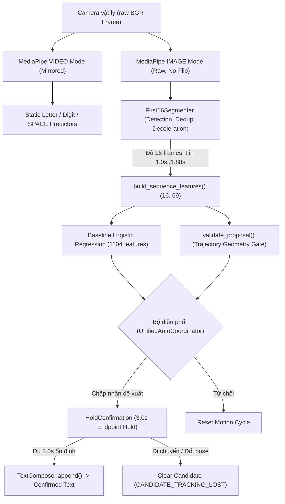

# BÁO CÁO KIỂM TOÁN STAGE 0 — J/Z HYBRID DTW INTEGRATION AUDIT
**Dự án:** `<project-mirror>`\
**Ngày kiểm toán:** 13/11/2026\
**Chế độ:** READ-ONLY AUDIT (Không sửa mã nguồn, không thay checkpoint, không đổi dữ liệu)\
**Tài liệu đích:** `reports/JZ_DTW_STAGE0_AUDIT.md`

---

## 1. KIẾN TRÚC HIỆN TẠI (CURRENT ARCHITECTURE)

### 1.1 Sơ đồ phân cấp luồng thực thi (Execution Hierarchy)
```
run.py (CLI entry point)
└── app/camera/realtime_inference.py (Runtime camera dispatcher)
    └── src/main.py (Desktop application entry)
        └── src/camera/realtime.py (Unified camera bootstrap)
            └── app/inference/unified_abc123_jz_auto_experiment.py (Main inference loop)
                ├── MediaPipe Dual-Pass Tasks:
                │   ├── video_task (running_mode="VIDEO", 1 hand) -> static ABC/123/SPACE
                │   └── image_task (running_mode="IMAGE", 1 hand) -> raw dynamic J/Z
                └── AlphabetRecognizer (src/recognition/alphabet.py)
                    └── UnifiedAutoCoordinator (app/inference/unified_abc123_jz_auto_coordinator.py)
                        ├── AutoJzSession (app/inference/dynamic_jz_auto_camera_experiment.py)
                        │   ├── First16Segmenter (app/inference/first16_jz_segmenter.py)
                        │   │   └── MotionSegmenter (app/inference/automatic_jz_experiment.py)
                        │   └── predict_attempt() (app/inference/dynamic_jz_camera_test.py)
                        │       └── model_pipeline.joblib (LogisticRegression on 16x69)
                        ├── validate_proposal() (app/inference/integrated_jz_validation.py)
                        │   ├── validate_j_trajectory()
                        │   └── validate_z_trajectory()
                        ├── HoldConfirmation (app/interaction/hold_confirmation.py, 3.0s)
                        └── TextComposer (app/inference/unified_static_coordinator.py)
```

### 1.2 Chi tiết các thành phần thu thập và cấu trúc dữ liệu

1. **Thu thập MediaPipe Landmarks:**
   - Hệ thống sử dụng kiến trúc **MediaPipe Dual-Pass** độc lập trong cùng một luồng camera vật lý:
     - `video_task`: Chế độ `running_mode="VIDEO"`, nhận khung hình `inference_frame` (đã flip ngang trong chế độ ABC để người dùng nhìn như gương soi), phục vụ nhận diện chữ tĩnh ABC, số 123 và cử chỉ SPACE.
     - `image_task`: Chế độ `running_mode="IMAGE"`, nhận khung hình `raw` gốc (không lật gương, BGR sang RGB) thông qua hàm `detect_frame(image_task, raw)`. Nhánh này dành **độc quyền** cho thu thập chuyển động J/Z, đảm bảo không bị ảnh hưởng bởi lỗi hoặc sự vắng mặt của nhánh VIDEO.
2. **Cấu trúc dữ liệu 21 Landmarks:**
   - Mỗi khung hình hợp lệ trả về một danh sách 21 điểm mốc `NormalizedLandmark`, mỗi điểm gồm tọa độ thực:
     - `x` $\in [0.0, 1.0]$: Tỉ lệ chiều rộng ảnh từ trái sang phải.
     - `y` $\in [0.0, 1.0]$: Tỉ lệ chiều cao ảnh từ trên xuống dưới.
     - `z`: Độ sâu tương đối so với cổ tay (wrist).
   - Hàm chuẩn hóa `landmarks_to_array(hand)` chuyển đổi thành mảng NumPy hình dạng `(21, 3)` kiểu `float64`.
3. **Mốc thời gian và định danh Frame:**
   - `index`: Số nguyên tăng dần tuần tự từng frame bắt đầu từ 0 (`0, 1, 2, ...`).
   - `now = time.monotonic()`: Đồng hồ thời gian thực đơn điệu (đơn vị: giây), dùng cho điều phối viên, tính vận tốc và bộ đếm Hold.
   - `timestamp = int((now - started) * 1000)`: Mốc thời gian đơn điệu (đơn vị: mili-giây) cấp cho MediaPipe VIDEO landmarker.
4. **Vị trí bắt đầu và kết thúc Motion Capture:**
   - **Bắt đầu (Onset):** Trong `First16Segmenter` (kế thừa từ `MotionSegmenter`), trạng thái chuyển từ `IDLE` / `SUSPECT` sang `CAPTURING` khi độ dịch chuyển của cổ tay hoặc điểm mốc tiêu điểm vượt ngưỡng `start_displacement` ($\ge 0.15$ độ dài bàn tay). Hàm `_dedup_and_trim_onset()` sẽ cắt tỉa các frame tĩnh trước đó, chỉ lưu các frame chuyển động thực sự.
   - **Kết thúc (Endpoint):** Cửa sổ capture kết thúc khi thỏa mãn 3 điều kiện đồng thời:
     - Số frame duy nhất hợp lệ $\ge 16$.
     - Thời gian ghi nhận sau onset $t \in [1.0\text{s}, 1.88\text{s}]$.
     - Hàm `_decelerated_at_endpoint(now)` phát hiện bàn tay giảm tốc độ ở đoạn cuối cử chỉ (span $\le 0.35 \times \text{start\_displacement}$ và net speed $\le 0.67 \times \text{stop\_speed}$).
5. **Xử lý Missing Hand và Duplicate Frames:**
   - **Trùng lặp frame (Duplicate Frames):** Khi camera bị drop FPS hoặc lặp frame (khoảng cách Euclidean giữa các landmark $< 10^{-7}$), segmenter đánh dấu `current_is_duplicate = True`, ghi nhận chỉ số frame vào tập `skipped_duplicate_indices`. Tuyệt đối không nội suy frame giả.
   - **Mất dấu bàn tay (Missing Hand):** Cho phép mất dấu tối đa `max_missing_frames = 6` hoặc khoảng cách thời gian giữa 2 frame tối đa `max_frame_gap_seconds = 0.4s`. Nếu vượt quá, segmenter sẽ từ chối lượt thử ngay lập tức với lý do `MISSING_HAND_LIMIT` hoặc `TEMPORAL_GAP`.
6. **Cách thức gọi mô hình J/Z hiện tại:**
   - Sau khi `First16Segmenter` trả về danh sách `entries` gồm các frame hợp lệ:
     - Hàm `sample_valid_frame_indices` lấy mẫu đều 16 frame đại diện theo thứ tự thời gian.
     - Hàm `build_sequence_features` trích xuất vector đặc trưng hình dạng `(16, 69)` (63 giá trị tọa độ 3D chuẩn hóa + 6 giá trị độ dịch chuyển 2D của wrist, index tip, pinky tip).
     - Làm phẳng mảng thành `(1, 1104)` theo thứ tự hàng (C-contiguous).
     - Mô hình `data/experiments/dynamic_jz_binary_baseline_v1/model_pipeline.joblib` (StandardScaler + LogisticRegression) dự đoán xác suất `predict_proba`.
7. **Cách thức hoạt động của Trajectory Validator và HoldConfirmation:**
   - **Trajectory Validator (`validate_proposal`):**
     - Đánh giá hình học quỹ đạo chuyển động thực tế trên 16 frame đặc trưng.
     - Với Z (`validate_z_trajectory`): Yêu cầu Landmark 8 (đầu ngón trỏ) vẽ đủ 3 nét Z (nét ngang trên -> nét chéo xuống -> nét ngang dưới).
     - Với J (`validate_j_trajectory`): Yêu cầu Landmark 20 (đầu ngón út) vẽ nét hạ xuống dưới rồi móc cong lên.
     - Kiểm tra bằng chứng chuyển động liên tục đơn nhất (`coherent_motion_evidence`).
   - **HoldConfirmation:**
     - Khi đề xuất được xác thực (`PASS`), hệ thống sinh ra `candidate` và chuyển sang trạng thái chờ ổn định tại điểm cuối (Endpoint Observation).
     - Người dùng phải giữ yên bàn tay tại điểm kết thúc trong **3.0 giây** (`HoldSettings.hold_seconds = 3.0`).
     - Độ lệch tâm bàn tay không vượt quá `max_center_drift_ratio = 0.25`, độ co giãn tỉ lệ $\le 0.18$, sai số hình dạng RMS $\le 0.28$.
8. **Chuyển giao kết quả vào TextComposer:**
   - Khi hoàn tất 3.0 giây giữ vững:
     ```python
     committed = self.jz_hold.update(observation, timestamp=now)
     if committed:
         self.composer.append(committed)
         self.suggestion_manager.update_text(self.composer.text)
     ```
   - Ký tự 'J' hoặc 'Z' được thêm trực tiếp vào `TextComposer.text`, đồng thời kích hoạt bộ gợi ý từ tiếng Anh và chuyển trạng thái sang `CONFIRMED`.

---

## 2. LUỒNG DỮ LIỆU HIỆN TẠI (DATA FLOW)



---

## 3. THIẾT KẾ FINGER TRACKING (FINGER TRACKING DESIGN)

### 3.1 Đánh giá và vai trò của các điểm mốc giải phẫu (Landmarks)
Trong nhận diện cử chỉ động J và Z, các điểm mốc MediaPipe đóng vai trò chuyên biệt:
- **Landmark 8 (Index Fingertip - Đầu ngón trỏ):**
  - **Cử chỉ Z:** Điểm mốc vẽ chính (active tracing tip). Đầu ngón trỏ vẽ toàn bộ đường đi 3 nét của chữ Z.
  - **Cử chỉ J:** Điểm kiểm tra co ngón (retracted constraint). Ngón trỏ bắt buộc phải gập sát vào lòng bàn tay.
- **Landmark 20 (Pinky Fingertip - Đầu ngón út):**
  - **Cử chỉ J:** Điểm mốc vẽ chính (active tracing tip). Đầu ngón út thực hiện nét rơi thẳng đứng rồi móc cong lên.
  - **Cử chỉ Z:** Điểm kiểm tra co ngón. Ngón út bắt buộc phải gập sát vào lòng bàn tay.
- **Landmark 0 (Wrist - Cổ tay):**
  - Điểm neo toàn cục (global spatial anchor). Dùng để xác định độ dịch chuyển tịnh tiến của cả cánh tay so với chuyển động nội tại của bàn tay.
- **Landmark 5, 9, 13, 17 (Palm MCPs - Khớp gốc các ngón tay):**
  - Xác định mặt phẳng lòng bàn tay (Palm Plane) và tâm lòng bàn tay $C_{palm} = \frac{1}{4}(p_5 + p_9 + p_{13} + p_{17})$.
  - Cung cấp kích thước bàn tay vật lý tức thời (Hand Scale) chuẩn mực, không phụ thuộc vào cử động co duỗi của các ngón:
    $$S_{palm}(t) = \text{mean}\left( \|p_5(t) - p_0(t)\|, \|p_9(t) - p_0(t)\|, \|p_{17}(t) - p_0(t)\| \right)$$
- **Handshape Extension Features (Đặc trưng tư thế bàn tay):**
  - Tỉ số duỗi của từng ngón tay so với kích thước lòng bàn tay:
    $$E_k(t) = \frac{\|p_k(t) - p_0(t)\|}{S_{palm}(t)}, \quad k \in \{4, 8, 12, 16, 20\}$$
  - Với J: $E_{20}(t) \ge 1.4$ (ngón út duỗi thẳng), trong khi $E_8(t), E_{12}(t), E_{16}(t) \le 1.0$ (ngón trỏ, giữa, áp út gập sát).
  - Với Z: $E_8(t) \ge 1.4$ (ngón trỏ duỗi thẳng), trong khi $E_{12}(t), E_{16}(t), E_{20}(t) \le 1.0$ (ngón giữa, áp út, út gập sát).

### 3.2 Đề xuất hệ tọa độ chuẩn hóa (Normalized Coordinate System)
Để thuật toán DTW so sánh chính xác quỹ đạo chuyển động giữa các người ký (signers) khác nhau ở khoảng cách camera khác nhau:
1. **Bảo toàn hướng chuyển động toàn cục (Global Direction Preserving):**
   - Không được xoay khử góc xoay cổ tay toàn phần trong không gian ảnh, vì cử chỉ Z đòi hỏi nét vẽ ngang ($+X$) và chéo xuống ($+Y$), cử chỉ J đòi hỏi nét hạ xuống ($+Y$) rồi móc sang ngang.
2. **Khử tịnh tiến vị trí xuất phát (Translation Normalization):**
   - Lấy vị trí của đầu ngón tay chủ đạo tại frame khởi phát chuyển động ($t=0$) làm gốc tọa độ:
     $$\mathbf{u}_k(t) = \frac{p_k(t) - p_k(0)}{S_{palm}}$$
     với $S_{palm}$ là trung vị kích thước lòng bàn tay trong toàn bộ chuỗi cử chỉ.
3. **Chuẩn hóa vận tốc tức thời (Instantaneous Velocity Normalization):**
   - Vector tiếp tuyến chuyển động tại mỗi frame:
     $$\Delta \mathbf{u}_k(t) = \frac{p_k(t) - p_k(t-1)}{S_{palm} \cdot \Delta t}$$

---

## 4. THIẾT KẾ DYNAMIC TIME WARPING (DTW DESIGN)

### 4.1 Vector đặc trưng từng bước thời gian (Time-step Feature Vector)
Tại mỗi frame $t$ trong chuỗi $T$ frame ghi nhận ($T \ge 16$):
- **Đối với cử chỉ J (đầu ngón út $k=20$):**
  $$\mathbf{f}_J(t) = \begin{bmatrix} x_{20}(t) \\ y_{20}(t) \\ \Delta x_{20}(t) \\ \Delta y_{20}(t) \\ E_{20}(t) \\ E_8(t) \end{bmatrix} \in \mathbb{R}^6$$
- **Đối với cử chỉ Z (đầu ngón trỏ $k=8$):**
  $$\mathbf{f}_Z(t) = \begin{bmatrix} x_8(t) \\ y_8(t) \\ \Delta x_8(t) \\ \Delta y_8(t) \\ E_8(t) \\ E_{20}(t) \end{bmatrix} \in \mathbb{R}^6$$

### 4.2 Phương pháp tạo Template tham chiếu (Template Generation)
- **Nguồn trích xuất:** Tuyệt đối chỉ sử dụng dữ liệu từ **Train Split** (512 mẫu) của tập dữ liệu `signnteam_jz_baseline_b_v1.jsonl`.
- **Đại diện đa dạng (Medoid Exemplars):**
  - Không gộp chung thành một trung bình duy nhất vì cử chỉ Z có 2 hướng vẽ tự nhiên:
    1. Hướng người quan sát (Viewer Perspective): Trái qua phải ($+X \to -X \to +X$).
    2. Hướng người ký (Signer / Mirrored Perspective): Phải qua trái ($-X \to +X \to -X$).
  - Sử dụng thuật toán k-Medoids clustering với khoảng cách DTW để chọn ra $K=4$ template chuẩn cho mỗi lớp:
    - Template $Z_1$: Hướng người xem, tốc độ chuẩn.
    - Template $Z_2$: Hướng người ký, tốc độ chuẩn.
    - Template $Z_3$: Nét chéo dốc ngắn, nét kết rộng.
    - Template $Z_4$: Nét chéo thoai thoải.
    - Template $J_1$: Nét rơi sâu, móc tròn rộng.
    - Template $J_2$: Nét rơi vừa, móc dốc đứng.
    - Template $J_3$: Nét rơi nghiêng nhẹ.
    - Template $J_4$: Cử chỉ nhanh dứt khoát.

### 4.3 Hàm khoảng cách và Ràng buộc Sakoe-Chiba Warping Window
- **Chi phí cục bộ (Local Cost):** Khoảng cách Euclidean có trọng số:
  $$d(\mathbf{f}(i), \mathbf{g}(j)) = \sqrt{w_p \|\mathbf{u}(i) - \mathbf{u}(j)\|^2 + w_v \|\Delta\mathbf{u}(i) - \Delta\mathbf{u}(j)\|^2 + w_e (E(i) - E(j))^2}$$
  với $w_p = 1.0, w_v = 0.5, w_e = 0.8$.
- **Ràng buộc Sakoe-Chiba:**
  $$|i - j| \le R, \quad R = \max(3, \lfloor 0.15 \times \max(N, M) \rfloor)$$
  Ràng buộc này ngăn ngừa sự biến dạng phi thực tế (ví dụ: gán điểm đầu của một nét vào điểm cuối của nét khác).

### 4.4 Phân loại K-Nearest Template Matching & Ngưỡng UNKNOWN
1. Tính khoảng cách DTW từ chuỗi ứng viên $S$ tới tất cả các template:
   $$D^*(J) = \min_{m \in \{1 \dots K\}} \text{DTW}(S, T_{J, m}), \quad D^*(Z) = \min_{m \in \{1 \dots K\}} \text{DTW}(S, T_{Z, m})$$
2. **Ngưỡng từ chối cử chỉ lạ (UNKNOWN Rejection Threshold):**
   - Nếu $\min(D^*(J), D^*(Z)) > \Theta_{reject} \implies$ Trả về `UNKNOWN` (cử chỉ không khớp với cả J và Z, loại bỏ cử chỉ nhiễu hoặc đưa tay vào khung hình).
3. **Ngưỡng phân định mơ hồ (Ambiguity Margin):**
   - Nếu $|D^*(J) - D^*(Z)| < \Delta_{margin} \implies$ Đánh dấu `AMBIGUOUS`, không tự ý đưa ra quyết định sai.
4. **Hiệu chỉnh ngưỡng (Threshold Calibration):**
   - Hiệu chỉnh $\Theta_{reject}$ và $\Delta_{margin}$ độc quyền trên **Validation Split** (64 mẫu) kết hợp với các chuỗi cử chỉ âm tính (negative distractor samples), tối ưu hóa đường cong ROC với mục tiêu FPR $\le 2\%$.

---

## 5. KIỂM TOÁN DỮ LIỆU J/Z HIỆN CÓ (DATA AUDIT)

### 5.1 Tập dữ liệu chuẩn huấn luyện (SignNTeam Dataset)
- **Tập tin đặc trưng:** `data/experiments/dynamic_jz_v1/processed/signnteam_jz_baseline_b_v1.jsonl`
- **Tổng số mẫu:** 683 video gốc, 640 mẫu trích xuất sạch (loại 3 mẫu lỗi `J/103.avi`, `J/250.avi`, `J/99.avi` theo `training_manifest.json`):
  - Nhãn J: 265 mẫu sạch.
  - Nhãn Z: 375 mẫu sạch.
- **Phân chia tập dữ liệu (Split Manifest - `split_manifest.json`):**
  - **Train:** 512 mẫu (80%).
  - **Validation:** 64 mẫu (10%).
  - **Test:** 64 mẫu (10%).
- **Metadata Signer/Session:** `ABSENT` (Không có nhãn người ký độc lập; phân chia dựa trên video nguồn phân tầng theo nhãn).
- **Quy tắc phân định sử dụng:**
  - **ĐƯỢC DÙNG LÀM DTW TEMPLATES:** **Duy nhất** 512 mẫu thuộc tập **Train**.
  - **GIỮ NGUYÊN KIỂM CHỨNG (HELD-OUT):** 64 mẫu Validation (dùng hiệu chỉnh ngưỡng) và 64 mẫu Test (dùng đánh giá độ chính xác cuối cùng).

### 5.2 Dữ liệu thực nghiệm Replay Diagnostics
- **Thư mục:** `data/experiments/dynamic_jz_v1/diagnostics/`
- **Số lượng:** 372 phiên capture đầy đủ chứa cả `attempt.json` và `replay_data.npz`.
- **Cấu trúc lưu trữ:**
  - `replay_data.npz` lưu đầy đủ mảng $(N, 21, 3)$ MediaPipe landmarks thực, chuỗi mốc thời gian `timestamps` thực tế, và `features` (16, 69).
  - Tái tạo hoàn chỉnh quỹ đạo 2D/3D không mất mát thông tin.

### 5.3 Dữ liệu kiểm chứng webcam thực tế (Real-World Webcam Sessions)
- **Các phiên đã ghi nhận:**
  1. `20261112T155634Z_baseline_5c3a97`: 20 lần thử (baseline trước sửa đổi).
  2. `20261112T165718Z_post_fix_32ec65`: 22 lần thử (phiên phát hiện lỗi Stage 6).
  3. `20261113T072437Z_post_stage6_cf0776`: 2 lần thử (phiên kiểm tra nhanh CLI post_stage6).
- **Đặc điểm:** Chỉ lưu 29 cột chỉ số định lượng trong `trials.csv`/`trials.jsonl`, không lưu mảng tọa độ 21 điểm mốc thô. Dữ liệu này phục vụ độc quyền việc đánh giá tỷ lệ thành công của người dùng thật, **tuyệt đối không dùng làm template**.

---

## 6. DANH MỤC CÁC TỆP CÓ THỂ CẦN TẠO / SỬA Ở CÁC GIAI ĐOẠN SAU

> [!NOTE]
> Giai đoạn hiện tại (Stage 0) là READ-ONLY. Tuyệt đối không chỉnh sửa bất kỳ tệp nào dưới đây ở Stage 0. Danh mục này là thiết kế dự kiến cho các Stage tiếp theo.

### 6.1 Các tệp dự kiến tạo mới (Stage 1+)
1. `ai/gesture/finger_tracker.py`: Module trích xuất và chuẩn hóa tọa độ các ngón tay chính ($L_0, L_8, L_{20}$, MCPs) và tỉ số co duỗi $E_k(t)$.
2. `ai/gesture/jz_dtw.py`: Module thuật toán Fast-DTW kèm ràng buộc Sakoe-Chiba, hàm so khớp template và tính khoảng cách.
3. `models/dynamic_jz/dtw_templates/jz_templates_v1.json` (hoặc `.joblib`): Chứa các vector template tham chiếu được sinh ra từ tập huấn luyện (512 mẫu Train).
4. `tests/test_jz_finger_tracking_dtw.py`: Bộ kiểm thử đơn vị tự động kiểm tra tính đúng đắn của Finger Tracking và DTW.

### 6.2 Các tệp có thể sửa đổi bổ sung (Stage 2+)
1. `app/inference/integrated_jz_validation.py`: Bổ sung lời gọi kiểm tra DTW score song song với Trajectory Validator hiện tại (Hybrid Verification).
2. `app/inference/unified_abc123_jz_auto_coordinator.py`: Nhận thêm chỉ số tin cậy DTW vào bản ghi chẩn đoán `jz_evaluation_record` mà không phá vỡ logic Hold hiện tại.

### 6.3 Danh mục các tệp BẤT KHẢ XÂM PHẠM (Strictly Protected Invariants)
- `models/dynamic_jz/binary_baseline_v1/model_pipeline.joblib`: Không được ghi đè hoặc thay đổi.
- `app/interaction/hold_confirmation.py`: Không đổi thời gian hold 3.0 giây.
- `app/inference/unified_static_coordinator.py`: Không sửa TextComposer hoặc SuggestionContext.
- Các module ABC/123/SPACE (`letter_inference.py`, `digit_inference.py`, `space_predictor.py`).

---

## 7. RỦI RO VÀ PHỤ THUỘC (RISKS & DEPENDENCIES)

1. **Hiệu năng thời gian thực (Computational Latency):**
   - Độ phức tạp tính toán của DTW là $O(K \cdot N \cdot M)$. Với $K=8$ template, chuỗi $N=16 \dots 30$ frame và ràng buộc Sakoe-Chiba $R=4$, thời gian tính toán thực tế ước tính $\le 1.5\text{ms}$ trên CPU Python (NumPy vectorization), hoàn toàn đáp ứng thời gian thực 30 FPS ($33.3\text{ms}$/frame).
2. **Xung đột phán quyết giữa LR và DTW (Hybrid Disagreement):**
   - Nếu mô hình Logistic Regression dự đoán 'Z' nhưng DTW cho khoảng cách gần 'J' hơn, hệ thống phải xử lý như thế nào?
   - **Giải pháp:** Cơ chế xác thực 2 lớp (Two-Stage Gating):
     - Lớp 1: Logistic Regression đưa ra dự đoán nhãn thô.
     - Lớp 2: DTW kiểm tra khoảng cách tới template của đúng nhãn đó. Nếu khoảng cách DTW $> \Theta_{reject}$, từ chối với lý do `DTW_TEMPLATE_DISTANCE_TOO_HIGH` thay vì phát sinh phán đoán sai.
3. **Hiện tượng giật frame do webcam (FPS Jitter):**
   - Thuật toán DTW vốn có khả năng co giãn trục thời gian tự nhiên, nên xử lý rất tốt việc người dùng vẽ nhanh/chậm hoặc webcam bị giảm tốc độ khung hình.

---

## 8. KẾ HOẠCH KIỂM THỬ (TEST PLAN)

1. **Kiểm thử đơn vị (Unit Tests):**
   - Test chuẩn hóa tọa độ đầu ngón tay không bị lỗi chia cho 0 khi bàn tay ở xa camera ($S_{palm}$ nhỏ).
   - Test ràng buộc Sakoe-Chiba không vượt biên chỉ số chuỗi.
   - Test khoảng cách DTW giữa 2 chuỗi giống hệt nhau phải bằng 0.
   - Test khoảng cách DTW giữa chuỗi J và chuỗi Z chuẩn phải vượt ngưỡng phân tách $\Delta_{margin}$.
2. **Kiểm thử hồi quy hệ thống (Full Regression Testing):**
   - Đảm bảo toàn bộ 71 tests hiện tại (`test_jz_stage6_frame_alignment.py`, `test_jz_pipeline_stage1_to_stage5.py`, `test_unified_abc123_jz_auto.py`, `test_dynamic_jz_motion_gate.py`, `test_i_fix_01_protection.py`) tiếp tục **100% PASS**.
3. **Kiểm tra Preflight Check-Only:**
   - `python run.py --check-only` -> PASS.
   - `python run.py --enable-space --check-only` -> PASS.
   - `python tools/jz_webcam_realworld_validation.py --phase post_stage6 --check-only` -> PASS.
4. **Đánh giá trên tập Validation (Offline Benchmark):**
   - Đánh giá trên 64 mẫu Validation: So sánh tỷ lệ nhận diện đúng, False Acceptance Rate (FAR) và False Rejection Rate (FRR) giữa hệ thống cũ và hệ thống Hybrid DTW.

---

## 9. BẢNG MÃ HASH SHA-256 CHECKPOINTS VÀ CÁC TỆP QUAN TRỌNG

Tất cả các tệp cốt lõi của hệ thống đã được kiểm tra mã băm SHA-256 xác thực:

| Tên thành phần / Tệp nguồn | Đường dẫn tệp | Mã băm SHA-256 |
|---|---|---|
| **Dynamic J/Z Pipeline Checkpoint** | `data/experiments/dynamic_jz_binary_baseline_v1/model_pipeline.joblib` | `8878B0C0CD04A1FF8BBFC263CB3D49B4C7BC92706140B71C99A36E37BC33C497` |
| **Dynamic J/Z Scaler Checkpoint** | `data/experiments/dynamic_jz_binary_baseline_v1/scaler.joblib` | `93804D73F4FC63AEE7F2DA08C1F0A879DC6D2BDC50EC27C0F5CFA4011B6FAD7C` |
| **Digits Production Checkpoint** | `models/digits/production/digits_final.joblib` | `43C7E87A287DAF7E2C4958F037A91C128F97AB381CCB4F0AE40C7C096776B25C` |
| **Letters Model (uvw_medium)** | `models/letters/production/uvw_medium_model.joblib` | `88EA2F270CD75575D8914650265AA00193FFE451EB1A72D3CE70970BB1525A45` |
| **Letters Scaler (uvw_medium)** | `models/letters/production/uvw_medium_scaler.joblib` | `93A0DDF102E456FEF90CC54DDFA8CFADDE60B72CCE30E4F3C7810A0309FE0D4C` |
| **SPACE Gesture Staging Checkpoint**| `.../staging/space_final_candidate_.../final_space_model.joblib` | `453162D8AA0212016216A6C02798D3DCAA445C1FBB7A6340C896BB828E076121` |
| **Application CLI Entry** | `run.py` | `D6A42D741F27BA4383F120F70308C2A85174049A89FE0327E1529AF5CADC9318` |
| **Camera Dispatcher** | `app/camera/realtime_inference.py` | `534F4E5C5B1297DAC4387EC97A553F26DAEE4CB85563C920038EB7109575D5D8` |
| **Desktop Entry** | `src/main.py` | `E8768843C5A4B0B7B8D98B3208BF48391F86CD6BADECD8632C35A7C345F5277C` |
| **Realtime Camera Entry** | `src/camera/realtime.py` | `8BC90B4E7ABECBA3BD61ACFC39582E24CE60FEB05FB1F06CEE1C0215D2E6A279` |
| **Unified Auto Coordinator** | `app/inference/unified_abc123_jz_auto_coordinator.py` | `8436FF4E80932D6467FD28F27F6A24A2D02B91191374479CED8540836B2A44BC` |
| **First16 Segmenter** | `app/inference/first16_jz_segmenter.py` | `8A5EB04ACC975A30D8037B106778C850EFDF954FFE91CDBBDB78C1F52E7D9111` |
| **Automatic Experiment Core** | `app/inference/automatic_jz_experiment.py` | `F3B897B57EBAD568C4ABF3508A4E6F6588BE8316B164177C4FC4DCF090A8F16D` |
| **Integrated J/Z Validation** | `app/inference/integrated_jz_validation.py` | `C13E89E5033DC83293DDC8764E79EF0D63B9F718D491765B3F07E7C78C7CCB73` |
| **Hold Confirmation Engine** | `app/interaction/hold_confirmation.py` | `BA172BF9CC19C2A2A92BDCAD86DEDDE62A1587E4D0F10CB7A1320BA3E5C5C91D` |
| **Text Composer** | `app/inference/unified_static_coordinator.py` | `5D1F73C8707FB4902578152ECD31DDD1CC65AC30782D8B253DBB349C738C7ADF` |
| **Validation Tool** | `tools/jz_webcam_realworld_validation.py` | `B80420A981149322A6EED6AB39DE07AD8E1004A3CC7BC84C355C072A1CAAC5D6` |

---

## 10. KẾT LUẬN VÀ TRẠNG THÁI STAGE 0

Kiểm toán Stage 0 đã hoàn thành với đầy đủ bằng chứng kỹ thuật, cấu trúc luồng dữ liệu, thiết kế toán học Finger Tracking + DTW và cam kết bảo toàn nguyên vẹn hệ thống production.

**Trạng thái:** HOÀN TẤT KIỂM TOÁN STAGE 0 — SẴN SÀNG CHO ĐÁNH GIÁ VÀ DUYỆT TRƯỚC KHI BƯỚC VÀO STAGE 1.
