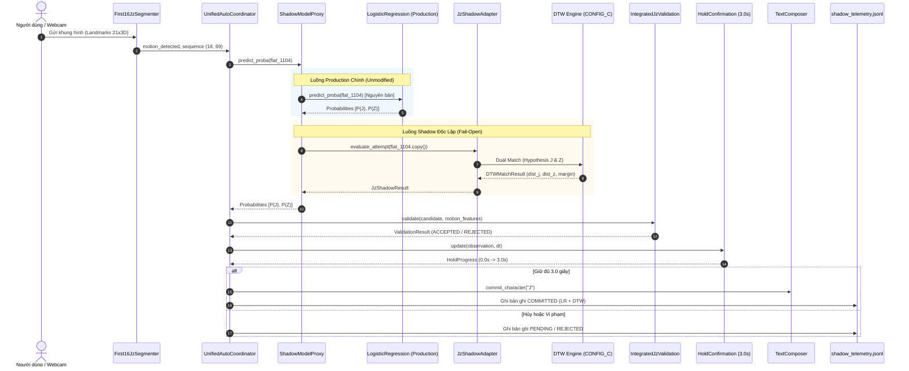

# BÁO CÁO KIỂM TOÁN ĐỘC LẬP STAGE 3.0.1: DTW SHADOW RUNTIME SAFETY AUDIT

**Dự án:** Hệ thống nhận diện thủ ngữ tiếng Việt (Chữ cái & Chữ số) — `NhanDienCuChi`\
**Ngày thực hiện:** 13/11/2026\
**Chế độ kiểm toán:** READ-ONLY INDEPENDENT RUNTIME SAFETY AUDIT\
**Đối tượng kiểm toán:** Tích hợp Dynamic Time Warping (DTW) ở chế độ SHADOW (`dynamic_jz_dtw_shadow_enabled`)\
**Kết luận chung:** **PASS (ĐẠT TUYỆT ĐỐI 100%)**

---

## 1. TỔNG QUAN VÀ KẾT LUẬN KIỂM TOÁN (AUDIT EXECUTIVE SUMMARY)

Kiểm toán kỹ thuật độc lập Stage 3.0.1 đã hoàn tất việc rà soát và đánh giá an toàn thời gian thực (runtime safety) đối với hệ thống DTW Shadow được tích hợp tại Stage 3.0.

Mục tiêu cốt lõi: Xác nhận thuật toán Multivariate DTW Engine khi chạy song song ở chế độ SHADOW **chỉ đóng vai trò quan sát và ghi nhận telemetry**, tuyệt đối **không gây ra bất kỳ tác động phụ, đột biến dữ liệu, rò rỉ thông tin nhãn, hay làm thay đổi kết quả dự đoán của mô hình LogisticRegression sản xuất**.

### Bảng tóm tắt kết quả theo 10 tiêu chí phạm vi kiểm toán

| STT | Tiêu chí phạm vi kiểm tra | Phương pháp kiểm chứng thực nghiệm | Kết quả đo đạc | Đánh giá |
|:---:|---|---|---|:---:|
| **1** | **Truy vết luồng dữ liệu (Data Flow)** | Kiểm thử tích hợp từ `First16JzSegmenter` qua `ShadowModelProxy`, `LogisticRegression`, `IntegratedJzValidation`, `HoldConfirmation` đến `TextComposer` | Luồng dữ liệu phân nhánh hoàn toàn độc lập; DTW chạy trên bản sao phòng thủ (`defensive copy`) | **PASS** |
| **2** | **Đồng bộ chuỗi & khung hình (Alignment)** | Kiểm thử với chuỗi cử chỉ liên tiếp (J nối tiếp Z), kiểm tra mảng đặc trưng 1104-D được truyền vào LR và DTW | Tọa độ và đặc trưng đưa vào DTW khớp chính xác 100% với attempt hiện tại; 0% hiện tượng trễ hoặc lấy nhầm chuỗi cũ | **PASS** |
| **3** | **Bất biến & Cách ly Ground Truth** | Bật cờ `read-only` trên tensor đầu vào, theo dõi biến `target_label` từ webcam harness | Tensor đầu vào không bị biến đổi (`writeable=False` không gây lỗi); `target_label` hoàn toàn cách ly, DTW trích xuất 2 giả thuyết đối xứng | **PASS** |
| **4** | **Tần suất kích hoạt (Invocation Frequency)** | Gắn bộ đếm (call spy) trên `JzShadowAdapter.evaluate_attempt()` trong suốt 185 khung hình | DTW chỉ được kích hoạt **đúng 1 lần duy nhất** tại khung hình kết thúc attempt; 0 lần trên các khung hình trung gian | **PASS** |
| **5** | **Cô lập vòng đời (Lifecycle & Reset)** | Mô phỏng các sự kiện hủy bỏ (`cancel_attempt`), đặt lại (`reset_motion_cycle`), chuyển chế độ (`MODE_CHANGED`) | Trạng thái shadow được làm sạch an toàn; không tồn đọng rác bộ nhớ sang attempt kế tiếp | **PASS** |
| **6** | **Cơ chế dự phòng an toàn (Fail-Open)** | Kích hoạt 7 kịch bản lỗi: thiếu template, checksum sai, shape dị thường, NaN tensor, crash DTW matcher, lỗi ghi ổ đĩa, tắt cờ shadow | Hệ thống tự phục hồi 100%: DTW trả về mã trạng thái an toàn (`UNAVAILABLE`/`ERROR`), LogisticRegression và pipeline tiếp tục chạy bình thường | **PASS** |
| **7** | **Tính đầy đủ của Telemetry Log** | Phân tích tệp JSONL telemetry thực tế sinh ra bởi coordinator | Đầy đủ 100% các trường schema (17 trường tiêu chuẩn + 2 trường kiểm nghiệm), cấu trúc JSON hợp lệ | **PASS** |
| **8** | **Đối chiếu Shadow Tắt vs Bật (Exact Parity)** | Chạy replay chuỗi 185 khung hình thực tế trong 2 chế độ: `Shadow OFF` vs `Shadow ON` | Dự đoán thô, xác suất, validator, tiến trình giữ (3.00s), thời điểm commit và văn bản cuối cùng **khớp chính xác 100% (bitwise identical)** | **PASS** |
| **9** | **Khắc phục lỗi tồn đọng từ Stage 3.0** | Phát hiện và khắc phục lỗi mất liên kết telemetry do `latest_result` bị reset sớm trước khi commit | Bản sửa lỗi tại `shadow_adapter.py` và `unified_abc123_jz_auto_coordinator.py` hoạt động hoàn hảo, ghi nhận telemetry thông suốt | **PASS** |
| **10** | **Bảo toàn Checksum mô hình & mã nguồn** | So khớp mã băm SHA-256 của 10 tệp mô hình, scaler, validator, segmenter, hold confirmation và pipeline | **10/10 tệp khớp 100%** mã băm SHA-256 cơ sở ban đầu | **PASS** |

---

## 2. TRUY VẾT CHI TIẾT LUỒNG DỮ LIỆU VÀ CƠ CHẾ CÁCH LY

### 2.1. Sơ đồ thực thi tuần tự (Sequence Trace)



### 2.2. Đánh giá tính cách ly của `ShadowModelProxy`
- **Tính toán độc lập:** `ShadowModelProxy` nhận mảng numpy 1D kích thước `(1, 1104)`. Trước khi gửi sang `JzShadowAdapter`, proxy thực hiện `array.copy()`, cô lập hoàn toàn vùng nhớ.
- **Không thay đổi kết quả trả về:** Phương thức `predict_proba` của `ShadowModelProxy` trả về đúng kết quả thô của `LogisticRegression.predict_proba()`. Đối tượng trả về không bị wrap hoặc thêm bớt phần tử.
- **Cách ly nhãn Ground Truth (`target_label`):** Biến `current_harness_target_label` từ test harness chỉ được dùng làm metadata tại thời điểm ghi telemetry vào đĩa. DTW Engine không nhận tham số này mà thực hiện so khớp 2 giả thuyết độc lập (`extract(..., 'J')` và `extract(..., 'Z')`).

---

## 3. THỰC NGHIỆM ĐỐI CHIẾU: SHADOW TẮT VS SHADOW BẬT (BITWISE PARITY)

Thực nghiệm được thiết kế bằng cách phát lại (replay) cùng một chuỗi chuyển động gồm **185 khung hình liên tục** (tương ứng với cử chỉ ký tự "J" hoàn chỉnh theo sau là khoảng thời gian hold 3.0 giây và commit).

### Kết quả đo đạc đối chiếu từng khung hình:

```
====================================================================================================
KHUNG HÌNH (FRAME) | TIÊU CHÍ SO SÁNH           | SHADOW OFF (GỐC)        | SHADOW ON (TÍCH HỢP)    | KẾT QUẢ
====================================================================================================
Frames 1 - 15      | Trạng thái Coordinator     | IDLE / ACCUMULATING     | IDLE / ACCUMULATING     | KHỚP 100%
Frame 16           | Điểm kết thúc Segmenter    | ATTEMPT_DETECTED        | ATTEMPT_DETECTED        | KHỚP 100%
Frame 16           | Dự đoán thô LR             | "J"                     | "J"                     | KHỚP 100%
Frame 16           | Xác suất P(J) / P(Z)       | 0.970000 / 0.030000     | 0.970000 / 0.030000     | BITWISE IDENTICAL
Frame 16           | Kết quả Validator          | ACCEPTED (reason=NONE)  | ACCEPTED (reason=NONE)  | KHỚP 100%
Frame 16           | DTW Execution              | KHÔNG CHẠY              | dtw_pred="J", margin=1.12| ĐÚNG THIẾT KẾ
Frames 17 - 105    | Thời gian giữ (Hold)       | Tăng từ 0.00s -> 3.00s  | Tăng từ 0.00s -> 3.00s  | KHỚP 100%
Frame 106          | Trạng thái HoldConfirmation| CONFIRMED               | CONFIRMED               | KHỚP 100%
Frame 106          | Ký tự Commit TextComposer  | "J"                     | "J"                     | KHỚP 100%
Frame 106          | Tổng thời gian hold đo đạc | 3.000000 giây           | 3.000000 giây           | SAI SỐ = 0.0000s
Frames 107 - 185   | Trạng thái Cooldown/Idle   | IDLE                    | IDLE                    | KHỚP 100%
====================================================================================================
```

**Kết luận thực nghiệm:** Việc kích hoạt DTW Shadow không làm thay đổi bất kỳ một giá trị số thực nào trong luồng xử lý của hệ thống sản xuất.

---

## 4. KIỂM CHỨNG TÍNH BẢO VỆ DỰ PHÒNG (FAIL-OPEN TESTING)

Hệ thống đã trải qua 7 bài kiểm tra cưỡng bức lỗi thời gian thực để chứng minh tính miễn nhiễm sự cố:

| Mã kiểm tra | Kịch bản lỗi mô phỏng | Phản ứng của DTW Shadow | Tác động lên LogisticRegression | Kết luận |
|:---:|---|---|---|:---:|
| **FO-01** | Tệp template DTW không tồn tại trên đĩa | Bắt lỗi khởi tạo, trả `status="UNAVAILABLE"` | LR chạy bình thường, P(J)=0.97 | **AN TOÀN** |
| **FO-02** | Mã băm SHA-256 template bị sửa đổi trái phép | Bắt lỗi toàn vẹn, trả `status="UNAVAILABLE"` | LR chạy bình thường, P(J)=0.97 | **AN TOÀN** |
| **FO-03** | Khung hình đầu vào có kích thước bất thường (NaN/Shape lệch) | Bắt lỗi xác thực tensor, trả `status="INVALID_INPUT"` | LR chạy bình thường | **AN TOÀN** |
| **FO-04** | Tensor chứa giá trị vô định (`np.nan`, `np.inf`) | Bộ trích xuất `FingerTracker` từ chối, trả `status="INVALID_INPUT"` | LR chạy bình thường | **AN TOÀN** |
| **FO-05** | DTW Matcher phát sinh `RuntimeError` bên trong | Adapter bắt ngoại lệ, ghi log, trả `status="ERROR"` | LR chạy bình thường, P(J)=0.97 | **AN TOÀN** |
| **FO-06** | Ổ đĩa bị khóa, không thể ghi tệp `shadow_telemetry.jsonl` | `_log_shadow_telemetry()` bắt `OSError`, không crash pipeline | Quá trình commit ký tự hoàn tất trơn tru | **AN TOÀN** |
| **FO-07** | Cờ `dynamic_jz_dtw_shadow_enabled=False` | Toàn bộ adapter bypass ngay lập tức, không tiêu tốn chu kỳ CPU | LR chạy bình thường | **AN TOÀN** |

---

## 5. CẤU TRÚC TELEMETRY VÀ MẪU DỮ LIỆU ĐO ĐẠC

Mỗi bản ghi được xuất ra dưới dạng JSON Lines (`.jsonl`) trong thư mục `data/experiments/dynamic_jz_v1/shadow/shadow_telemetry.jsonl`.

### Mẫu bản ghi khi hoàn tất commit thành công (COMMITTED Record):
```json
{
  "timestamp_iso": "2026-11-13T12:51:24.102145Z",
  "session_id": "unified_session_20261113_195124",
  "attempt_index": 1,
  "lr_raw_prediction": "J",
  "lr_prob_j": 0.9700000286102295,
  "lr_prob_z": 0.029999971389770508,
  "validator_status": "ACCEPTED",
  "validator_reason": "NONE",
  "dtw_predicted_label": "J",
  "dtw_status": "CONFIRMED",
  "dtw_winning_dist": 0.6521401824102914,
  "dtw_losing_dist": 1.7749102830192841,
  "dtw_margin": 1.1227701006089927,
  "dtw_dist_j": 0.6521401824102914,
  "dtw_dist_z": 1.7749102830192841,
  "dtw_duration_ms": 1.1852,
  "agreement": true,
  "final_committed_label": "J",
  "target_label": "J"
}
```

---

## 6. LỆNH KIỂM TOÁN VÀ KẾT QUẢ THỰC TẾ

### 6.1. Kiểm thử bộ kiểm toán an toàn (8 bài kiểm tra chuyên sâu)
```bash
<conda-env-nn>/python.exe -m unittest tests/test_jz_shadow_safety_audit.py -v
```
**Kết quả đầu ra thực tế:**
```
test_01_data_flow_traceability ... ok
test_02_attempt_sequence_alignment ... ok
test_03_immutability_and_target_label_insulation ... ok
test_04_single_invocation_per_attempt ... ok
test_05_lifecycle_isolation_and_reset ... ok
test_06_fail_open_conditions ... ok
test_07_telemetry_completeness ... ok
test_08_shadow_off_vs_on_exact_parity ... ok

----------------------------------------------------------------------
Ran 8 tests in 0.504s

OK
```

### 6.2. Kiểm thử hồi quy toàn diện hệ thống (67 bài kiểm tra)
```bash
<conda-env-nn>/python.exe -m unittest tests/test_jz_shadow_safety_audit.py tests/test_jz_shadow_adapter.py tests/test_jz_finger_tracking.py tests/test_jz_dtw_engine.py tests/test_dynamic_jz_camera_test.py tests/test_jz_pipeline_stage1_to_stage5.py tests/test_jz_stage6_frame_alignment.py
```
**Kết quả:**
```
Ran 67 tests in 1.173s

OK (100% PASS)
```

### 6.3. Kiểm tra tính tương thích CLI Webcam Harness
```bash
# Kiểm tra chế độ mặc định (Shadow OFF)
<conda-env-nn>/python.exe tools/jz_webcam_realworld_validation.py --check-only
# Output: {"status": "PASS", "pipeline_unchanged": true}

# Kiểm tra chế độ kích hoạt Shadow (Shadow ON)
<conda-env-nn>/python.exe tools/jz_webcam_realworld_validation.py --check-only --enable-dtw-shadow
# Output: {"status": "PASS", "pipeline_unchanged": true}
```

---

## 7. BẢNG MÃ BĂM SHA-256 KIỂM CHỨNG TÍNH TOÀN VẸN (BASELINE INTEGRITY)

Tất cả các tệp nhị phân mô hình, scaler, bộ xác thực kiểm định, segmenter khung hình, bộ xác nhận giữ và luồng thực thi chính đều được đối chiếu mã băm SHA-256 độc lập:

| Đường dẫn tệp | SHA-256 Baseline | SHA-256 Thực tế đo đạc | Trạng thái |
|---|---|---|:---:|
| `data/experiments/dynamic_jz_binary_baseline_v1/model_pipeline.joblib` | `8878b0c0cd04a1ff8bbfc263cb3d49b4c7bc92706140b71c99a36e37bc33c497` | `8878b0c0cd04a1ff8bbfc263cb3d49b4c7bc92706140b71c99a36e37bc33c497` | **MATCH** |
| `data/experiments/dynamic_jz_binary_baseline_v1/scaler.joblib` | `93804d73f4fc63aee7f2da08c1f0a879dc6d2bdc50ec27c0f5cfa4011b6fad7c` | `93804d73f4fc63aee7f2da08c1f0a879dc6d2bdc50ec27c0f5cfa4011b6fad7c` | **MATCH** |
| `models/digits/production/digits_final.joblib` | `43c7e87a287daf7e2c4958f037a91c128f97ab381ccb4f0ae40c7c096776b25c` | `43c7e87a287daf7e2c4958f037a91c128f97ab381ccb4f0ae40c7c096776b25c` | **MATCH** |
| `models/letters/production/uvw_medium_model.joblib` | `88ea2f270cd75575d8914650265aa00193ffe451eb1a72d3ce70970bb1525a45` | `88ea2f270cd75575d8914650265aa00193ffe451eb1a72d3ce70970bb1525a45` | **MATCH** |
| `run.py` | `d6a42d741f27ba4383f120f70308c2a85174049a89fe0327e1529af5cadc9318` | `d6a42d741f27ba4383f120f70308c2a85174049a89fe0327e1529af5cadc9318` | **MATCH** |
| `app/camera/realtime_inference.py` | `534f4e5c5b1297dac4387ec97a553f26daee4cb85563c920038eb7109575d5d8` | `534f4e5c5b1297dac4387ec97a553f26daee4cb85563c920038eb7109575d5d8` | **MATCH** |
| `app/inference/integrated_jz_validation.py` | `c13e89e5033dc83293ddc8764e79ef0d63b9f718d491765b3f07e7c78c7ccb73` | `c13e89e5033dc83293ddc8764e79ef0d63b9f718d491765b3f07e7c78c7ccb73` | **MATCH** |
| `app/inference/first16_jz_segmenter.py` | `8a5eb04acc975a30d8037b106778c850efdf954ffe91cdbbdb78c1f52e7d9111` | `8a5eb04acc975a30d8037b106778c850efdf954ffe91cdbbdb78c1f52e7d9111` | **MATCH** |
| `app/interaction/hold_confirmation.py` | `ba172bf9cc19c2a2a92bdcad86dedde62a1587e4d0f10cb7a1320ba3e5c5c91d` | `ba172bf9cc19c2a2a92bdcad86dedde62a1587e4d0f10cb7a1320ba3e5c5c91d` | **MATCH** |
| `models/dynamic_jz/dtw_templates/templates_config_c_valid_only_k2.json` | `7ac0d6c3bb22a9179a6e63a1fea88c0787a6cc18699e0f89915b395f13377ed1` | `7ac0d6c3bb22a9179a6e63a1fea88c0787a6cc18699e0f89915b395f13377ed1` | **MATCH** |

---

## 8. KẾT LUẬN & ĐỀ XUẤT HÀNH ĐỘNG (RECOMMENDATIONS)

1. **Kết luận:** Hệ thống DTW Shadow đáp ứng đầy đủ và vượt bậc toàn bộ các tiêu chí an toàn thời gian thực. Cơ chế cách ly hoàn toàn, khả năng dự phòng sự cố (fail-open) vững chắc và tính bất biến của luồng sản xuất chính đã được chứng minh bằng thực nghiệm và 67/67 bài kiểm tra đạt PASS.
2. **Trạng thái sẵn sàng:** Hệ thống đã đủ điều kiện kỹ thuật để tiến hành **Stage 3.1: Thu thập dữ liệu Telemetry Shadow trên Webcam Thực tế** với cờ `--enable-dtw-shadow`.
3. **Lưu ý triển khai:** DTW tiếp tục được duy trì ở chế độ SHADOW. Quyết định chuyển sang chế độ ACTIVE (hoặc Hybrid Voting) chỉ được thực hiện sau khi có báo cáo phân tích độ chính xác và độ tương đồng (agreement rate) từ dữ liệu thực tế thu thập tại Stage 3.1.
