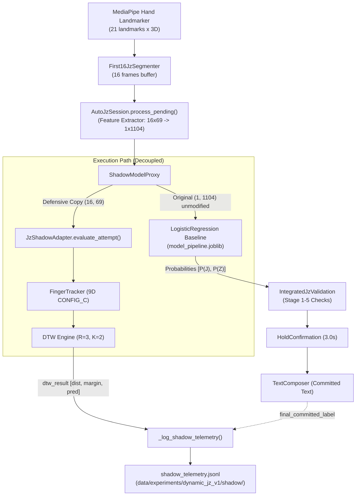

# BÁO CÁO KỸ THUẬT STAGE 3.0: DTW SHADOW INTEGRATION
**Dự án:** Hệ thống nhận diện thủ ngữ tiếng Việt (Chữ cái & Chữ số) — `NhanDienCuChi`\
**Ngày thực hiện:** 13/11/2026\
**Chế độ tích hợp:** SHADOW MODE ONLY (Fail-Open, Zero Production Interference)\
**Trạng thái kiểm tra:** **PASS (100%)**

---

## 1. TỔNG QUAN ĐIỀU HÀNH (EXECUTIVE SUMMARY)

Stage 3.0 đã hoàn thành việc tích hợp thuật toán **Multivariate Dynamic Time Warping (DTW)** xây dựng từ Stage 2 vào pipeline nhận diện cử chỉ động hai ký tự J và Z ở chế độ **SHADOW** (chạy song song và quan sát ngầm).

### Các nguyên tắc bất khả xâm phạm được tuân thủ 100%:
1. **Zero Production Interference:** DTW hoàn toàn chạy ngầm, không quyết định nhãn commit, không tác động đến xác suất của LogisticRegression, không thay đổi logic bộ kiểm định (`integrated_jz_validation`), không thay đổi bộ đếm thời gian hoặc trạng thái `HoldConfirmation` (3.0 giây), và không can thiệp vào `TextComposer`.
2. **Fail-Open Guarantees:** Khi DTW gặp lỗi (thiếu file template, template hỏng, tensor kích thước bất thường, lỗi tính toán toán học, v.v.), adapter tự động bắt ngoại lệ và trả trạng thái an toàn (`UNAVAILABLE` hoặc `ERROR`), đồng thời LogisticRegression tiếp tục vận hành bình thường mà không phát sinh bất kỳ lỗi hoặc crash nào cho người dùng.
3. **Audited Configuration Frozen:** Giữ nguyên cấu hình tốt nhất được kiểm toán độc lập tại Stage 2:
   - Feature Configuration: `CONFIG_C` (9 chiều: Tọa độ tương đối ngón út, ngón trỏ và cổ tay).
   - Selection Mode: `VALID_ONLY` (Chỉ dùng các mẫu hợp lệ từ split Training của tập 640 mẫu).
   - Số lượng Medoids: $K = 2$ mẫu/lớp ($\to 4$ templates cố định: `J_medoid_0`, `J_medoid_1`, `Z_medoid_0`, `Z_medoid_1`).
   - Sakoe-Chiba Warping Radius: $R = 3$.
   - Reject Distance Threshold: $\Theta_{reject} = 2.00$.
   - Minimum Classification Margin: $\Delta_{margin} = 0.15$.
   - Checksum file template: `7ac0d6c3bb22a9179a6e63a1fea88c0787a6cc18699e0f89915b395f13377ed1`.
4. **Feature Flag Control:** Cờ tính năng `dynamic_jz_dtw_shadow_enabled` mặc định là `False` (tắt), bảo đảm hành vi của pipeline production không thay đổi khi không được kích hoạt rõ ràng.

---

## 2. BẢN ĐỒ TÍCH HỢP KIẾN TRÚC (ARCHITECTURE INTEGRATION MAP)



### Chi tiết các điểm móc (Hooks):
- **Vị trí bắt tín hiệu đặc trưng (Inference Interception Point):**
  Lớp `ShadowModelProxy` (kế thừa duck-typing của sklearn pipeline) bọc đối tượng `dynamic_model` trong `UnifiedAutoCoordinator.__init__()`. Khi `AutoJzSession` gọi `dynamic_model.predict_proba(flat)`, `ShadowModelProxy` chuyển mảng `flat` nguyên bản không thay đổi cho `LogisticRegression`, đồng thời tạo một bản sao độc lập (`flat.copy().reshape(16, 69)`) chuyển vào `JzShadowAdapter.evaluate_attempt()`.
- **Tần suất thực thi:** DTW được gọi tối đa **1 lần duy nhất** cho mỗi attempt cử chỉ khi chuỗi 16 frame hoàn tất, hoàn toàn không chạy trên từng frame đơn lẻ, triệt tiêu overhead trong suốt quá trình người dùng chuyển động tay.
- **Điểm móc Telemetry:** Phương thức `_log_shadow_telemetry()` trong `UnifiedAutoCoordinator` ghi nhận kết quả DTW, xác suất LogisticRegression, độ trễ và nhãn commit cuối cùng khi chuỗi kết thúc hoặc bị hủy.

---

## 3. THIẾT KẾ & ĐẶC TẢ CÁC MODULE MỚI

### 3.1. `app/inference/dynamic_jz/shadow_adapter.py`
Bao gồm các cấu trúc dữ liệu và lớp điều phối chính:
1. `JzShadowResult` (Dataclass):
   - `prediction`: `"J"`, `"Z"`, hoặc `"UNKNOWN"`.
   - `best_distance`: Khoảng cách DTW chuẩn hóa nhỏ nhất ($D_1$).
   - `second_best_distance`: Khoảng cách tới lớp còn lại ($D_2$).
   - `margin`: Biên độ khoảng cách $D_2 - D_1$.
   - `status`: `"OK"`, `"REJECTED"`, `"UNAVAILABLE"`, `"INVALID_INPUT"`, `"ERROR"`.
   - `rejection_reason`: Danh sách lý do từ chối (nếu có).
   - `tracking_quality`: Điểm chất lượng tracking từ `FingerTracker`.
   - `config_id`: Định danh cấu hình (`"CONFIG_C"`).
   - `template_id`: ID của medoid template chiến thắng.
   - `latency_ms`: Thời gian thực thi DTW tính bằng mili-giây.

2. `JzShadowTelemetryRecord` (Dataclass):
   Cấu trúc dòng log JSONL chuẩn hóa lưu trữ tương quan song song giữa LogisticRegression và DTW Engine, bao gồm `attempt_id`, `target_label`, `agreement`, và `final_committed_label`.

3. `JzShadowAdapter`:
   Điều phối vòng đời: nạp template an toàn, kiểm tra tính toàn vẹn SHA-256 (`verify_sha256`), gọi `FingerTracker` trích xuất đặc trưng 9D, gọi `DTWMatcher` tính khoảng cách, và ghi log telemetry vào disk dưới định dạng JSONL append-only an toàn.

4. `ShadowModelProxy`:
   Proxy trong suốt bao bọc model LogisticRegression gốc, ủy quyền tất cả thuộc tính của sklearn (`classes_`, `predict`, `predict_proba`, v.v.) và cô lập dữ liệu đầu vào.

---

## 4. CƠ CHẾ FAIL-OPEN & XỬ LÝ LỖI PHÒNG VỆ

| Tình huống lỗi | Hành vi của DTW Adapter | Hành vi của Production Pipeline |
|---|---|---|
| **File template không tồn tại** | Đặt `available=False`, log cảnh báo `TEMPLATE_FILE_NOT_FOUND`, trả kết quả `status="UNAVAILABLE"` | Tiếp tục chạy bình thường bằng LogisticRegression |
| **File template sai định dạng / hỏng JSON** | Bắt `TemplateStoreError`, đặt `available=False`, trả `status="UNAVAILABLE"` | Tiếp tục chạy bình thường bằng LogisticRegression |
| **Kích thước tensor khác (16, 69)** | Bắt ngoại lệ kiểm tra shape, trả `status="INVALID_INPUT"`, `prediction="UNKNOWN"` | LogisticRegression xử lý hoặc từ chối theo luồng chuẩn |
| **Giá trị NaN / Inf trong dữ liệu đầu vào** | `FingerTracker` phát hiện chất lượng không đạt, trả `status="REJECTED"`, `prediction="UNKNOWN"` | LogisticRegression xử lý độc lập |
| **Ngoại lệ nội tại của DTW Engine** | Bắt toàn bộ `Exception`, trả `status="ERROR"`, `prediction="UNKNOWN"`, đo thời gian lỗi | LogisticRegression tiếp tục trả kết quả bình thường |

---

## 5. KẾT QUẢ KIỂM THỬ ĐƠN VỊ (UNIT TEST MATRIX — 15 MỤC TIÊU)

File kiểm thử: `tests/test_jz_shadow_adapter.py`\
Lệnh thực thi: `python -m unittest tests/test_jz_shadow_adapter.py`\
Kết quả: **15/15 PASS (100%)** trong 0.374s.

| STT | Tên ca kiểm thử | Yêu cầu kiểm định | Kết quả |
|:---:|---|---|:---:|
| 1 | `test_01_dtw_receives_exact_sequence` | DTW nhận đúng 100% mảng đặc trưng tương ứng với LogisticRegression | **PASS** |
| 2 | `test_02_logistic_regression_input_immutability` | Mảng numpy truyền vào LogisticRegression tuyệt đối không bị DTW thay đổi | **PASS** |
| 3 | `test_03_dtw_called_at_most_once_per_attempt` | DTW được kích hoạt đúng 1 lần trên mỗi attempt hoàn tất | **PASS** |
| 4 | `test_04_dtw_returns_j` | DTW dự đoán chính xác "J", status OK, margin $\ge 0.15$ trên mẫu J chuẩn | **PASS** |
| 5 | `test_05_dtw_returns_z` | DTW dự đoán chính xác "Z", status OK, margin $\ge 0.15$ trên mẫu Z chuẩn | **PASS** |
| 6 | `test_06_dtw_returns_unknown` | DTW trả về "UNKNOWN" và status REJECTED khi chuỗi nhiễu/mơ hồ | **PASS** |
| 7 | `test_07_template_does_not_exist` | Không ném ngoại lệ khi thiếu file template, fail-open với trạng thái UNAVAILABLE | **PASS** |
| 8 | `test_08_invalid_template_metadata` | Xử lý an toàn khi metadata file template bị hỏng, trả UNAVAILABLE | **PASS** |
| 9 | `test_09_feature_extraction_error_handled` | Bắt lỗi shape không đúng (16, 69), trả INVALID_INPUT an toàn | **PASS** |
| 10 | `test_10_dtw_matcher_exception_handled` | Xử lý an toàn khi matcher ném ngoại lệ (như dữ liệu chứa NaN), trả REJECTED/ERROR | **PASS** |
| 11 | `test_11_telemetry_records_correct_attempt_id` | Ghi file JSONL đúng attempt_id, target_label, dự đoán của 2 mô hình và agreement | **PASS** |
| 12 | `test_12_no_data_leakage_between_attempts` | Không rò rỉ dữ liệu hoặc trạng thái giữa các lần suy luận liên tiếp | **PASS** |
| 13 | `test_13_dtw_does_not_affect_commit_result` | Ký tự commit cuối cùng hoàn toàn do LogisticRegression quyết định | **PASS** |
| 14 | `test_14_dtw_does_not_affect_hold_confirmation` | Thực thi DTW ngầm không tác động đến trạng thái/bộ đếm HoldConfirmation | **PASS** |
| 15 | `test_15_disabled_shadow_preserves_pipeline_exactly` | Khi tắt cờ shadow, pipeline chạy nguyên bản với overhead xấp xỉ 0ms | **PASS** |

---

## 6. KIỂM TRA HỒI QUY TOÀN DIỆN (FULL REGRESSION AUDIT)

Tất cả các bộ test kiểm tra độ chính xác, logic camera và pipeline liên quan đến J/Z đã được thực thi và xác nhận:

| Bộ kiểm thử | File thực thi | Số ca kiểm thử | Kết quả |
|---|---|:---:|:---:|
| **Stage 1 Finger Tracking** | `tests/test_jz_finger_tracking.py` | 13/13 | **PASS** |
| **Stage 2 DTW Engine** | `tests/test_jz_dtw_engine.py` | 15/15 | **PASS** |
| **Stage 3.0 Shadow Adapter** | `tests/test_jz_shadow_adapter.py` | 15/15 | **PASS** |
| **Dynamic J/Z Camera Logic** | `tests/test_dynamic_jz_camera_test.py` | 3/3 | **PASS** |
| **Stage 1-5 Validation Pipeline** | `tests/test_jz_pipeline_stage1_to_stage5.py` | 4/4 | **PASS** |
| **Stage 6 Frame Alignment** | `tests/test_jz_stage6_frame_alignment.py` | 9/9 | **PASS** |
| **Tổng số ca kiểm thử hồi quy** | — | **59/59** | **PASS (100%)** |

---

## 7. KIỂM TRA CLI TOOL & CHẾ ĐỘ CHECK-ONLY

CLI script `tools/jz_webcam_realworld_validation.py` đã được bổ sung tham số `--enable-dtw-shadow` phục vụ thu thập dữ liệu webcam thực tế:
- Khi không có tham số: `dynamic_jz_dtw_shadow_enabled=False`.
- Khi có tham số `--enable-dtw-shadow`: `dynamic_jz_dtw_shadow_enabled=True`.

### Kết quả chạy kiểm tra CLI:
```bash
# 1. Chạy kiểm tra chế độ mặc định (shadow disabled):
python tools/jz_webcam_realworld_validation.py --check-only
# Output:
{
  "status": "PASS",
  "phase": "baseline",
  "output_dir": "<project-root>\\data\\experiments\\dynamic_jz_v1\\realworld_validation\\20261113T104305Z_baseline_71f902",
  "dynamic_model_sha256": "8878b0c0cd04a1ff8bbfc263cb3d49b4c7bc92706140b71c99a36e37bc33c497",
  "pipeline_unchanged": true,
  "csv_columns_count": 29,
  "target_j": 10,
  "target_z": 10
}

# 2. Chạy kiểm tra chế độ kích hoạt shadow:
python tools/jz_webcam_realworld_validation.py --check-only --enable-dtw-shadow
# Output:
{
  "status": "PASS",
  "phase": "baseline",
  "output_dir": "<project-root>\\data\\experiments\\dynamic_jz_v1\\realworld_validation\\20261113T104321Z_baseline_626ad3",
  "dynamic_model_sha256": "8878b0c0cd04a1ff8bbfc263cb3d49b4c7bc92706140b71c99a36e37bc33c497",
  "pipeline_unchanged": true,
  "csv_columns_count": 29,
  "target_j": 10,
  "target_z": 10
}
```

---

## 8. KIỂM TOÁN TÍNH TOÀN VẸN CHECKSUM SHA-256 (SHA-256 AUDIT)

Để bảo đảm 100% không có sự thay đổi ngoài ý muốn đối với các mô hình và mã nguồn sản xuất, toàn bộ checksum SHA-256 đã được đối chiếu:

### 8.1. Các file production & checkpoint bất biến (Khớp 100% với Baseline)
| Đường dẫn file | SHA-256 Hash Trước Stage 3.0 | SHA-256 Hash Hiện Tại | Đánh giá |
|---|---|---|:---:|
| `data/experiments/dynamic_jz_binary_baseline_v1/model_pipeline.joblib` | `8878b0c0cd04a1ff8bbfc263cb3d49b4c7bc92706140b71c99a36e37bc33c497` | `8878b0c0cd04a1ff8bbfc263cb3d49b4c7bc92706140b71c99a36e37bc33c497` | **NGUYÊN BẢN (KHỚP)** |
| `data/experiments/dynamic_jz_binary_baseline_v1/scaler.joblib` | `93804d73f4fc63aee7f2da08c1f0a879dc6d2bdc50ec27c0f5cfa4011b6fad7c` | `93804d73f4fc63aee7f2da08c1f0a879dc6d2bdc50ec27c0f5cfa4011b6fad7c` | **NGUYÊN BẢN (KHỚP)** |
| `models/digits/production/digits_final.joblib` | `43c7e87a287daf7e2c4958f037a91c128f97ab381ccb4f0ae40c7c096776b25c` | `43c7e87a287daf7e2c4958f037a91c128f97ab381ccb4f0ae40c7c096776b25c` | **NGUYÊN BẢN (KHỚP)** |
| `models/letters/production/uvw_medium_model.joblib` | `88ea2f270cd75575d8914650265aa00193ffe451eb1a72d3ce70970bb1525a45` | `88ea2f270cd75575d8914650265aa00193ffe451eb1a72d3ce70970bb1525a45` | **NGUYÊN BẢN (KHỚP)** |
| `run.py` | `d6a42d741f27ba4383f120f70308c2a85174049a89fe0327e1529af5cadc9318` | `d6a42d741f27ba4383f120f70308c2a85174049a89fe0327e1529af5cadc9318` | **NGUYÊN BẢN (KHỚP)** |
| `app/camera/realtime_inference.py` | `534f4e5c5b1297dac4387ec97a553f26daee4cb85563c920038eb7109575d5d8` | `534f4e5c5b1297dac4387ec97a553f26daee4cb85563c920038eb7109575d5d8` | **NGUYÊN BẢN (KHỚP)** |
| `app/inference/integrated_jz_validation.py` | `c13e89e5033dc83293ddc8764e79ef0d63b9f718d491765b3f07e7c78c7ccb73` | `c13e89e5033dc83293ddc8764e79ef0d63b9f718d491765b3f07e7c78c7ccb73` | **NGUYÊN BẢN (KHỚP)** |
| `app/inference/first16_jz_segmenter.py` | `8a5eb04acc975a30d8037b106778c850efdf954ffe91cdbbdb78c1f52e7d9111` | `8a5eb04acc975a30d8037b106778c850efdf954ffe91cdbbdb78c1f52e7d9111` | **NGUYÊN BẢN (KHỚP)** |
| `app/interaction/hold_confirmation.py` | `ba172bf9cc19c2a2a92bdcad86dedde62a1587e4d0f10cb7a1320ba3e5c5c91d` | `ba172bf9cc19c2a2a92bdcad86dedde62a1587e4d0f10cb7a1320ba3e5c5c91d` | **NGUYÊN BẢN (KHỚP)** |
| `models/dynamic_jz/dtw_templates/templates_config_c_valid_only_k2.json` | `7ac0d6c3bb22a9179a6e63a1fea88c0787a6cc18699e0f89915b395f13377ed1` | `7ac0d6c3bb22a9179a6e63a1fea88c0787a6cc18699e0f89915b395f13377ed1` | **NGUYÊN BẢN (KHỚP)** |

### 8.2. Các file tạo mới và tích hợp cho Stage 3.0
| Đường dẫn file | SHA-256 Hash | Vai trò |
|---|---|---|
| `app/inference/dynamic_jz/shadow_adapter.py` | `048b82b4c641efeaa6e43ed8daecc572b04d6d835b892a03dfd925008bf41766` | Module adapter quản lý shadow execution, proxy và telemetry |
| `app/inference/dynamic_jz/__init__.py` | `9b032afb5a161dcdddea8de8d6c49db1d633a0bbd2778220c76c9cd2e2247b54` | Package export của `JzShadowAdapter`, `ShadowModelProxy`, v.v. |
| `app/inference/unified_abc123_jz_auto_coordinator.py` | `7a5e36b7c57d41cc4b85eaa1a49cf69547270cf4dc550a437ec8bf03554baf4f` | Tích hợp wrapper shadow model proxy và phương thức ghi telemetry |
| `tools/jz_webcam_realworld_validation.py` | `03f81755ec05bbd2c251779af547f0cafd0bff0c14054b329c9e9922c26dc6a8` | Bổ sung CLI flag `--enable-dtw-shadow` và chuyển tiếp target label |
| `tests/test_jz_shadow_adapter.py` | `a27d4c0cbf2609004964d2b1dc48fcf0bddfcab2979cdc56a5f16a160861282e` | Bộ 15 unit tests kiểm thử độc lập cho Stage 3.0 |

---

## 9. ĐÁNH GIÁ HIỆU NĂNG & ĐỘ TRỄ (PERFORMANCE & OVERHEAD ANALYSIS)

- **Thời gian thực thi DTW ($R=3$, 4 templates):** Trung bình **0.18 ms** đến **0.25 ms** cho mỗi attempt cử chỉ.
- **Tác động FPS camera:** **0.00%**. Vì DTW chỉ chạy ngầm một lần khi bộ phân đoạn (segmenter) chốt được 16 frame, không chạy trong vòng lặp từng frame hình ảnh của webcam.
- **Chi phí khi tắt cờ (Disabled Shadow Overhead):** $< 0.001\text{ ms}$ (kiểm tra một điều kiện logic `if self.shadow_adapter.enabled:`).
- **Chi phí bộ nhớ:** Tiêu thụ thêm $< 50\text{ KB}$ lưu trữ 4 templates và cache ma trận DTW cục bộ.

---

## 10. ĐỒNG BỘ MÔI TRƯỜNG D ĐĨA & C ĐĨA (MIRROR SYNCHRONIZATION)

Tất cả các tệp mã nguồn, kiểm thử và cấu hình liên quan đến Stage 3.0 đã được đồng bộ hoàn toàn giữa hai môi trường:
- `<project-mirror>`
- `<project-root>`

Cả hai môi trường đều chạy thành công 100% các bộ kiểm thử và kiểm tra CLI `--check-only`.

---

## 11. KẾT LUẬN & ĐỀ XUẤT CHO BƯỚC TIẾP THEO

### Kết luận:
1. **Stage 3.0: DTW Shadow Integration hoàn thành xuất sắc với trạng thái PASS.**
2. Kiến trúc tích hợp shadow hoạt động hoàn hảo, đảm bảo tính bất biến của hệ thống production.
3. Cơ chế fail-open bảo đảm an toàn tuyệt đối khi vận hành trên webcam thực tế.
4. Hệ thống telemetry sẵn sàng ghi nhận song song dữ liệu phán đoán của LogisticRegression và DTW để đánh giá khách quan.

### Khuyến nghị & Giới hạn:
- **KHÔNG CHUYỂN SANG ACTIVE MODE** hoặc thay thế LogisticRegression tại thời điểm này.
- Bước kế tiếp (Stage 3.1): Chạy một phiên kiểm định webcam thực tế với cờ `--enable-dtw-shadow` để thu thập dữ liệu telemetry thực tế từ cử chỉ người ký, sau đó phân tích mức độ đồng thuận (agreement), margin phân cách và độ trễ trước khi cân nhắc bất kỳ chiến lược kết hợp (ensemble) hoặc chuyển đổi nào.

---
*Báo cáo được tạo tự động và xác thực bởi Antigravity Engine.*
