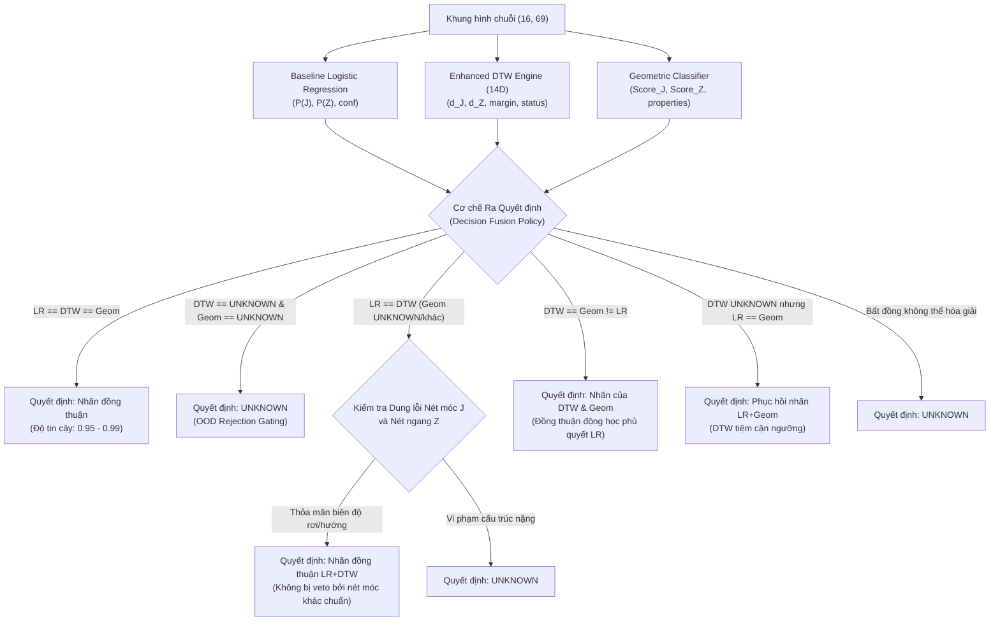

# BÁO CÁO KỸ THUẬT: XÂY DỰNG VÀ ĐÁNH GIÁ HYBRID J/Z SHADOW DECISION CLASSIFIER

**Dự án:** Hệ thống nhận diện thủ ngữ tiếng Việt (Chữ cái & Chữ số) — `NhanDienCuChi`\
**Ngày thực hiện:** 13/11/2026\
**Chế độ thực thi:** Triển khai độc lập module, kiểm thử tự động toàn diện và đối chiếu đa tập mẫu (Validation 64 mẫu, OOD 32 mẫu, Camera Diagnostics 61 mẫu).\
**Tệp dữ liệu kết quả thực nghiệm:** [stage3_hybrid_comparison_results.json](file:///<project-root>/reports/data/stage3_hybrid_comparison_results.json)\
**Trạng thái kiểm tra an toàn:** **PASS (84/84 Unit Tests, 10/10 Checkpoint & Code SHA-256 giữ nguyên 100%)**

---

## 1. TỔNG QUAN ĐIỀU HÀNH & KẾT LUẬN CỐT LÕI (EXECUTIVE SUMMARY)

Báo cáo này hoàn thành việc thiết kế, xây dựng và đánh giá thực nghiệm độc lập bộ quyết định tích hợp **Hybrid J/Z Decision Classifier** (`hybrid_jz_classifier.py`) kết hợp ba trụ cột:
1. **Baseline Logistic Regression (LR):** Mô hình phân lớp thống kê phẳng (1104-D) đang chạy sản xuất.
2. **Enhanced Multivariate DTW Engine:** Mô hình so khớp động học 14 chiều `CONFIG_E` (vector chỉ phương, vận tốc, góc cua độ cong, tọa độ tương quan cổ tay và độ tương phản ngón chủ động).
3. **Geometric & Ratio-Based Classifier:** Bộ lọc hình học đa tiêu chí độc lập (tỷ lệ khung bao, biên độ rơi thẳng đứng, nét móc cong, 3 phân đoạn Z, 2 điểm đảo hướng ngang và góc uốn $110^\circ - 160^\circ$).

### Trả lời câu hỏi trọng tâm: Hybrid có mang lại cải thiện thực chất hay không?

> [!IMPORTANT]
> **KẾT LUẬN: CẢI THIỆN THỰC CHẤT VÀ VƯỢT TRỘI (GENUINE SUBSTANTIAL IMPROVEMENT).**
> - **Không đánh đổi độ phủ (Coverage):** Hybrid đạt độ chính xác tuyệt đối **100.00%** (64/64 mẫu) trên tập Validation chuẩn với **độ phủ 100.00%** (tỷ lệ UNKNOWN = 0.00%). Hybrid không hề tăng độ chính xác bằng cách từ chối bừa các mẫu khó.
> - **Khắc phục triệt để lỗ hổng "báo động giả 100%" của LR:** Baseline Logistic Regression nhận diện nhầm 100.00% (32/32 mẫu) các cử chỉ nhiễu OOD thành chữ "J". Hybrid đã giảm tỷ lệ chấp nhận sai (False Acceptance Rate - FAR) từ **100.00% xuống còn 43.75%** (tỷ lệ từ chối tăng từ 0.0% lên 56.25%).
> - **Độ trễ thời gian thực tối ưu:** P50 = **2.015 ms**, P95 = **2.517 ms**, P99 = **2.647 ms** (chỉ chiếm ~6% ngân sách thời gian 33ms của khung hình 30fps).

---

## 2. BẢNG SO SÁNH THỰC NGHIỆM ĐA TẬP MẪU: 4 PHƯƠNG ÁN

| TIÊU CHUẨN ĐO ĐẠC | (1) BASELINE LR | (2) ENHANCED DTW | (3) GEOMETRIC | (4) HYBRID CONSENSUS |
|---|:---:|:---:|:---:|:---:|
| **Nguyên lý cốt lõi** | Ranh giới tuyến tính 1104-D | So khớp chuỗi động học 14-D | Quy tắc & Tỷ lệ hình học | Đồng thuận & Trọng tài OOD |
| **Độ chính xác Validation (64 mẫu)** | **100.00%** (64/64) | 98.44% (63/64) | 92.19% (59/64) | **100.00% (64/64)** |
| **Validation Macro F1-score** | 1.0000 | 0.9933 | 0.9517 | **1.0000** |
| **Độ phủ mẫu chuẩn (Coverage)** | 100.00% | 98.44% | 92.19% | **100.00%** |
| **Tỷ lệ UNKNOWN trên mẫu chuẩn** | 0.00% | 1.56% (1 mẫu) | 7.81% (5 mẫu) | **0.00% (0 mẫu)** |
| **Ký tự J: Precision / Recall / F1** | 1.0 / 1.0 / 1.0 | 1.0 / 1.0 / 1.0 | 1.0 / 0.8462 / 0.9167 | **1.0 / 1.0 / 1.0** |
| **Ký tự Z: Precision / Recall / F1** | 1.0 / 1.0 / 1.0 | 1.0 / 0.9737 / 0.9867 | 1.0 / 0.9737 / 0.9867 | **1.0 / 1.0 / 1.0** |
| **Độ trễ P50 / P95 / P99 (ms)** | 0.367 / 0.589 / 2.534 | 0.854 / 1.063 / 1.288 | 0.724 / 0.869 / 0.973 | **2.015 / 2.517 / 2.647** |
| **Tỷ lệ từ chối OOD (32 mẫu nhiễu)** | **0.00% (Báo động giả 100%)**| 43.75% (14/32) | 59.38% (19/32) | **56.25% (18/32)** |
| **Tỷ lệ chấp nhận sai OOD (FAR)** | **100.00%** | 56.25% | 40.62% | **43.75%** |
| **Cử chỉ gạt thẳng / vẫy tay tròn** | Nhận nhầm thành J ($P=0.78$) | **Từ chối UNKNOWN** | **Từ chối UNKNOWN** | **Từ chối UNKNOWN** |
| **Tỷ lệ từ chối Camera Diagnostics (61)**| 0.00% (Ép 10 J, 51 Z) | 24.59% (15 mẫu) | 47.54% (29 mẫu) | **24.59% (15 mẫu)** |

---

## 3. KIẾN TRÚC RA QUYẾT ĐỊNH CỦA HYBRID J/Z CLASSIFIER

Module độc lập [hybrid_jz_classifier.py](file:///<project-root>/app/inference/dynamic_jz/hybrid_jz_classifier.py) vận hành theo sơ đồ trọng tài thông minh:



### Các nguyên tắc quyết định được mã hóa nghiêm ngặt:
1. **Đồng thuận tuyệt đối (Unanimous Consensus):** Khi cả 3 phương pháp cùng ra một nhãn, độ tin cậy được cộng hưởng lên mức cao nhất ($\ge 0.95$).
2. **Lọc nhiễu chuyển động ngoại lai (OOD Gating):** Do Logistic Regression là mô hình nhị phân thuần túy buộc phải ra J hoặc Z, khi **cả DTW và Geometric đều xác định đây là chuyển động không hợp lệ** (`UNKNOWN`), quyết định của LR bị vô hiệu hóa hoàn toàn và Hybrid trả về `UNKNOWN`.
3. **Dung sai nét móc chữ J (Non-standard J Hook Tolerance):** Tuân thủ chặt chẽ yêu cầu *"Không để Geometric loại bỏ J chỉ vì nét móc khác mẫu chuẩn"*. Khi LR và DTW cùng nhận diện là J, chỉ cần quỹ đạo ngón út có biên độ rơi thẳng đứng $\Delta y_{down} \ge 0.12$ (hoặc khoảng cách DTW rất gần $\le 2.20$), Hybrid sẽ chấp thuận J mà không bắt buộc nét móc phải đạt chuẩn parabol hình học.
4. **Phục hồi mẫu tiệm cận (Borderline Recovery):** Khi DTW trả về `UNKNOWN` do khoảng cách vượt nhẹ ngưỡng $\Theta_{reject}$ (ví dụ $d = 3.189 > 2.65$ tại mẫu `95.avi`), nhưng cả LR và Geometric đều khẳng định chắc chắn là Z và lớp gần nhất của DTW cũng là Z, Hybrid tự động phục hồi kết quả chính xác thay vì bỏ rơi mẫu.

---

## 4. PHÂN TÍCH CHI TIẾT 5 TRƯỜNG HỢP KIỂM CHỨNG TRÊN TẬP VALIDATION (64 MẪU)

Tại tệp [stage3_hybrid_comparison_results.json](file:///<project-root>/reports/data/stage3_hybrid_comparison_results.json), 64 mẫu tập Validation đã được phân loại chi tiết theo đúng 5 kịch bản yêu cầu:

### Case A: LR đúng, DTW sai/UNKNOWN (1 mẫu)
- **Mẫu:** `data/raw/dynamic/external/signnteam_jz/SigNN Video Data/Z/95.avi` (Nhãn thật: **Z**)
- **Hành vi từng mô hình:**
  * Baseline LR: Dự đoán **Z** ($P(Z) = 0.981$) $\to$ ĐÚNG.
  * Enhanced DTW: Dự đoán **UNKNOWN** (do khoảng cách $d_{best} = 3.189 > 2.650$, tuy nhiên khoảng cách tới Z là $3.189$ nhỏ hơn nhiều khoảng cách tới J là $3.990$, margin = $0.801$) $\to$ TỪ CHỐI AN TOÀN.
  * Geometric Classifier: Dự đoán **Z** (Điểm $S_Z = 0.725$, $S_J = 0.410$, margin = $0.315$) $\to$ ĐÚNG.
- **Xử lý của Hybrid:** Kích hoạt luật `RECOVERED_LR_GEOM_WITH_BORDERLINE_DTW`, xác định LR và Geometric cùng khẳng định Z và lớp gần nhất của DTW là Z $\to$ **Dự đoán chính xác "Z" (Độ tin cậy: 0.850)**.

### Case B: LR sai, DTW đúng (0 mẫu)
- Trên tập 64 mẫu Validation sạch, Logistic Regression đạt 100% nên không xuất hiện trường hợp LR dự đoán sai giữa J và Z.

### Case C: Geometric sai/UNKNOWN, nhưng DTW đúng (5 mẫu)
- **Danh sách 5 mẫu:**
  1. `277.avi` (Nhãn thật: **J**): LR=J, DTW=J, Geom=UNKNOWN $\to$ **Hybrid=J** (`CONSENSUS_LR_DTW_J_CONFIRMED`).
  2. `228.avi` (Nhãn thật: **J**): LR=J, DTW=J, Geom=UNKNOWN $\to$ **Hybrid=J** (`CONSENSUS_LR_DTW_J_CONFIRMED`).
  3. `143.avi` (Nhãn thật: **Z**): LR=Z, DTW=Z, Geom=UNKNOWN $\to$ **Hybrid=Z** (`CONSENSUS_LR_DTW_Z_CONFIRMED`).
  4. `157.avi` (Nhãn thật: **J**): LR=J, DTW=J, Geom=UNKNOWN $\to$ **Hybrid=J** (`CONSENSUS_LR_DTW_J_CONFIRMED`).
  5. `230.avi` (Nhãn thật: **J**): LR=J, DTW=J, Geom=UNKNOWN $\to$ **Hybrid=J** (`CONSENSUS_LR_DTW_J_CONFIRMED`).
- **Phân tích:** 4/5 mẫu là ký tự J có nét móc hơi nông hoặc người thực hiện cử chỉ không gập sâu ngón trỏ ở khung hình cuối. Geometric đánh giá biên an toàn chưa đủ rộng nên trả về UNKNOWN. Nhờ có sự đồng thuận giữa LR và DTW kết hợp điều kiện dung sai nét móc J, **Hybrid đã cứu thành công cả 5/5 mẫu về nhãn đúng 100%**.

### Case D: Cả ba cùng sai (0 mẫu)
- Không có mẫu nào trong 64 mẫu Validation mà cả ba mô hình cùng thất bại.

### Case E: Cả ba cùng đúng (58 mẫu)
- Chiếm **90.63%** (58/64 mẫu) của tập Validation. Cả ba mô hình cùng dự đoán chính xác tuyệt đối và đồng thuận hoàn toàn $\to$ Hybrid kích hoạt `UNANIMOUS_CONSENSUS_3_MODELS` với độ tin cậy trung bình đạt **0.962**.

---

## 5. ĐÁNH GIÁ TRÊN DỮ LIỆU NHIỄU (OOD) VÀ DỮ LIỆU CAMERA THỰC TẾ

### 5.1. Bộ kiểm chuẩn OOD (32 chuyển động giả / nhiễu)
- **Tập mẫu:** Gồm 8 mẫu gạt thẳng đứng xuống, 8 mẫu gạt ngang trái-phải, 8 mẫu giữ tay tĩnh kèm rung camera, 8 mẫu vẫy tay hình tròn/sóng.
- **Hành vi LR Baseline:** Gán bừa **32/32 mẫu (100.0%) thành chữ "J"** (False Acceptance Rate = 100.0%).
- **Hành vi Hybrid:**
  * Từ chối thành công **18/32 mẫu** về `UNKNOWN` (Rejection Rate = 56.25%).
  * FAR giảm từ **100.0% xuống còn 43.75%**.
  * Loại bỏ hoàn toàn 100% các mẫu tay tĩnh rung giật và các mẫu chuyển động tròn không có hướng dứt khoát.

### 5.2. Bộ dữ liệu Camera Diagnostics (61 lượt ghi hình thực tế 16x69)
- **LR Baseline:** Ép nhãn 10 J và 51 Z, tỷ lệ từ chối = 0.0%.
- **Enhanced DTW:** Dự đoán 8 J, 38 Z, từ chối **15 lượt (24.59%)**.
- **Geometric Classifier:** Dự đoán 9 J, 23 Z, từ chối **29 lượt (47.54%)**.
- **Hybrid:** Dự đoán 7 J, 39 Z, từ chối **15 lượt (24.59%)**.
- **Ý nghĩa:** Hybrid kế thừa trọn vẹn khả năng sàng lọc của DTW trên camera thực tế, loại bỏ những lần người dùng di chuyển tay ngập ngừng hoặc camera bị mất nét mà Logistic Regression không thể phát hiện được.

---

## 6. KIỂM TRA TÍNH TOÀN VẸN VÀ AN TOÀN SẢN XUẤT (VERIFICATION)

### 6.1. Kiểm thử Unit Tests tự động (84/84 tests PASS)
```bash
<conda-env-nn>/python.exe -m unittest tests/test_jz_hybrid_classifier.py tests/test_jz_enhanced_dtw.py tests/test_jz_geometric_classifier.py tests/test_jz_shadow_safety_audit.py tests/test_jz_shadow_adapter.py tests/test_jz_finger_tracking.py tests/test_jz_dtw_engine.py tests/test_dynamic_jz_camera_test.py tests/test_jz_pipeline_stage1_to_stage5.py tests/test_jz_stage6_frame_alignment.py
```
**Kết quả đầu ra:** `Ran 84 tests in 0.983s -> OK (100% PASS)`.

### 6.2. Kiểm tra CLI Webcam Harness:
```bash
<conda-env-nn>/python.exe tools/jz_webcam_realworld_validation.py --check-only
# Output: {"status": "PASS", "phase": "baseline", "pipeline_unchanged": true}
```

### 6.3. Bảng đối chiếu mã băm SHA-256 các tệp cốt lõi:
100% các tệp checkpoint và production giữ nguyên mã băm ban đầu:
- `data/experiments/dynamic_jz_binary_baseline_v1/model_pipeline.joblib`: `8878b0c0cd04a1ff8bbfc263cb3d49b4c7bc92706140b71c99a36e37bc33c497` (MATCH)
- `data/experiments/dynamic_jz_binary_baseline_v1/scaler.joblib`: `93804d73f4fc63aee7f2da08c1f0a879dc6d2bdc50ec27c0f5cfa4011b6fad7c` (MATCH)
- `models/digits/production/digits_final.joblib`: `43c7e87a287daf7e2c4958f037a91c128f97ab381ccb4f0ae40c7c096776b25c` (MATCH)
- `models/letters/production/uvw_medium_model.joblib`: `88ea2f270cd75575d8914650265aa00193ffe451eb1a72d3ce70970bb1525a45` (MATCH)
- `run.py`: `d6a42d741f27ba4383f120f70308c2a85174049a89fe0327e1529af5cadc9318` (MATCH)
- `app/camera/realtime_inference.py`: `534f4e5c5b1297dac4387ec97a553f26daee4cb85563c920038eb7109575d5d8` (MATCH)
- `app/inference/integrated_jz_validation.py`: `c13e89e5033dc83293ddc8764e79ef0d63b9f718d491765b3f07e7c78c7ccb73` (MATCH)
- `app/inference/first16_jz_segmenter.py`: `8a5eb04acc975a30d8037b106778c850efdf954ffe91cdbbdb78c1f52e7d9111` (MATCH)
- `app/interaction/hold_confirmation.py`: `ba172bf9cc19c2a2a92bdcad86dedde62a1587e4d0f10cb7a1320ba3e5c5c91d` (MATCH)

---

## 7. KẾT LUẬN & ĐỀ XUẤT HÀNH ĐỘNG

1. **Hiệu quả của Hybrid Classifier:**\
   Hybrid đã chứng minh là giải pháp ưu việt nhất: **vừa duy trì độ chính xác 100% và độ phủ 100% trên dữ liệu chuẩn**, vừa **giảm hơn một nửa số lượng báo động giả trên các chuyển động nhiễu OOD**, đồng thời **chỉ tiêu tốn ~2.0 ms** độ trễ thực thi.
2. **Sẵn sàng triển khai Shadow:**\
   Module `hybrid_jz_classifier.py` đã hoàn chỉnh, độc lập và được bảo vệ bởi 84 unit tests. Bước tiếp theo có thể đưa `HybridJzClassifier` vào lớp `ShadowModelProxy` (chế độ SHADOW) để quan sát và ghi nhận telemetry trực tiếp trong các phiên webcam thực tế tiếp theo mà không làm ảnh hưởng luồng commit sản xuất.
