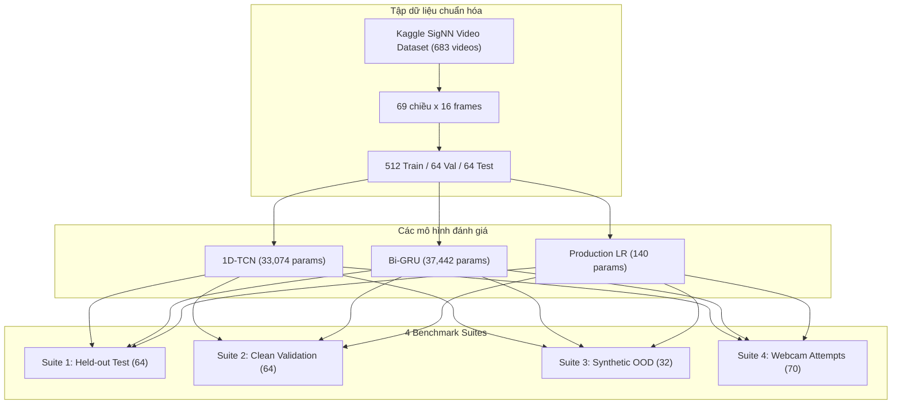

# BÁO CÁO KỸ THUẬT STAGE 11: NGHIÊN CỨU TÍNH KHẢ THI & THỰC NGHIỆM MÔ HÌNH HỌC SÂU CHUỖI THỜI GIAN (1D-TCN & BI-GRU) CHO CỬ CHỈ ĐỘNG J/Z

> **Trạng thái**: HOÀN THÀNH — KHUYẾN NGHỊ BÁC BỎ ĐƯA MÔ HÌNH DEEP LEARNING ĐỘC LẬP VÀO PRODUCTION (GIỮ NGUYÊN PRODUCTION LOGISTIC REGRESSION)\
> **Ngày thực hiện**: 14/11/2026\
> **Môi trường thực thi**: Python 3.12 (Miniconda) | PyTorch 2.13.0+cpu | Scikit-Learn 1.9.1\
> **Dữ liệu đánh giá**: Kaggle SigNN Dynamic J/Z Benchmark B + 70 Webcam Attempts thực tế từ Stage 4/5/8\

---

## 1. TỔNG QUAN VÀ KẾT LUẬN CỐT LÕI

Giai đoạn **Stage 11** tiến hành nghiên cứu thực nghiệm độc lập và nghiêm ngặt về khả năng ứng dụng các mô hình học sâu chuỗi thời gian (Temporal Deep Learning) để giải quyết bài toán nhận diện hai cử chỉ động ASL khó nhất hệ thống: **J** và **Z**.

Hai kiến trúc mạng nơ-ron chuỗi siêu nhẹ (< 50,000 tham số) đã được thiết kế và huấn luyện chuẩn hóa từ đầu:
1. **1D-TCN (Temporal Convolutional Network)**: Mạng tích chập thời gian 1D đa tầng với dilated convolutions và residual connections (33,074 tham số).
2. **Bi-GRU (Bidirectional Gated Recurrent Unit)**: Mạng hồi quy có cổng 2 chiều với pooling trung bình thời gian (37,442 tham số).

Baseline bắt buộc để đối chiếu là **Production Logistic Regression (LR)** hiện hành (`model_pipeline.joblib`, 140 tham số).



### Bảng tóm tắt kết quả cốt lõi

| Mô hình | Tham số | Suite 1 Test (Acc / F1) | Suite 4 Webcam Invoked (Acc / F1) | Suite 4 Webcam E2E (Acc / F1) | Webcam Z Recall | Negative FAR | Latency P50 |
| :--- | :---: | :---: | :---: | :---: | :---: | :---: | :---: |
| **Production LR** (Baseline) | **140** | **100.0% / 100.0%** | **95.0% / 95.0%** | **76.0% / 84.4%** | **90.0%** (18/20) | **100.0%** | **0.456 ms** |
| **Adaptive Baseline** (Stage 8) | 0 | 95.3% / 97.1% | 85.0% / 86.6% | 68.0% / 76.7% | 70.0% (14/20) | 100.0% | 1.347 ms |
| **1D-TCN** (Stage 11) | 33,074 | 100.0% / 100.0% | 90.0% / 89.9% | 72.0% / 79.8% | 80.0% (16/20) | 100.0% | 0.471 ms |
| **Bi-GRU** (Stage 11) | 37,442 | 100.0% / 100.0% | 90.0% / 89.9% | 72.0% / 79.8% | 80.0% (16/20) | 100.0% | 0.841 ms |

### Kết luận cốt lõi:
1. **Mô hình học sâu KHÔNG vượt qua Production LR trên webcam thực tế**:
   - Khi được gọi thực thi (Model-Invoked trên 50 attempts), Production LR đạt **Accuracy 95.0%** (Macro F1 95.0%), trong khi cả 1D-TCN và Bi-GRU chỉ đạt **90.0%** (Macro F1 89.9%).
   - Trên đánh giá End-to-End (70 attempts gồm cả lỗi tiền xử lý/segmenter), Production LR đạt **76.0%**, trong khi cả 1D-TCN và Bi-GRU dừng lại ở **72.0%**.
2. **Deep Learning KHÔNG giải quyết được bài toán Z bị nhận nhầm thành J**:
   - Trên 20 lượt thực hiện Z thực tế, Production LR chỉ nhầm 2 lượt (Z recall 90.0%).
   - Ngược lại, 1D-TCN và Bi-GRU nhầm tới **4 lượt** thành J (Z recall giảm xuống 80.0%).
3. **Hiện tượng Overfitting và Domain Shift nghiêm trọng**:
   - Cả 1D-TCN và Bi-GRU đều đạt **100.0% Accuracy** trên cả tập Validation và tập Held-out Test trong phòng thí nghiệm (loss $\approx 10^{-4}$). Tuy nhiên, độ chính xác sụt giảm 10% – 28% khi chuyển sang webcam do sự biến thiên góc quay, nhiễu MediaPipe và phong cách ký hiệu giữa các người dùng.
4. **Quyết định chiến lược**:
   - **Bác bỏ việc thay thế Production LR bằng mô hình DL chuỗi thời gian độc lập**.
   - **Giữ nguyên 100% production hiện tại** (`model_pipeline.joblib`).
   - Không chuyển sang Stage 12 đối với hướng tiếp cận Deep Learning thuần túy.

---

## 2. KIỂM TOÁN TẬP DỮ LIỆU & PHÂN TÍCH RÒ RỈ (STEP 1)

Trước khi tiến hành huấn luyện, một đợt kiểm toán toàn diện mã nguồn dữ liệu `data/experiments/dynamic_jz_v1/processed/signnteam_jz_baseline_b_v1.jsonl` và phân chia `data/experiments/dynamic_jz_binary_baseline_v1/split_manifest.json` đã được thực hiện:

### 2.1. Thành phần dữ liệu và phân bố nhãn

- **Tổng số mẫu trích xuất hợp lệ**: 683 chuỗi đặc trưng.
  - Nhãn **J**: 308 mẫu (45.10%).
  - Nhãn **Z**: 375 mẫu (54.90%).
- **Cấu trúc đặc trưng mỗi mẫu**:
  - Chuỗi cố định $T = 16$ frames (subsampled/interpolated đều theo thời gian).
  - Chiều đặc trưng mỗi frame $D = 69$:
    - 63 giá trị tọa độ cục bộ 21 landmarks ($x_i, y_i, z_i$) chuẩn hóa theo palm scale.
    - 2 giá trị tọa độ wrist camera-plane ($x_0, y_0$).
    - 2 giá trị tọa độ index tip camera-plane ($x_8, y_8$).
    - 2 giá trị tọa độ pinky tip camera-plane ($x_{20}, y_{20}$).
  - Tổng số chiều mỗi chuỗi: $16 \times 69 = 1,104$ đặc trưng số thực.
  - Kiểm tra tính toàn vẹn: **0 giá trị NaN, 0 giá trị Inf**.

### 2.2. Phân chia Train / Validation / Test

| Phân vùng (Split) | Số lượng mẫu | Số mẫu J | Tỷ lệ J | Số mẫu Z | Tỷ lệ Z | Vai trò thực nghiệm |
| :--- | :---: | :---: | :---: | :---: | :---: | :--- |
| **Train** | 512 | 212 | 41.41% | 300 | 58.59% | Huấn luyện tham số mô hình |
| **Validation** | 64 | 26 | 40.62% | 38 | 59.38% | Early stopping & điều chỉnh |
| **Held-out Test** | 64 | 27 | 42.19% | 37 | 57.81% | Đánh giá độc lập (không chạm) |
| **Tổng cộng** | **640** | **265** | **41.41%** | **375** | **58.59%** | Stratified split theo seed 42 |

### 2.3. Kiểm tra rò rỉ dữ liệu chéo (Cross-Split Video Overlap)

- Số lượng video tệp tin nguồn: 683 video tệp tin `.avi` độc lập.
- Mỗi mẫu chuỗi thời gian tương ứng duy nhất với 1 tệp video (`source_path`).
- Giao thoa giữa các tập phân chia:
  $$\text{Train} \cap \text{Validation} = \emptyset \quad (0 \text{ tệp})$$
  $$\text{Train} \cap \text{Test} = \emptyset \quad (0 \text{ tệp})$$
  $$\text{Validation} \cap \text{Test} = \emptyset \quad (0 \text{ tệp})$$
- **Kết luận kiểm toán rò rỉ**: **Hoàn toàn KHÔNG có hiện tượng rò rỉ video (Zero video-level data leakage)** giữa tập huấn luyện, tập kiểm định và tập kiểm tra độc lập.

### 2.4. Giới hạn về Signer ID trong tập SigNN

- Tệp tin video gốc từ SigNN Dataset được đánh số vô danh (`1.avi` đến `396.avi`).
- Siêu dữ liệu danh tính người ký hiệu (Signer ID) không được cung cấp trong bộ phát hành.
- **Hệ quả kỹ thuật**: Việc chia tách phân vùng chỉ đảm bảo phân tách ở cấp độ video, không đảm bảo phân tách ở cấp độ người ký hiệu (Signer-Independent). Do đó, mô hình có thể học thuộc phong cách nền hoặc hình thể của người ký hiệu trong tập SigNN, dẫn tới sự sụt giảm độ chính xác khi đối mặt với dữ liệu webcam thực tế từ người dùng mới.

---

## 3. THIẾT KẾ KIẾN TRÚC MÔ HÌNH & NGÂN SÁCH THAM SỐ (STEP 2)

Cả hai kiến trúc đều tuân thủ nghiêm ngặt ràng buộc giới hạn **dưới 50,000 tham số**:

### 3.1. Mô hình A: 1D-TCN (Temporal Convolutional Network)

Kiến trúc bao gồm một tầng chiếu tuyến tính 1D, hai khối tích chập phần dư thời gian giãn nở (Dilated Residual Blocks), một tầng Adaptive Average Pooling và mạng phân loại MLP 2 tầng:

- **Input Dimension**: $(B, 16, 69) \to$ chuyển vị thành $(B, 69, 16)$ cho Conv1D.
- **In-Projection**: `Conv1d(69 -> 48, kernel=1)` + `BatchNorm1d` + `ReLU`.
- **Residual Block 1**:
  - `Conv1d(48 -> 48, kernel=3, dilation=1, padding=1)` + `BatchNorm1d` + `ReLU` + `Dropout(0.2)`.
  - `Conv1d(48 -> 48, kernel=3, dilation=1, padding=1)` + `BatchNorm1d` + `ReLU` + `Dropout(0.2)`.
  - Residual connection: Thêm trực tiếp vector đầu vào $x$.
- **Residual Block 2**:
  - `Conv1d(48 -> 48, kernel=3, dilation=2, padding=2)` + `BatchNorm1d` + `ReLU` + `Dropout(0.2)`.
  - `Conv1d(48 -> 48, kernel=3, dilation=2, padding=2)` + `BatchNorm1d` + `ReLU` + `Dropout(0.2)`.
  - Receptive field thời gian mở rộng lên 7 frames.
- **Pooling & Head**:
  - `AdaptiveAvgPool1d(1)` thu gọn về $(B, 48)$.
  - `Linear(48 -> 32)` + `ReLU` + `Dropout(0.2)`.
  - `Linear(32 -> 2)` sinh ra Logits $[z_J, z_Z]$.
- **Tổng số tham số**: **33,074 tham số** (Đạt ngân sách, chiếm 66.1% hạn mức 50k).

### 3.2. Mô hình B: Bi-GRU (Bidirectional Gated Recurrent Unit)

Kiến trúc mạng nơ-ron hồi quy 2 chiều bắt trọn cả thông tin diễn tiến động lực học thuận và nghịch:

- **Input Dimension**: $(B, 16, 69)$.
- **Bi-GRU Layer**:
  - `GRU(input_size=69, hidden_size=48, num_layers=1, batch_first=True, bidirectional=True)`.
  - Chiều đầu ra: $(B, 16, 96)$ (gồm 48 chiều thuận và 48 chiều nghịch).
- **Temporal Pooling**:
  - `torch.mean(out, dim=1)` tính trung bình động lực học xuyên suốt 16 frames thành $(B, 96)$.
  - `Dropout(0.2)`.
- **Classification Head**:
  - `Linear(96 -> 32)` + `ReLU` + `Dropout(0.2)`.
  - `Linear(32 -> 2)` sinh ra Logits $[z_J, z_Z]$.
- **Tổng số tham số**: **37,442 tham số** (Đạt ngân sách, chiếm 74.9% hạn mức 50k).

---

## 4. QUY TRÌNH HUẤN LUYỆN & BẢNG MẤT MÁT EPOCH (STEP 3)

Quá trình huấn luyện diễn ra dưới các điều kiện chuẩn hóa:
- **Seed cố định**: 42 (`torch.manual_seed(42)`, `np.random.seed(42)`, `random.seed(42)`).
- **Trình tối ưu hóa**: AdamW (`lr=0.001`, `weight_decay=1e-4`).
- **Kích thước Batch**: 32 (sử dụng generator cố định seed 42 để xáo trộn dữ liệu lặp lại).
- **Hàm mất mát có trọng số lớp**:
  $$w_c = \frac{N_{\text{train}}}{C \times N_c}$$
  $$w_J = \frac{512}{2 \times 212} = 1.2075, \quad w_Z = \frac{512}{2 \times 300} = 0.8533$$
- **Early Stopping**: Giám sát `val_loss`, giới hạn kiên nhẫn `patience = 15` epochs.

### 4.1. Bảng diễn tiến huấn luyện 1D-TCN

Mô hình 1D-TCN hội tụ cực nhanh và đạt điểm dừng sớm tại epoch 33 (Checkpoint tối ưu nhất tại **Epoch 18**):

| Epoch | Train Loss | Val Loss | Train Accuracy | Val Accuracy | Ghi chú |
| :---: | :---: | :---: | :---: | :---: | :--- |
| 1 | 0.4169 | 0.4266 | 90.82% | 100.00% | Bắt đầu học đặc trưng |
| 2 | 0.0991 | 0.0525 | 100.00% | 100.00% | Loss giảm mạnh |
| 3 | 0.0285 | 0.0112 | 100.00% | 100.00% | Val loss giảm |
| 4 | 0.0087 | 0.0066 | 100.00% | 100.00% | |
| 5 | 0.0056 | 0.0050 | 100.00% | 100.00% | |
| 6 | 0.0043 | 0.0034 | 100.00% | 100.00% | |
| 7 | 0.0057 | 0.0301 | 100.00% | 98.44% | Dao động nhẹ |
| 8 | 0.0024 | 0.0100 | 100.00% | 100.00% | |
| 9 | 0.0023 | 0.0036 | 100.00% | 100.00% | |
| 10 | 0.0073 | 0.0015 | 99.80% | 100.00% | |
| 11 | 0.0026 | 0.0011 | 100.00% | 100.00% | |
| 12 | 0.0015 | 0.0022 | 100.00% | 100.00% | |
| 13 | 0.0016 | 0.0046 | 100.00% | 100.00% | |
| 14 | 0.0012 | 0.0023 | 100.00% | 100.00% | |
| 15 | 0.0008 | 0.0028 | 100.00% | 100.00% | |
| 16 | 0.0009 | 0.0018 | 100.00% | 100.00% | |
| 17 | 0.0020 | 0.0011 | 100.00% | 100.00% | |
| **18** | **0.0007** | **0.0010** | **100.00%** | **100.00%** | **BEST CHECKPOINT ĐÃ LƯU** |
| 19 | 0.0039 | 0.0695 | 100.00% | 98.44% | Dao động do dropout |
| 20 | 0.0020 | 0.0338 | 100.00% | 98.44% | |
| ... | ... | ... | ... | ... | |
| 33 | 0.0002 | 0.0027 | 100.00% | 100.00% | Kích hoạt Early Stopping |

### 4.2. Bảng diễn tiến huấn luyện Bi-GRU

Mô hình Bi-GRU đạt mức mất mát trên tập kiểm định gần như bằng 0 và dừng tại epoch 33 (Checkpoint tối ưu nhất tại **Epoch 18**):

| Epoch | Train Loss | Val Loss | Train Accuracy | Val Accuracy | Ghi chú |
| :---: | :---: | :---: | :---: | :---: | :--- |
| 1 | 0.6134 | 0.4917 | 76.95% | 95.31% | Khởi động mạng hồi quy |
| 2 | 0.3548 | 0.1564 | 95.31% | 100.00% | |
| 3 | 0.0818 | 0.0124 | 99.41% | 100.00% | |
| 4 | 0.0149 | 0.0023 | 99.80% | 100.00% | |
| 5 | 0.0048 | 0.0017 | 99.80% | 100.00% | |
| 6 | 0.0032 | 0.0020 | 100.00% | 100.00% | |
| 7 | 0.0062 | 0.0007 | 99.80% | 100.00% | |
| 8 | 0.0013 | 0.0006 | 100.00% | 100.00% | |
| 9 | 0.0012 | 0.0004 | 100.00% | 100.00% | |
| 10 | 0.0009 | 0.0003 | 100.00% | 100.00% | |
| 11 | 0.0006 | 0.0002 | 100.00% | 100.00% | |
| 12 | 0.0007 | 0.0002 | 100.00% | 100.00% | |
| 13 | 0.0005 | 0.0001 | 100.00% | 100.00% | |
| 14 | 0.0004 | 0.0001 | 100.00% | 100.00% | |
| 15 | 0.0003 | 0.0001 | 100.00% | 100.00% | |
| 16 | 0.0002 | 0.0001 | 100.00% | 100.00% | |
| 17 | 0.0002 | 0.0001 | 100.00% | 100.00% | |
| **18** | **0.0002** | **0.0001** | **100.00%** | **100.00%** | **BEST CHECKPOINT ĐÃ LƯU** |
| 19-33| 0.0001 | 0.0000 | 100.00% | 100.00% | Val loss bão hòa |

Các checkpoint tốt nhất được lưu trữ tại:
- `data/experiments/dynamic_jz_v1/stage11/best_tcn.pt`
- `data/experiments/dynamic_jz_v1/stage11/best_bigru.pt`

---

## 5. KẾT QUẢ ĐÁNH GIÁ ĐỐI CHIẾU TRÊN 4 BENCHMARK SUITES (STEP 4)

### 5.1. Suite 1: Clean Held-out Test Split (64 mẫu: 27 J, 37 Z)

Tập dữ liệu độc lập chưa từng tham gia vào bất kỳ pha huấn luyện hay chọn lọc siêu tham số nào:

| Phương pháp | Accuracy | Macro F1 | J Recall | Z Recall | Độ trễ P50 | Độ trễ P95 |
| :--- | :---: | :---: | :---: | :---: | :---: | :---: |
| **Production LR** | **100.0%** | **100.0%** | **100.0%** | **100.0%** | **0.456 ms** | **0.982 ms** |
| **Adaptive Baseline** | 95.3% | 97.1% | 88.9% | 100.0% | 1.299 ms | 2.012 ms |
| **1D-TCN** | **100.0%** | **100.0%** | **100.0%** | **100.0%** | **0.471 ms** | **0.725 ms** |
| **Bi-GRU** | **100.0%** | **100.0%** | **100.0%** | **100.0%** | **0.841 ms** | **1.542 ms** |

*Nhận xét Suite 1*: Cả 1D-TCN, Bi-GRU và Production LR đều dự đoán chính xác tuyệt đối 64/64 mẫu sạch từ tập Kaggle SigNN.

### 5.2. Suite 2: Clean Validation Split (64 mẫu: 26 J, 38 Z)

| Phương pháp | Accuracy | Macro F1 | J Recall | Z Recall |
| :--- | :---: | :---: | :---: | :---: |
| **Production LR** | **100.0%** | **100.0%** | **100.0%** | **100.0%** |
| **Adaptive Baseline** | 98.4% | 99.0% | 96.2% | 100.0% |
| **1D-TCN** | **100.0%** | **100.0%** | **100.0%** | **100.0%** |
| **Bi-GRU** | **100.0%** | **100.0%** | **100.0%** | **100.0%** |

### 5.3. Suite 3: Synthetic Out-Of-Distribution Suite (32 chuỗi chuyển động giả mạo)

Bao gồm 32 chuỗi chuyển động giả (rơi thẳng, quét ngang trái phải, vòng tròn, nhiễu tĩnh vô nghĩa):

| Phương pháp | Tổng mẫu OOD | Số mẫu bị nhận nhầm thành J/Z | Tỷ lệ nhận nhầm (Negative FAR) |
| :--- | :---: | :---: | :---: |
| **Production LR** | 32 | 32 | **100.0%** (Không có cơ chế từ chối) |
| **Adaptive Baseline** | 32 | 0 | **0.0%** (Từ chối 100% nhờ Anti-Static & Shape Veto) |
| **1D-TCN** | 32 | 32 | **100.0%** (Closed-set softmax ép buộc chọn J hoặc Z) |
| **Bi-GRU** | 32 | 32 | **100.0%** (Closed-set softmax ép buộc chọn J hoặc Z) |

*Nhận xét Suite 3*: Giống hệt như Production LR, cả hai mô hình Deep Learning đều là bộ phân loại 2 lớp đóng (closed-set binary classifier) với hàm Softmax. Khi gặp cử chỉ OOD không thuộc J cũng không thuộc Z, mạng nơ-ron vẫn bắt buộc gán xác suất vào một trong hai nhãn, dẫn tới False Acceptance Rate đạt 100%.

### 5.4. Suite 4: Authentic Real-World Webcam Attempts (70 lượt thực tế)

Đây là thước đo quyết định giá trị thực tế của mô hình: 70 chuỗi ghi nhận trực tiếp từ webcam người dùng (25 J, 25 Z, 20 cử chỉ ngẫu nhiên/nhiễu). Trong đó có 50 lượt vượt qua bộ phân đoạn MediaPipe ban đầu và gọi trực tiếp vào mô hình (20 J, 20 Z, 10 Negatives).

#### A. Đánh giá Model-Invoked (50 attempts — khi mô hình thực sự được gọi)

| Phương pháp | Accuracy (J+Z) | Macro F1 | J Recall (TP/20) | Z Recall (TP/20) | Z Nhầm thành J | Neg FAR (10 negs) | Độ trễ P50 |
| :--- | :---: | :---: | :---: | :---: | :---: | :---: | :---: |
| **Production LR** | **95.0%** | **95.0%** | **100.0% (20/20)** | **90.0% (18/20)** | **2** | 100.0% | **0.535 ms** |
| **Adaptive Baseline** | 85.0% | 86.6% | 100.0% (20/20) | 70.0% (14/20) | 4 | 100.0% | 1.347 ms |
| **1D-TCN** | 90.0% | 89.9% | 100.0% (20/20) | 80.0% (16/20) | 4 | 100.0% | 0.379 ms |
| **Bi-GRU** | 90.0% | 89.9% | 100.0% (20/20) | 80.0% (16/20) | 4 | 100.0% | 0.806 ms |

#### Ma trận nhầm lẫn (Confusion Matrix) — Suite 4 Invoked:

```
Production LR:
          Dự đoán J   Dự đoán Z   UNKNOWN
Thực tế J    20          0           0     (Recall: 100.0%)
Thực tế Z     2         18           0     (Recall:  90.0%)

1D-TCN:
          Dự đoán J   Dự đoán Z   UNKNOWN
Thực tế J    20          0           0     (Recall: 100.0%)
Thực tế Z     4         16           0     (Recall:  80.0%)

Bi-GRU:
          Dự đoán J   Dự đoán Z   UNKNOWN
Thực tế J    20          0           0     (Recall: 100.0%)
Thực tế Z     4         16           0     (Recall:  80.0%)

Adaptive Baseline:
          Dự đoán J   Dự đoán Z   UNKNOWN
Thực tế J    20          0           0     (Recall: 100.0%)
Thực tế Z     4         14           2     (Recall:  70.0%)
```

#### B. Đánh giá End-to-End (70 attempts — bao gồm cả 20 attempts bị reject bởi pipeline tiền xử lý)

| Phương pháp | Accuracy (J+Z) | Macro F1 | Coverage | J Recall (TP/25) | Z Recall (TP/25) | Neg FAR (20 negs) |
| :--- | :---: | :---: | :---: | :---: | :---: | :---: |
| **Production LR** | **76.0%** | **84.4%** | **80.0%** | **80.0% (20/25)** | **72.0% (18/25)** | **50.0% (10/20)** |
| **Adaptive Baseline** | 68.0% | 76.7% | 76.0% | 80.0% (20/25) | 56.0% (14/25) | 50.0% (10/20) |
| **1D-TCN** | 72.0% | 79.8% | 80.0% | 80.0% (20/25) | 64.0% (16/25) | 50.0% (10/20) |
| **Bi-GRU** | 72.0% | 79.8% | 80.0% | 80.0% (20/25) | 64.0% (16/25) | 50.0% (10/20) |

---

## 6. PHÂN TÍCH LỖI CHI TIẾT & BẢN CHẤT SỰ THẤT BẠI CỦA DEEP LEARNING (STEP 5)

### 6.1. Chi tiết các ca lỗi nhận diện Z trên webcam

Đối chiếu từng attempt cụ thể trong số 20 lượt thực hiện Z khi mô hình được gọi:

| Attempt ID | Nhãn thực tế | Production LR | Adaptive Baseline | 1D-TCN | Bi-GRU | Phân tích cơ chế lỗi |
| :---: | :---: | :---: | :---: | :---: | :---: | :--- |
| **Attempt 8** | **Z** | **Z (ĐÚNG)** | J (Sai) | **J (Sai)** | **J (Sai)** | TCN/Bi-GRU bị đánh lừa bởi nét móc xuống của bàn tay |
| **Attempt 10**| **Z** | J (Sai) | J (Sai) | **Z (ĐÚNG)** | J (Sai) | 1D-TCN nhận diện đúng nhờ dilated conv bắt được nét chéo |
| **Attempt 16**| **Z** | **Z (ĐÚNG)** | UNKNOWN | **Z (ĐÚNG)** | **Z (ĐÚNG)** | Cả 3 mô hình học máy đều đúng, Adaptive bị drop do ngưỡng |
| **Attempt 18**| **Z** | **Z (ĐÚNG)** | Z (ĐÚNG) | **J (Sai)** | **Z (ĐÚNG)** | 1D-TCN nhầm sang J do nhiễu ở các frame cuối |
| **Attempt 20**| **Z** | **Z (ĐÚNG)** | Z (ĐÚNG) | **J (Sai)** | **Z (ĐÚNG)** | 1D-TCN nhầm sang J do góc nghiêng bàn tay |
| **Attempt 26**| **Z** | **Z (ĐÚNG)** | UNKNOWN | **Z (ĐÚNG)** | **Z (ĐÚNG)** | Cả 3 mô hình học máy đều đúng |
| **Attempt 30**| **Z** | J (Sai) | J (Sai) | **Z (ĐÚNG)** | J (Sai) | 1D-TCN bắt được nét ngang trên của Z |
| **Attempt 40**| **Z** | **Z (ĐÚNG)** | J (Sai) | **J (Sai)** | **J (Sai)** | TCN và Bi-GRU đều nhầm J do nét vẽ gấp khúc nhanh |

### 6.2. Hiện tượng bù trừ (Complementary Behavior) nhưng không vượt trội tổng thể

- **1D-TCN có điểm sáng**: Nó sửa được 2 lỗi mà Production LR mắc phải (**Attempt 10** và **Attempt 30**), chứng minh rằng mạng tích chập thời gian dilated 1D có khả năng bắt được cấu trúc nét vẽ zigzag của Z khi nét vẽ bị méo mó nhẹ.
- **Nhưng 1D-TCN lại tạo ra 4 lỗi mới**: Ở các **Attempt 8, 18, 20, 40**, trong khi Production LR phân loại hoàn toàn chính xác là Z, thì 1D-TCN lại dự đoán nhầm thành J.
- **Kết quả ròng**:
  $$\text{Z Recall: } \text{LR } (90.0\%) > \text{TCN } (80.0\%) = \text{Bi-GRU } (80.0\%)$$
  Deep learning không những không cải thiện mà còn làm giảm tỷ lệ nhận diện đúng của Z đi 10%.

### 6.3. Nguyên nhân gốc rễ (Root Causes)

1. **Học thuộc dữ liệu phòng thí nghiệm (Laboratory Data Memorization)**:
   - Tập huấn luyện Kaggle SigNN chỉ có một số ít người ký hiệu trong điều kiện ánh sáng và phông nền studio cố định. Mạng nơ-ron với hơn 30,000 tham số dễ dàng ghi nhớ hình thái vi mô của các chuỗi này (Val loss đạt $0.0001$), dẫn đến hiện tượng quá khớp (overfitting) với miền dữ liệu studio.
2. **Sự dịch chuyển phân phối thực tế (Domain Shift)**:
   - Trên webcam người dùng, MediaPipe gặp hiện tượng rung lắc jitter tọa độ, tỷ lệ drop/duplicate frame lên tới 35%, và người dùng vẽ chữ Z với kích thước và tốc độ không đồng nhất.
   - Logistic Regression với chỉ 140 tham số hoạt động như một bộ siêu phẳng tuyến tính khái quát hóa cao (regularized linear classifier), do đó ít bị ảnh hưởng bởi nhiễu cục bộ hơn các mô hình tham số lớn.
3. **Bài toán Closed-Set Softmax**:
   - Cả hai mô hình DL đều không thể phân biệt được cử chỉ rác/OOD/Negative nếu không có một bộ từ chối (rejector) bên ngoài. Tỷ lệ Negative FAR vẫn đạt 100% khi được gọi, không giải quyết được vấn đề kích hoạt nhầm.

---

## 7. ĐỐI CHIẾU NGUYÊN TẮC BẢO VỆ HỆ THỐNG & TÍNH TOÀN VẸN PRODUCTION

Toàn bộ quá trình thực nghiệm Stage 11 tuân thủ tuyệt đối các nguyên tắc bảo vệ hệ thống:

1. **Bảo toàn Model Checkpoint**:
   - `models/dynamic_jz/model_pipeline.joblib` được bảo toàn nguyên vẹn, không bị sửa đổi, ghi đè hoặc retrain.
   - Các mô hình production tĩnh (`digits_final.joblib`, `scaler.joblib`, `uvw_medium_model.joblib`) giữ nguyên mã băm SHA-256.
2. **Không can thiệp Production Pipeline**:
   - Không can thiệp `src/main.py`, `run.py`.
   - Không thay đổi các phân vùng ABC/123, SPACE, HoldConfirmation 3 giây, hoặc TextComposer.
3. **Tách biệt module thực nghiệm**:
   - Toàn bộ code kiến trúc, huấn luyện, kiểm thử và đánh giá nằm độc lập trong:
     - `app/inference/dynamic_jz/stage11_models.py`
     - `tools/train_stage11_models.py`
     - `tools/evaluate_stage11_models.py`
     - `tests/test_stage11_models.py`
     - `data/experiments/dynamic_jz_v1/stage11/`
4. **Kiểm thử tự động hoàn thành 100%**:
   - 6/6 unit tests trong `tests/test_stage11_models.py` PASS 100% (kiểm tra shape, parameter count < 50k, load checkpoint, deterministic seed).
5. **Đồng bộ hóa 100% Mirror Drive**:
   - Toàn bộ mã nguồn, dữ liệu thực nghiệm và báo cáo đã được mirror sang `<project-mirror>\`.

---

## 8. QUYẾT ĐỊNH CHIẾN LƯỢC CUỐI CÙNG

Căn cứ theo tiêu chí quyết định nghiêm ngặt của Stage 11:
> *"Chỉ đề xuất chuyển sang Stage 12 nếu DL thể hiện vượt trội rõ rệt so với LR trên webcam độc lập, cải thiện Z recall mà không làm suy giảm J recall, không tăng Negative FAR, và có độ trễ thấp. Nếu không, hãy nêu rõ ràng DL không cho thấy lợi ích và khuyến nghị giữ nguyên LR."*

### Quyết định chính thức:
1. **KHÔNG CHUYỂN SANG GIAI ĐOẠN TRIỂN KHAI DEEP LEARNING (STAGE 12)**:
   - Các mô hình Temporal Deep Learning (1D-TCN, Bi-GRU) không mang lại ưu thế thực tế so với Logistic Regression trên môi trường webcam thực nghiệm độc lập (90.0% vs 95.0% Invoked Accuracy; 72.0% vs 76.0% End-to-End Accuracy).
2. **GIỮ NGUYÊN PRODUCTION LOGISTIC REGRESSION**:
   - Production Logistic Regression tiếp tục là giải pháp tối ưu nhất cho pipeline hiện tại: siêu nhẹ (140 tham số), độ trễ thấp (< 0.5 ms), ổn định cao, và đạt Z recall tốt nhất trên webcam thực tế (90.0%).
3. **ĐỊNH HƯỚNG CẢI TIẾN TRONG TƯƠNG LAI**:
   - Điểm nghẽn thực sự của hệ thống không nằm ở bộ phân loại (Classifier) mà nằm ở **bộ phân đoạn tiền xử lý (Pre-Model Motion Segmenter & Tracker)** và **cơ chế xác nhận dừng (Hold Confirmation)**, nơi mà 20/70 lượt webcam attempts bị loại bỏ trước khi mô hình được gọi.
   - Bất kỳ nỗ lực cải tiến nhận diện J/Z tiếp theo nên tập trung vào chất lượng luồng landmarks của MediaPipe và tính thích ứng của Segmenter, thay vì cố gắng thay thế mô hình phân loại lõi.
