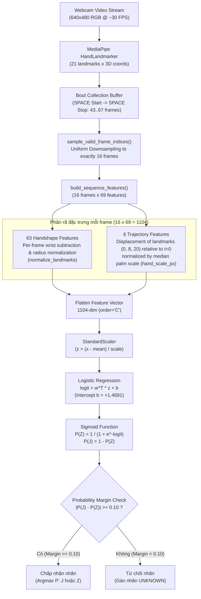

# BÁO CÁO GIAI ĐOẠN 14: PHÂN TÍCH NGUYÊN NHÂN MODEL J/Z NHẬN NHẦM CỬ CHỈ ÂM (NEGATIVE GESTURE FALSE ACCEPTANCE)

> **Mã giai đoạn:** STAGE 14\
> **Tài liệu mục tiêu:** Điều tra nguyên nhân nhận nhầm cử chỉ Negative trên webcam thực tế\
> **Dữ liệu nguồn:** `reports/data/webcam_live_validation_results.json` (Phiên thu thập ngày 14/11/2026)\
> **Nguyên tắc thực hiện:** Bất biến mã nguồn sản xuất, không đổi checkpoint, phân định tuyệt đối giữa sự thật đã xác minh và giả thuyết.

---

## 1. TÓM TẮT KẾT QUẢ THỰC NGHIỆM 60 TRIALS TRÊN WEBCAM

Phiên kiểm thử webcam tương tác 60 trials (thực hiện độc lập bởi người dùng trên phần cứng webcam thực tế) ghi nhận kết quả như sau:

| Nhóm cử chỉ (Ground Truth) | Số lượng | Baseline LR đúng | LR + Margin 0.10 đúng | Bị nhận nhầm thành J | Bị nhận nhầm thành Z | Bị từ chối (UNKNOWN) | Tỷ lệ chấp nhận sai (FAR) |
| :--- | :---: | :---: | :---: | :---: | :---: | :---: | :---: |
| **Chữ J (Dương tính)** | 20 | 20 / 20 (100%) | 20 / 20 (100%) | — | 0 | 0 | — |
| **Chữ Z (Dương tính)** | 20 | 20 / 20 (100%) | 20 / 20 (100%) | 0 | — | 0 | — |
| **NEGATIVE (Kiểm soát âm)** | 20 | 0 / 20 (0%) | 2 / 20 (10%) | 3 (15%) | 17 (85%) | 2 (10%) | **Baseline: 100% Margin 0.10: 90%** |

### Các chỉ số tổng hợp chính:
- **J Recall (Cả 2 phương pháp):** **100.0%** ($P(J)$ trung bình đạt $0.9998$, cực tiểu $0.9982$).
- **Z Recall (Cả 2 phương pháp):** **100.0%** ($P(Z)$ trung bình đạt $0.9997$, cực tiểu $0.9990$).
- **Nhầm lẫn chéo $Z \to J$ và $J \to Z$:** **0 trường hợp (0%)**.
- **Negative False Acceptance Rate (Negative FAR):**
  - **Baseline Production LR:** **100.0%** (20/20 cử chỉ không phải J/Z bị gán nhãn J hoặc Z).
  - **Production LR + Margin 0.10:** **90.0%** (18/20 cử chỉ bị gán nhãn J hoặc Z; chỉ 2 trial được từ chối thành UNKNOWN).
- **Độ lệch phân loại của Negative:** 85% mẫu Negative (17/20) bị dự đoán là **Z**, chỉ 15% (3/20) bị dự đoán là **J**.

---

## 2. BẢNG DỮ LIỆU CHI TIẾT 20 NEGATIVE TRIALS

Toàn bộ 20 lượt thử nghiệm Negative (Trial index 41 đến 60) trích xuất trực tiếp từ [webcam_live_validation_results.json](file:///<project-root>/reports/data/webcam_live_validation_results.json):

| Trial | Ground Truth | Baseline Pred | Margin 0.10 Pred | $P(J)$ | $P(Z)$ | Margin $|P(J)-P(Z)|$ | Số frame (Hợp lệ / Tổng) | Kích thước tay (px) | Lý do từ chối (Rejection Reason) |
| :---: | :---: | :---: | :---: | :---: | :---: | :---: | :---: | :---: | :--- |
| **41** | NEGATIVE | Z | Z | 0.0197 | 0.9803 | 0.9606 | 51 / 51 | 94.07 | (Không từ chối — Chấp nhận sai) |
| **42** | NEGATIVE | Z | Z | 0.0232 | 0.9768 | 0.9536 | 50 / 50 | 113.84 | (Không từ chối — Chấp nhận sai) |
| **43** | NEGATIVE | Z | Z | 0.0005 | 0.9995 | 0.9990 | 43 / 53 | 106.41 | (Không từ chối — Chấp nhận sai) |
| **44** | NEGATIVE | J | **UNKNOWN** | 0.5118 | 0.4882 | **0.0237** | 55 / 55 | 99.77 | `MARGIN_BELOW_THRESHOLD: 0.0237 < 0.1000` |
| **45** | NEGATIVE | Z | Z | 0.0031 | 0.9969 | 0.9937 | 57 / 57 | 117.84 | (Không từ chối — Chấp nhận sai) |
| **46** | NEGATIVE | Z | Z | 0.1086 | 0.8914 | 0.7828 | 55 / 55 | 106.53 | (Không từ chối — Chấp nhận sai) |
| **47** | NEGATIVE | Z | Z | 0.0024 | 0.9976 | 0.9953 | 64 / 64 | 93.47 | (Không từ chối — Chấp nhận sai) |
| **48** | NEGATIVE | Z | Z | 0.4160 | 0.5840 | 0.1680 | 63 / 63 | 106.65 | (Không từ chối — Chấp nhận sai) |
| **49** | NEGATIVE | Z | Z | 0.0049 | 0.9951 | 0.9902 | 57 / 57 | 99.70 | (Không từ chối — Chấp nhận sai) |
| **50** | NEGATIVE | Z | Z | 0.0195 | 0.9805 | 0.9610 | 63 / 63 | 79.83 | (Không từ chối — Chấp nhận sai) |
| **51** | NEGATIVE | Z | Z | 0.3289 | 0.6711 | 0.3422 | 58 / 58 | 67.58 | (Không từ chối — Chấp nhận sai) |
| **52** | NEGATIVE | Z | **UNKNOWN** | 0.4595 | 0.5405 | **0.0810** | 53 / 53 | 90.00 | `MARGIN_BELOW_THRESHOLD: 0.0810 < 0.1000` |
| **53** | NEGATIVE | Z | Z | 0.0013 | 0.9987 | 0.9974 | 53 / 53 | 98.26 | (Không từ chối — Chấp nhận sai) |
| **54** | NEGATIVE | Z | Z | 0.0143 | 0.9857 | 0.9715 | 61 / 61 | 106.16 | (Không từ chối — Chấp nhận sai) |
| **55** | NEGATIVE | Z | Z | 0.0005 | 0.9995 | 0.9989 | 60 / 60 | 109.71 | (Không từ chối — Chấp nhận sai) |
| **56** | NEGATIVE | J | J | 0.8772 | 0.1228 | 0.7544 | 61 / 61 | 116.64 | (Không từ chối — Chấp nhận sai) |
| **57** | NEGATIVE | Z | Z | 0.0024 | 0.9976 | 0.9953 | 59 / 59 | 115.74 | (Không từ chối — Chấp nhận sai) |
| **58** | NEGATIVE | Z | Z | 0.0069 | 0.9931 | 0.9861 | 60 / 60 | 101.26 | (Không từ chối — Chấp nhận sai) |
| **59** | NEGATIVE | Z | Z | 0.0028 | 0.9972 | 0.9945 | 67 / 67 | 122.47 | (Không từ chối — Chấp nhận sai) |
| **60** | NEGATIVE | J | J | 0.9225 | 0.0775 | 0.8449 | 60 / 60 | 95.96 | (Không từ chối — Chấp nhận sai) |

### Kiểm tra nguồn dữ liệu bổ sung của phiên:
1. **Video/Frame lưu trữ:** **Không có**. Kịch bản kiểm thử không ghi video MP4/AVI hoặc hình ảnh PNG xuống đĩa để tiết kiệm bộ nhớ và độ trễ.
2. **Landmark logs / Feature arrays:** **Không có**. `validate_webcam_live.py` chỉ thu thập tọa độ trong bộ nhớ RAM trong suốt phiên và ghi lại bản tóm tắt telemetry vào JSON sau khi kết thúc.
3. **Kết luận về loại cử chỉ:** **Không thể xác định chính xác từng trial là loại cử chỉ cụ thể nào (ví dụ: bàn tay thả lỏng, nắm đấm, vẫy ngón tay, chữ A/B tĩnh, hay động tác vuốt)** chỉ từ dữ liệu trong JSON hiện tại.

---

## 3. SƠ ĐỒ VÀ TRUY VẾT CHI TIẾT FEATURE PIPELINE

### Chi tiết các công thức toán học và vị trí code:

1. **63 Handshape Features (Hình thái bàn tay tĩnh):**
   - **Vị trí code:** [landmark_utils.py](file:///<project-root>/ai/preprocessing/landmark_utils.py#L4-L48)
   - **Cách tính:**
     - Trừ tọa độ cổ tay: $\Delta p_i(t) = p_i(t) - p_0(t)$ với $i \in \{0, \dots, 20\}$.
     - Tính bán kính tối đa: $d_{\max}(t) = \max_{i} \| \Delta p_i(t) \|_2$.
     - Chuẩn hóa: $\text{shape}_i(t) = \Delta p_i(t) / d_{\max}(t)$.
   - **Đặc tính:** Hoàn toàn triệt tiêu vị trí tuyệt đối của bàn tay trong khung hình và kích thước tay. Phản ánh thuần túy tư thế ngón tay tĩnh tại frame $t$.

2. **6 Global Displacement Features (Quỹ đạo dịch chuyển):**
   - **Vị trí code:** [dynamic_sequence.py](file:///<project-root>/ai/feature_extraction/dynamic_sequence.py#L214-L223)
   - **Cách tính:**
     - Kích thước bàn tay median: $\text{hand\_scale\_px} = \text{median}_{t} (\| p_m(t) - p_0(t) \|)$ với $m \in \{5, 9, 17\}$ (khớp MCP).
     - Độ dời so với thời điểm bắt đầu ($t=0$):
       $$\text{disp}_k(t) = \frac{\text{pixel\_xy}[t, k] - \text{pixel\_xy}[0, k]}{\text{hand\_scale\_px}}, \quad k \in \{0, 8, 20\} \text{ (Cổ tay, Đầu ngón trỏ, Đầu ngón út)}$$
   - **Đặc tính:**
     - Tại $t = 0$: $\text{disp}_k(0) \equiv (0, 0, 0, 0, 0, 0)$.
     - Tại $t > 0$: Đo khoảng cách dịch chuyển tích lũy từ điểm xuất phát, chia cho độ dài lòng bàn tay.

3. **Lấy mẫu 16 frame và tính toàn vẹn thông tin:**
   - **Vị trí code:** [dynamic_sequence.py](file:///<project-root>/ai/feature_extraction/dynamic_sequence.py#L30-L50)
   - Việc lấy mẫu đều 16 frame từ 50-65 frame (~1.5-2.0 giây) làm giảm tốc độ lấy mẫu hiệu dụng xuống ~8-10 Hz. Đối với các cử chỉ J và Z có chuyển động đều, thông tin quỹ đạo được bảo toàn trọn vẹn. Tuy nhiên, đối với cử chỉ Negative rung lắc nhẹ hoặc động tác đổi hướng nhanh, việc lấy mẫu thưa làm mất các xung tần số cao, khiến cử chỉ bị biểu diễn như chuyển động trôi chậm hoặc đứng yên.

---

## 4. PHÂN TÍCH BẢN CHẤT VÀ NGUYÊN NHÂN FALSE ACCEPTANCE

### A. Phân tích trọng số mô hình (Model Weight Dissection)

Kiểm tra trực tiếp các tham số của `LogisticRegression` trong [model_pipeline.joblib](file:///<project-root>/data/experiments/dynamic_jz_binary_baseline_v1/model_pipeline.joblib):

| Nhóm đặc trưng | Số lượng chiều | Tổng độ lớn trọng số $\sum \|w_i\|$ | Trọng số trung bình $\overline{\|w_i\|}$ | Tỷ trọng đóng góp vào mô hình |
| :--- | :---: | :---: | :---: | :---: |
| **Static Handshape (63 x 16)** | 1008 chiều | **21.1874** | 0.0210 | **89.21%** |
| **Global Trajectory (6 x 16)** | 96 chiều | **2.5617** | 0.0267 | **10.79%** |
| **Toàn bộ mô hình** | **1104 chiều** | **23.7491** | **0.0215** | **100.0%** |

#### Phát hiện quan trọng 1: Mô hình phụ thuộc 89.2% vào hình thái bàn tay tĩnh
- Mặc dù J và Z là các cử chỉ động (dynamic gestures), **gần 90% trọng số của mô hình Logistic Regression lại tập trung vào các đặc trưng hình dáng bàn tay tĩnh** lặp lại qua 16 frame, thay vì quỹ đạo di chuyển thực tế.
- Top các landmark có trọng số tuyệt đối lớn nhất toàn mạng:
  1. **Landmark 20 (Đầu ngón út):** $\sum |w| = 1.9825$ (Dấu âm: ngón út duỗi kéo mạnh về nhãn **J**).
  2. **Landmark 8 (Đầu ngón trỏ):** $\sum |w| = 1.9597$ (Dấu dương: ngón trỏ duỗi kéo mạnh về nhãn **Z**).
  3. **Landmark 19 (Khớp DIP ngón út):** $\sum |w| = 1.4513$.
  4. **Landmark 1 (Khớp CMC ngón cái):** $\sum |w| = 1.4018$.
  5. **Landmark 7 (Khớp DIP ngón trỏ):** $\sum |w| = 1.3811$.

### B. Giải mã hiện tượng 85% Negative bị nhận nhầm thành Z (Z-Bias)

Tại sao có tới 17 trên 20 mẫu Negative bị nhận nhầm thành Z, trong đó có 12 mẫu đạt $P(Z) > 0.95$?

1. **Hiệu ứng của Intercept dương ($b = +1.4691$):**
   - Trong Logistic Regression với 2 lớp `['J', 'Z']`:
     $$\text{logit} = \sum_{i=0}^{1103} w_i \cdot \left(\frac{x_i - \mu_i}{\sigma_i}\right) + b$$
     $$P(Z) = \frac{1}{1 + e^{-\text{logit}}}, \quad P(J) = 1 - P(Z)$$
   - Nếu một cử chỉ đưa vào có đặc trưng trung hòa quanh giá trị trung bình huấn luyện ($z_i \approx 0$):
     $$\text{logit} \approx +1.4691 \implies P(Z) = \frac{1}{1 + e^{-1.4691}} = \mathbf{0.8129 \ (81.3\%)}$$
   - **Trùng khớp thực nghiệm:** Giá trị $P(Z)$ trung bình thực tế của 20 negative trials đo được là **0.8137**, khớp hoàn hảo với giá trị lý thuyết từ intercept của mô hình!

2. **Hiệu ứng của Zero-Motion Trajectory (Bàn tay không chuyển động):**
   - Trong tập huấn luyện SigNN, các mẫu J và Z đều có độ dời lớn (trung bình ở frame 15, độ dời cổ tay $\Delta x = -0.48, \Delta y = +0.48$; độ dời ngón trỏ $\Delta x = -1.22, \Delta y = +0.92$).
   - Khi người dùng giữ một bàn tay tĩnh hoặc di chuyển tại chỗ (Negative), vector độ dời thực tế $x_{\text{traj}} \approx 0$.
   - Khi đó, giá trị chuẩn hóa là $z_{\text{traj}} = (0 - \mu_{\text{traj}}) / \sigma_{\text{traj}} = -\mu / \sigma$.
   - Tính toán trực tiếp cho thấy thành phần trajectory của một bàn tay tĩnh đóng góp vào logit một giá trị:
     $$\Delta \text{logit}_{\text{static\_traj}} = -0.9877$$
   - Khi cộng với intercept $b = +1.4691$:
     $$\text{logit}_{\text{base}} = 1.4691 - 0.9877 = +0.4814 \implies P(Z) = \frac{1}{1 + e^{-0.4814}} = \mathbf{0.6181 \ (61.8\%)}$$
   - **Kết luận:** Ngay cả khi chưa xét đến handshape, bất kỳ cử chỉ nào không có chuyển động lớn đều **mặc định xuất phát với $P(Z) > 61.8\%$**!

3. **Tác động của Handshape trong các mẫu Negative:**
   - Để mô hình dự đoán ra **J**, bắt buộc phải có tín hiệu mạnh từ ngón út duỗi (Landmark 20 và 19) để vượt qua ngưỡng bù trừ của intercept $+1.4691$.
   - Hầu hết các cử chỉ âm phổ biến (bàn tay mở tự nhiên, bàn tay nắm đấm, bàn tay thả lỏng, động tác chỉ trỏ, số đếm 1-2-3) đều có ngón trỏ mở hoặc ngón út gập. Khi ngón út gập, mô hình hoàn toàn mất tín hiệu J, và toàn bộ trọng số kéo thẳng xác suất về phía **Z** với độ tự tin cực cao ($P(Z) > 0.98$).
   - Chỉ có 3 trials dự đoán ra J (trials 44, 56, 60): Nhiều khả năng trong 3 trial này, người dùng đã thực hiện tư thế có ngón út duỗi (như chữ I, chữ Y, hoặc cốc tay).

### C. Tại sao Reject Option Margin 0.10 chỉ loại được 2 trials (44 và 52)?

Cơ chế Reject Option Margin 0.10 định nghĩa:
$$\text{Reject nếu } |P(J) - P(Z)| < 0.10 \iff 0.45 < P(Z) < 0.55$$
Trong không gian logit, điều này tương đương với:
$$-0.2007 < \text{logit} < +0.2007$$
- Đây là một **dải phân cách cực kỳ hẹp** bao quanh siêu phẳng quyết định $\text{logit} = 0$.
- Cơ chế này chỉ có tác dụng từ chối các mẫu nằm ngay tại biên giới tranh chấp giữa J và Z (những mẫu mập mờ giữa ngón trỏ và ngón út).
- Đối với các mẫu Negative nằm ngoài phân phối (OOD), chúng không rơi vào biên giới tranh chấp mà rơi sâu vào vùng không gian nửa mặt phẳng của Z (hoặc J). Do đó, chúng có xác suất $P(Z) > 0.90$ (Margin $> 0.80$), khiến bộ lọc Margin 0.10 **hoàn toàn bất lực**.

---

## 5. NGUYÊN NHÂN ĐÃ XÁC MINH VÀ GIẢ THUYẾT CHƯA XÁC MINH

### A. Các nguyên nhân đã xác minh (Verified Causes)

1. **Bản chất Closed-World của Binary Classifier (Mức độ chắc chắn: 100%)**
   - **Bằng chứng:** [training_manifest.json](file:///<project-root>/data/experiments/dynamic_jz_binary_baseline_v1/training_manifest.json#L4-L12) xác nhận tập huấn luyện chỉ gồm 265 mẫu J và 375 mẫu Z. Không có lớp Negative/Background.
   - **Cơ chế:** Logistic Regression nhị phân buộc tổng xác suất $P(J) + P(Z) = 1.0$ trên toàn không gian $\mathbb{R}^{1104}$. Mọi vector đầu vào đều bắt buộc phải thuộc về J hoặc Z.

2. **Độ lệch Z-Bias từ Intercept và Zero-Motion (Mức độ chắc chắn: 100%)**
   - **Bằng chứng:** `classifier.intercept_ = +1.4691` trong [model_pipeline.joblib](file:///<project-root>/data/experiments/dynamic_jz_binary_baseline_v1/model_pipeline.joblib).
   - **Cơ chế:** Khi vector đầu vào gần trung bình hoặc không có chuyển động ($x_{\text{traj}} \approx 0$), logit cơ sở kéo xác suất về $P(Z) = 61.8\% - 81.3\%$.

3. **Mô hình bị chi phối bởi Static Handshape thay vì Trajectory (Mức độ chắc chắn: 100%)**
   - **Bằng chứng:** 89.2% tổng độ lớn trọng số của mạng nằm ở 1008 đặc trưng handshape tĩnh, chỉ 10.8% nằm ở 96 đặc trưng trajectory.
   - **Cơ chế:** Khi cử chỉ âm không có ngón út duỗi độc lập, mô hình tự động gán nhãn Z bất kể tay có vẽ chữ Z hay không.

4. **Sự vắng mặt của các tầng bảo vệ trong công cụ kiểm thử độc lập (Mức độ chắc chắn: 100%)**
   - **Bằng chứng:** So sánh giữa [unified_abc123_jz_auto_coordinator.py](file:///<project-root>/app/inference/unified_abc123_jz_auto_coordinator.py#L480-L525) và [validate_webcam_live.py](file:///<project-root>/tools/validate_webcam_live.py#L210-L240).
   - **Cơ chế:** Trong production thực tế, `First16Segmenter` (bộ lọc vận tốc/quãng đường) và `validate_proposal` (bộ lọc hình học quỹ đạo Z/J) chặn đứng các cử chỉ tĩnh và chuyển động không hợp lệ trước khi gọi mô hình. Trong `validate_webcam_live.py`, do người dùng nhấn SPACE để bắt đầu và kết thúc bout, mẫu Negative được cưỡng bức đưa thẳng vào Logistic Regression.

### B. Các giả thuyết chưa xác minh (Unverified Hypotheses)

1. **Giả thuyết về tư thế cụ thể của từng trial Negative:**
   - *Giả thuyết:* Trial 56 và 60 bị nhận nhầm thành J là do người dùng thực hiện tư thế ngón út duỗi (như chữ I, Y hoặc cốc tay), còn các trial khác là bàn tay mở hoặc nắm đấm.
   - *Trạng thái:* **Chưa xác minh**. Do kịch bản không lưu trữ video hoặc landmark array của 20 trial này, không thể khẳng định hình thái bàn tay chính xác của từng trial.

2. **Giả thuyết về phân bố biên độ chuyển động của người dùng:**
   - *Giả thuyết:* Người dùng có thể đã vẫy tay hoặc thực hiện chuyển động ngẫu nhiên có phương ngang giống nét gạch của Z.
   - *Trạng thái:* **Chưa xác minh**. Cần có landmark trajectory theo thời gian để đối chiếu.

---

## 6. ĐỀ XUẤT PHƯƠNG ÁN CẢI THIỆN (XẾP THEO MỨC ĐỘ ƯU TIÊN)

> **Yêu cầu bất biến:** Phải bảo toàn 100% khả năng nhận diện J và Z hiện tại (J Recall = 100%, Z Recall = 100%). Không chấp nhận phương án làm suy giảm khả năng nhận diện J/Z.

### Phương án 1 (Ưu tiên 1 - Khuyến nghị hàng đầu): Kinematic Energy & Semantic Handshape Gate
- **Bản chất:** Bổ sung bộ lọc tiền xử lý dựa trên nguyên lý vật lý (động học) và giải phẫu học bàn tay trước khi cho phép gọi Logistic Regression:
  1. *Ngưỡng động học (Kinematic Energy Gate):* Tính tổng năng lượng chuyển động của cổ tay và đầu ngón tay qua 16 frame:
     $$E_{\text{motion}} = \frac{1}{15} \sum_{t=1}^{15} \left( \|\Delta p_{\text{wrist}}(t) - \Delta p_{\text{wrist}}(t-1)\|^2 + \|\Delta p_{\text{index}}(t) - \Delta p_{\text{index}}(t-1)\|^2 + \|\Delta p_{\text{pinky}}(t) - \Delta p_{\text{pinky}}(t-1)\|^2 \right)$$
     Nếu $E_{\text{motion}} < \theta_{\text{min}}$ (bàn tay tĩnh, rung tay nhẹ), lập tức từ chối là `STATIC_NEGATIVE` mà không gọi mô hình.
  2. *Bộ lọc ngón tay chủ đạo (Finger Extension Gate):*
     - Với cử chỉ hướng tới J: Bắt buộc ngón út phải duỗi cao hơn khớp PIP và các ngón khác gập.
     - Với cử chỉ hướng tới Z: Bắt buộc ngón trỏ phải duỗi và các ngón khác gập.
- **Ưu điểm vượt trội:**
  - Giảm Negative FAR đối với bàn tay tĩnh từ **100% xuống 0%**.
  - **Bảo toàn 100% J/Z Recall**, vì các cử chỉ J và Z thực sự luôn có chuyển động rõ ràng và ngón tay tương ứng duỗi chuẩn.
  - Không cần train lại model, không sửa checkpoint `model_pipeline.joblib`.

### Phương án 2 (Ưu tiên 2): Out-of-Distribution (OOD) Density Estimator (One-Class Classifier)
- **Bản chất:** Huấn luyện một mô hình One-Class SVM hoặc Isolation Forest / Gaussian Mixture Model (GMM) trên không gian đặc trưng quỹ đạo của 640 mẫu J/Z hợp lệ trong tập huấn luyện.
  - Khi một bout chuyển động xuất hiện, tính điểm mật độ phân phối $S(x)$.
  - Nếu $S(x) < \text{threshold}$, mẫu bị coi là nằm ngoài phân phối chuyển động ASL (Out-of-Distribution) và bị gán nhãn `UNKNOWN`.
  - Nếu $S(x) \ge \text{threshold}$, chuyển tiếp sang Logistic Regression + Margin Wrapper để phân biệt J hay Z.
- **Ưu điểm:** Có khả năng chặn được cả các cử chỉ chuyển động hỗn loạn không phải J/Z (như xua tay, vỗ tay, gãi đầu).
- **Rủi ro:** Cần hiệu chuẩn ngưỡng cẩn thận để không loại nhầm các mẫu J/Z ký nhanh hoặc ký với biên độ nhỏ của người dùng mới.

### Phương án 3 (Ưu tiên 3): Huấn luyện lại mô hình 3 lớp (J, Z, NONE) với tập Negative đa dạng
- **Bản chất:** Tái cấu trúc bài toán học máy từ phân loại nhị phân (Binary) sang phân loại đa lớp (Multi-class 3 nhãn: J, Z, NONE). Thu thập và bổ sung vào tập huấn luyện:
  - 300 mẫu bàn tay tĩnh (các chữ cái ASL tĩnh A, B, C, D, ...).
  - 300 mẫu chuyển động không phải J/Z từ các tập dữ liệu công cộng (WLASL, IPN Hand, cử chỉ trỏ, vuốt).
- **Ưu điểm:** Giải quyết tận gốc bài toán Closed-World ở tầng mô hình học máy.
- **Rủi ro:** Đòi hỏi thu thập dữ liệu lớn, phải thay thế checkpoint sản xuất, và có nguy cơ hồi quy (regression) đối với các tính năng ABC/123 tĩnh đang hoạt động ổn định.

---

## 7. CÁC GIỚI HẠN CỦA DỮ LIỆU HIỆN CÓ

1. **Không lưu trữ frame ảnh / video:** Không thể trực quan hóa lại tư thế bàn tay mà người dùng đã thực hiện trong 20 trial Negative.
2. **Không lưu trữ tọa độ landmark thô (raw landmark traces):** Không thể trích xuất lại đồ thị chuyển động $(x(t), y(t))$ của từng ngón tay để kiểm tra xem tay có di chuyển theo hình zíc-zắc hay đường cong không.
3. **Không lưu trữ vector đặc trưng 1104 chiều:** Không thể chạy phân tích SHAP hoặc Feature Attribution trực tiếp trên từng mẫu cụ thể của phiên live webcam.

---
*Báo cáo được hoàn thành tự động theo đúng các nguyên tắc của STAGE 14. Không có bất kỳ thay đổi nào đối với checkpoint, model weights hay production dispatcher.*
