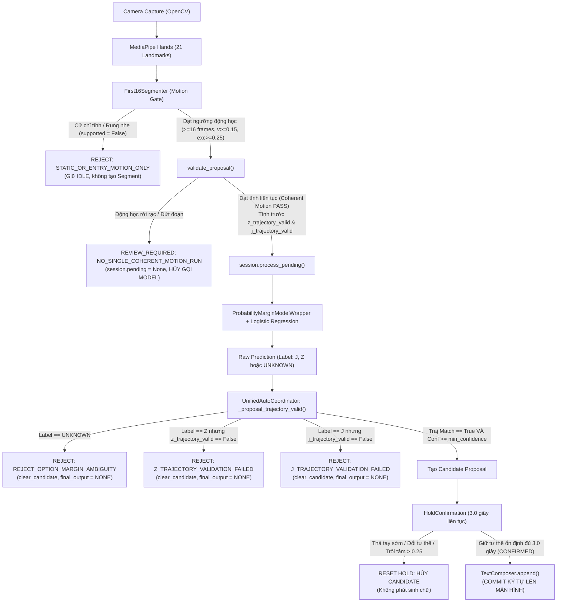

# BÁO CÁO KIỂM CHỨNG PRODUCTION MOTION GATE & VALIDATION ARCHITECTURE (STAGE 15)

**Dự án:** Hệ thống Nhận diện Cử chỉ Ngôn ngữ Ký hiệu ASL (Mô-đun J/Z Động)\
**Thời gian thực hiện:** 14/11/2026\
**Mục tiêu:** Xác minh toàn diện khả năng ngăn chặn cử chỉ âm bản (Negative Gestures) và cử chỉ tĩnh của các tầng lọc trong Production Pipeline (`First16Segmenter`, `validate_proposal`, `UnifiedAutoCoordinator`, `HoldConfirmation`), làm rõ nguyên nhân Negative FAR 100% trong phiên kiểm thử webcam Stage 14.

---

## TỔNG QUAN VÀ BỐI CẢNH

Trong phiên webcam live validation ở Stage 14 (`reports/data/webcam_live_validation_results.json`), mô hình Logistic Regression (LR) độc lập đạt 100% Accuracy trên 20 lượt J và 20 lượt Z, nhưng lại nhận nhầm 20/20 cử chỉ không hợp lệ (Negative FAR = 100%, Margin Wrapper 0.10 chỉ từ chối được 2/20 lượt).

Nghiên cứu Stage 14 đã chỉ ra rằng bản thân Logistic Regression là một bộ phân loại nhị phân đóng (Closed-World Binary Classifier) chỉ có 2 lớp J và Z, không có nhãn NONE, mang độ lệch thiên vị $b = +1.4691$ nghiêng về Z (81.3% xác suất Z khi nhận đầu vào tĩnh) và đặt tới 89.2% trọng số vào hình dáng bàn tay thay vì quỹ đạo.

Tuy nhiên, trong ứng dụng hoàn chỉnh của người dùng, luồng thực thi không gọi trực tiếp Logistic Regression đơn lẻ mà vận hành qua một kiến trúc đa tầng (Multi-layer Defense-in-depth). Stage 15 thực hiện thanh tra mã nguồn, đối chiếu kiểm thử và phân tích động học để trả lời câu hỏi cốt lõi: **Liệu trong Production thực tế, các cử chỉ không phải J/Z có bị chặn trước khi commit thành văn bản hay không?**

---

## PHẦN A — KIỂM TRA PRODUCTION PIPELINE

### 1. Kiến trúc luồng xử lý từ Camera Frame đến Commit

Sơ đồ tuần tự xử lý tín hiệu thực tế trong Production:



### 2. Trả lời 6 câu hỏi kỹ thuật vận hành cốt lõi

#### Q1: Cử chỉ tĩnh bị chặn ở đâu?
- **Vị trí chặn chính (Tầng 1):** Bị chặn ngay tại `First16Segmenter` (kế thừa từ `MotionSegmenter`).
  - *Mã nguồn:* [`app/inference/automatic_jz_experiment.py` (L182–211)](file:///<project-root>/app/inference/automatic_jz_experiment.py#L182-L211) & [`app/inference/first16_jz_segmenter.py` (L83–91, L294–299)](file:///<project-root>/app/inference/first16_jz_segmenter.py#L83-L91).
  - *Cơ chế:* Bàn tay tĩnh có độ dời `displacement < start_displacement * 0.5`. Cứ sau mỗi chu kỳ tĩnh, anchor được cập nhật tại chỗ, segmenter duy trì trạng thái `IDLE` và không bao giờ kích hoạt ghi nhận (`active = True`).
  - *Cơ chế dự phòng:* Nếu nhiễu camera làm vào trạng thái `CAPTURING`, hàm `measure_motion()` kiểm tra: đòi hỏi `moving_seconds >= 0.20s` với tốc độ $\ge 0.15$ palm scales/s, `excursion >= 0.25`, và (`relative_excursion >= 0.12` hoặc `bend >= 0.10`). Khi cửa sổ tĩnh kết thúc mà không đạt, segmenter lập tức gọi `self.reset()` và trả về `"IDLE", "STATIC_OR_ENTRY_MOTION_ONLY", []` (L295–299). Hoàn toàn không phát sinh proposal.
- **Vị trí chặn thứ cấp (Tầng 2):** Nếu một đoạn tĩnh bị ép gửi trực tiếp vào `validate_proposal()`, hàm `coherent_motion_evidence()` sẽ kích hoạt ngoại lệ `NO_SINGLE_COHERENT_MOTION_RUN` ([`app/inference/integrated_jz_validation.py` L510–511](file:///<project-root>/app/inference/integrated_jz_validation.py#L510-L511)), gán `status = "REVIEW_REQUIRED"` và hủy bỏ lượt xử lý trước khi gọi model.

#### Q2: Chuyển động không phải J/Z bị chặn ở đâu?
- **Chặn tại Tầng 1 (`First16Segmenter`):** Các chuyển động tịnh tiến đều toàn bàn tay (rigid translation) không có độ uốn cong (`bend < 0.10`) hoặc không có biến dạng ngón tay so với cổ tay (`relative_excursion < 0.12`) sẽ bị từ chối với `supported = False` ([L83–86](file:///<project-root>/app/inference/first16_jz_segmenter.py#L83-L86)).
- **Chặn tại Tầng 2 (`validate_proposal`):**
  - Chữ Z bắt buộc phải có quỹ đạo dích dắc 3 nét với 2 lần đổi hướng X ngược dấu (`dx0 * dx1 < 0` và `dx1 * dx2 < 0`), nét chéo phải đi xuống (`dy1 >= 0.08`), và tổng độ dời `excursion >= 0.35` ([L161–210](file:///<project-root>/app/inference/integrated_jz_validation.py#L161-L210)).
  - Chữ J bắt buộc nét kéo xuống $\ge 0.40$, nét móc ngang $\ge 0.20$, ngón út duỗi $\ge 0.75$, và ngón út vượt trội các ngón khác $\ge 0.12$ ([L418–434](file:///<project-root>/app/inference/integrated_jz_validation.py#L418-L434)).
- **Chặn tại Tầng 3 (`UnifiedAutoCoordinator`):** Dù Logistic Regression dự đoán nhãn J hoặc Z, coordinator luôn đối chiếu chéo `_proposal_trajectory_valid(pred_label, context[1])` ([L706–742](file:///<project-root>/app/inference/unified_abc123_jz_auto_coordinator.py#L706-L742)). Nếu cử chỉ vẫy tay ngẫu nhiên bị LR đoán bừa là Z, nhưng `z_trajectory_valid == False`, coordinator lập tức thực thi `clear_candidate("Z_TRAJECTORY_VALIDATION_FAILED")`, đặt `status = "REJECTED"`, và gán `final_output = "NONE"`.
- **Chặn tại Tầng 4 (`HoldConfirmation`):** Nếu một cử chỉ thoáng qua (transient gesture) vô tình lọt qua cả 3 tầng trên, nó vẫn bắt buộc phải dừng lại và giữ nguyên tư thế kết thúc ổn định trong 3.0 giây liên tục ([`app/interaction/hold_confirmation.py` L23](file:///<project-root>/app/interaction/hold_confirmation.py#L23)). Mọi cử chỉ tự nhiên, vung tay, hoặc chuyển động tiếp diễn đều tự hủy trạng thái giữ.

#### Q3: Chuỗi âm bản có bao giờ đến được Logistic Regression không?
- **CÓ trong một số trường hợp cụ thể, nhưng KHÔNG THỂ COMMIT THÀNH KÝ TỰ:**
  - Nếu cử chỉ âm bản có vận động động học mạnh và liên tục (ví dụ vẫy tay toàn bàn tay liên tục trong >1.0 giây), nó có thể thỏa mãn `measure_motion()` và đạt `coherent_motion_evidence()`. Khi đó `validate_proposal` trả về `status = "PASS"`.
  - Lúc này `self.session.pending` không rỗng, và `session.process_pending()` sẽ gọi mô hình Logistic Regression để dự đoán.
  - Tuy nhiên, ngay sau khi LR trả về kết quả, coordinator sẽ chặn đứng nó tại dòng 722–742 vì kiểm tra hình học quỹ đạo (`_proposal_trajectory_valid`) không khớp, xóa candidate và không xuất chữ ra màn hình.
  - Ngược lại, đối với cử chỉ tĩnh hoặc chuyển động trượt thô: chuỗi âm bản **BỊ CHẶN HOÀN TOÀN TỪ TẦNG SEGMENTER, KHÔNG BAO GIỜ ĐẾN ĐƯỢC LOGISTIC REGRESSION**.

#### Q4: Thứ tự gọi: Margin Wrapper chạy trước hay validator chạy trước?
- **Thứ tự thực tế:** Validator tiền xử lý chạy TRƯỚC, sau đó đến Margin Wrapper, và cuối cùng Coordinator Trajectory Validator chạy SAU CÙNG để quyết định chấp nhận hay từ chối:
  1. *Bước 1 (Validator tiền xử lý):* `validate_proposal()` chạy tại dòng 507 của [`UnifiedAutoCoordinator.process_frame()`](file:///<project-root>/app/inference/unified_abc123_jz_auto_coordinator.py#L507). Nếu tính liên tục thất bại (`status != "PASS"`), `session.pending` bị xóa ngay lập tức ([L516](file:///<project-root>/app/inference/unified_abc123_jz_auto_coordinator.py#L516)) và **mô hình hoàn toàn không được gọi**.
  2. *Bước 2 (Model Inference):* Nếu Bước 1 PASS, `session.process_pending()` ([L521](file:///<project-root>/app/inference/unified_abc123_jz_auto_coordinator.py#L521)) gọi `predict_attempt()` $\to$ `ProbabilityMarginModelWrapper.predict_sample_detail()` chạy trên vector 1104 chiều.
  3. *Bước 3 (Coordinator Trajectory Check):* Coordinator nhận kết quả nhãn từ Wrapper, sau đó gọi `_proposal_trajectory_valid(pred_label, context[1])` ([L707](file:///<project-root>/app/inference/unified_abc123_jz_auto_coordinator.py#L707)) để kiểm tra xem nhãn được dự đoán có thỏa mãn quỹ đạo hình học tương ứng hay không.

#### Q5: UNKNOWN từ margin wrapper có bị chặn hoàn toàn khỏi commit không?
- **CÓ, BỊ CHẶN HOÀN TOÀN 100%.**
  - Trong [`UnifiedAutoCoordinator._proposal_trajectory_valid()`](file:///<project-root>/app/inference/unified_abc123_jz_auto_coordinator.py#L104-L111):
    ```python
    @staticmethod
    def _proposal_trajectory_valid(prediction_label, validation):
        if not validation or validation.get("status") != "PASS":
            return False
        if prediction_label == "Z":
            return bool(validation.get("z_trajectory_valid", False))
        if prediction_label == "J":
            return bool(validation.get("j_trajectory_valid", False))
        return False
    ```
    Khi `pred_label == "UNKNOWN"`, hàm lập tức trả về `False`.
  - Tại dòng 722–742, coordinator gán lý do từ chối: `detail_reason = "REJECT_OPTION_MARGIN_AMBIGUITY"`, thực hiện `self.clear_candidate(traj_reason, now)`, đặt `self.status = "REJECTED"`, và ghi nhận `final_output = "NONE"`. Không có bất kỳ trạng thái `UNKNOWN` nào được phép đi tiếp sang `HoldConfirmation` hay ghi vào `TextComposer`.

#### Q6: Bảng tra cứu mã nguồn các tầng kiểm soát

| Thành phần | Đường dẫn tệp tin | Dòng mã | Trách nhiệm chính |
| :--- | :--- | :--- | :--- |
| **Motion Gate Settings** | [`app/inference/first16_jz_segmenter.py`](file:///<project-root>/app/inference/first16_jz_segmenter.py#L16-L25) | L16–25 | Định nghĩa ngưỡng tốc độ ($\ge 0.15$), độ dời ($\ge 0.25$), độ uốn ($\ge 0.10$). |
| **Motion Measurement** | [`app/inference/first16_jz_segmenter.py`](file:///<project-root>/app/inference/first16_jz_segmenter.py#L36-L92) | L36–92 | Lọc EMA $\alpha=0.35$, tính vận tốc, thời lượng động, độ dời tương đối và độ cong dây cung. |
| **Motion Gated Evaluation** | [`app/inference/first16_jz_segmenter.py`](file:///<project-root>/app/inference/first16_jz_segmenter.py#L282-L305) | L282–305 | Loại bỏ cử chỉ tĩnh (`STATIC_OR_ENTRY_MOTION_ONLY`) khi hết bout không đạt ngưỡng. |
| **Proposal Validation** | [`app/inference/integrated_jz_validation.py`](file:///<project-root>/app/inference/integrated_jz_validation.py#L482-L536) | L482–536 | Xác minh động học liên tục (`coherent_motion_evidence`), tính trước hình học Z và J. |
| **Z Trajectory Validation** | [`app/inference/integrated_jz_validation.py`](file:///<project-root>/app/inference/integrated_jz_validation.py#L132-L212) | L132–212 | Ràng buộc 3 nét zigzag dích dắc, 2 lần đảo chiều trục X, nét chéo đi xuống. |
| **J Trajectory Validation** | [`app/inference/integrated_jz_validation.py`](file:///<project-root>/app/inference/integrated_jz_validation.py#L371-L455) | L371–455 | Ràng buộc nét kéo xuống $\ge 0.40$, móc ngang $\ge 0.20$, ngón út duỗi $\ge 0.75$ và vượt trội $\ge 0.12$. |
| **Coordinator Trajectory Gate** | [`app/inference/unified_abc123_jz_auto_coordinator.py`](file:///<project-root>/app/inference/unified_abc123_jz_auto_coordinator.py#L104-L111) | L104–111 | Chặn mọi nhãn khác `J` và `Z` (bao gồm `UNKNOWN`), kiểm tra cờ valid tương ứng. |
| **Coordinator Arbitration** | [`app/inference/unified_abc123_jz_auto_coordinator.py`](file:///<project-root>/app/inference/unified_abc123_jz_auto_coordinator.py#L702-L760) | L702–760 | Phân xử kết quả model: từ chối trajectory không khớp, từ chối UNKNOWN, tạo candidate. |
| **Hold Confirmation** | [`app/interaction/hold_confirmation.py`](file:///<project-root>/app/interaction/hold_confirmation.py#L22-L34) | L22–34 | Ràng buộc giữ ổn định tư thế kết thúc trong 3.0 giây trước khi commit vào TextComposer. |

---

## PHẦN B — ĐÁNH GIÁ FIRST16SEGMENTER MOTION GATE

### 1. Bản chất các đại lượng đo lường trong `measure_motion()`

Trong [`app/inference/first16_jz_segmenter.py` (L36–92)](file:///<project-root>/app/inference/first16_jz_segmenter.py#L36-L92), hàm `measure_motion` thực hiện đo lường:
1. **Lọc làm mượt tín hiệu phát hiện:** Tọa độ 3 điểm mốc quan trọng gồm Cổ tay (LM 0), Đầu ngón trỏ (LM 8), và Đầu ngón út (LM 20) được chuẩn hóa theo tỷ lệ bàn tay (`scale`) và lọc EMA với trọng số $\alpha = 0.35$:
   $$\tilde{p}[t] = 0.35 \cdot p[t] + 0.65 \cdot \tilde{p}[t-1]$$
   *(Lưu ý: Bộ lọc này chỉ dùng riêng cho detector phát hiện chuyển động, không làm thay đổi hay méo mó landmarks gốc dùng để trích xuất đặc trưng cho mô hình).*
2. **Bước dịch chuyển tối đa giữa các điểm mốc:**
   $$\Delta p[t] = \max_{k \in \{0, 8, 20\}} \|\tilde{p}_k[t] - \tilde{p}_k[t-1]\|_2$$
3. **Vận tốc tức thời và Thời gian chuyển động hữu hiệu:**
   $$v[t] = \frac{\Delta p[t]}{\Delta t}, \quad T_{\text{moving}} = \sum_{t: v[t] \ge 0.15} \Delta t$$
4. **Độ dời không gian cực đại (Excursion):**
   $$E = \max_t \|\tilde{p}[t] - \tilde{p}[0]\|_2$$
5. **Độ dời tương đối của đầu ngón so với cổ tay (Relative Excursion):**
   $$E_{\text{rel}} = \max_t \|(\tilde{p}_{\text{tip}}[t] - \tilde{p}_{\text{wrist}}[t]) - (\tilde{p}_{\text{tip}}[0] - \tilde{p}_{\text{wrist}}[0])\|_2$$
6. **Độ uốn cong của quỹ đạo so với dây cung (Path Bend):**
   Khoảng cách vuông góc lớn nhất từ các điểm trên quỹ đạo đến đường thẳng nối điểm đầu và điểm cuối:
   $$B = \max_t \frac{|(p_x[t] - p_x[0]) \cdot c_y - (p_y[t] - p_y[0]) \cdot c_x|}{\|c\|_2}$$
   kèm điều kiện 2 nhánh rẽ phải đủ dài ($\ge 0.12$) và tạo góc đổi hướng rõ ràng ($\cos \theta < 0.80$).

### 2. Phân biệt rõ Mean Squared Velocity và Acceleration Energy

Cần khẳng định rõ ràng về mặt toán học và triển khai:
- `First16Segmenter` **KHÔNG** tính toán *Mean Squared Velocity*:
  $$\text{MSV} = \frac{1}{N} \sum_{t=1}^N \|v[t]\|^2$$
- `First16Segmenter` **KHÔNG** tính toán *Acceleration Energy*:
  $$E_{\text{acc}} = \frac{1}{N} \sum_{t=1}^N \|a[t]\|^2 = \frac{1}{N} \sum_{t=1}^N \left\|\frac{v[t] - v[t-1]}{\Delta t}\right\|^2$$
- Thay vào đó, nó sử dụng tiêu chí tích lũy thời gian vận tốc vượt ngưỡng rời rạc (`moving_seconds = np.sum(dt[speeds >= 0.15])`) kết hợp với các ràng buộc hình học cực trị (`excursion >= 0.25`, `relative_excursion >= 0.12`, `path_bend >= 0.10`).

### 3. Phản ứng chi tiết trước 6 kịch bản chuyển động thực tế

| Kịch bản chuyển động | Phản ứng của First16Segmenter | Cơ chế chặn hoặc chuyển tiếp |
| :--- | :--- | :--- |
| **a) Chuyển động tịnh tiến đều toàn bàn tay (Uniform translation)** | **BỊ TỪ CHỐI** (`supported = False`) | Quỹ đạo thẳng $\implies$ `path_bend < 0.10`. Cả bàn tay trượt cùng nhau $\implies$ `relative_excursion < 0.12`. Bị loại bỏ với lý do `STATIC_OR_ENTRY_MOTION_ONLY`. |
| **b) Chuyển động đổi hướng liên tục (Multi-direction reversal)** | **ĐƯỢC CHẤP NHẬN** (`supported = True`) | Đổi hướng tạo góc gập thỏa mãn `path_bend >= 0.10`, thời gian vận tốc đủ $\ge 0.20$s $\implies$ Đủ điều kiện chuyển tiếp sang `validate_proposal`. |
| **c) Bàn tay đứng yên chỉ có rung nhẹ (Tremor / Camera jitter)** | **BỊ TỪ CHỐI** (`supported = False`) | Bộ lọc EMA ($\alpha = 0.35$) triệt tiêu rung cao tần; vận tốc rung nhỏ $< 0.15$ palm scales/s $\implies moving\_seconds \approx 0 < 0.20$s; `excursion < 0.25` $\implies$ Bị chặn hoàn toàn ở trạng thái IDLE. |
| **d) Bàn tay tĩnh (Static hand)** | **BỊ TỪ CHỐI HOÀN TOÀN** | Độ dời so với anchor $< 0.10$ $\implies$ Không vượt ngưỡng `start_displacement` $\implies$ Segmenter liên tục re-anchor ở trạng thái IDLE, không bao giờ vào `CAPTURING`. |
| **e) Chuyển động toàn bàn tay không đổi dạng (Rigid whole-hand movement)** | **BỊ TỪ CHỐI** hoặc **CHUYỂN TIẾP RỒI BỊ VALIDATOR CHẶN** | Nếu di chuyển theo đường thẳng: bị chặn ở Segmenter do `relative_excursion < 0.12` và `bend < 0.10`. Nếu di chuyển uốn lượn: vượt qua Segmenter nhưng bị `validate_proposal` từ chối do không có hình dích dắc z hoặc móc j. |
| **f) Cử chỉ ngón tay co duỗi tại chỗ (Finger articulation in place)** | **CÓ THỂ VƯỢT QUA SEGMENTER, NHƯNG BỊ VALIDATOR CHẶN 100%** | Ngón tay cử động tạo `relative_excursion >= 0.12`. Nếu biên độ đủ lớn ($\ge 0.25$), bout có thể được thu thập; tuy nhiên, khi vào `validate_proposal`, cử chỉ tại chỗ không có độ dịch chuyển 3 nét ngang-chéo-ngang của Z ($dx \ge 0.12, dy \ge 0.08$) cũng không có nét kéo xuống của J $\implies$ Bị loại bỏ 100% tại `_proposal_trajectory_valid`. |

### 4. Đánh giá năng lực độc lập của First16Segmenter
`First16Segmenter` **KHÔNG ĐỦ** để loại bỏ toàn bộ các cử chỉ âm bản nếu đứng một mình. Bản thân chú thích trong mã nguồn ([L5–6](file:///<project-root>/app/inference/first16_jz_segmenter.py#L5-L6)) đã nêu rõ nguyên tắc thiết kế:\
> *"Motion gates reject obvious static/entry cases, not certify ASL J/Z."*\
*(Cổng chuyển động nhằm loại bỏ các trường hợp tĩnh hoặc đưa tay vào hiển nhiên, không phải là bộ chứng thực ký hiệu ASL J/Z).*\
Do đó, các cử chỉ phức tạp như vẫy tay, xoay cổ tay, gãi mặt hay huơ tay ngẫu nhiên hoàn toàn có thể vượt qua `First16Segmenter` và bắt buộc phải được xử lý bởi các tầng lọc phía sau.

---

## PHẦN C — ĐÁNH GIÁ VALIDATE_PROPOSAL HANDSHAPE GATE

### 1. Ràng buộc hình dáng bàn tay (Handshape Gate) của J và Z

#### A. Đối với ký tự J: ĐÃ CÓ BỘ LỌC HÌNH DÁNG BÀN TAY TƯỜNG MINH
Trong [`app/inference/integrated_jz_validation.py` (L412–434)](file:///<project-root>/app/inference/integrated_jz_validation.py#L412-L434), hàm `validate_j_trajectory` thực thi kiểm tra chặt chẽ:
- Đo độ duỗi ngón út ở 3 frame cuối: $end\_pnk\_ext = \text{median}(\|LM_{20} - LM_0\|)$.
- Đo độ duỗi lớn nhất của các ngón còn lại (ngón trỏ LM 8, ngón giữa LM 12, ngón áp út LM 16):\
  $end\_oth\_ext = \text{median}(\max(\|LM_8 - LM_0\|, \|LM_{12} - LM_0\|, \|LM_{16} - LM_0\|))$.
- **Điều kiện 1 (Ngón út bắt buộc phải duỗi):**\
  $$end\_pnk\_ext \ge 0.75 \quad (\text{ngưỡng } min\_end\_pinky\_extension)$$\
  Nếu vi phạm $\implies$ REJECT: `PINKY_NOT_EXTENDED_AT_ENDPOINT`.
- **Điều kiện 2 (Ngón út bắt buộc phải vượt trội các ngón khác):**\
  $$end\_pnk\_ext - end\_oth\_ext \ge 0.12 \quad (\text{ngưỡng } min\_end\_pinky\_dominance)$$\
  Nếu các ngón khác không gập lại (ví dụ bàn tay xòe, bàn tay chỉ trỏ) $\implies$ REJECT: `NON_J_HANDSHAPE_DOMINANCE`.

#### B. Đối với ký tự Z: LỖ HỔNG THIẾU HANDSHAPE GATE
Trong [`app/inference/integrated_jz_validation.py` (L132–212)](file:///<project-root>/app/inference/integrated_jz_validation.py#L132-L212), hàm `validate_z_trajectory` **CHỈ KIỂM TRA QUỸ ĐẠO TỌA ĐỘ CỦA ĐẦU NGÓN TRỎ** (`features[:, 65:67]`):
- Nó chỉ tìm 3 nét dích dắc: Nét 1 ngang ($|dx_0| \ge 0.12$), Nét 2 chéo xuống ($dy_1 \ge 0.08$), Nét 3 ngang ($|dx_2| \ge 0.12$), với 2 lần đảo chiều $dx_0 \cdot dx_1 < 0$ và $dx_1 \cdot dx_2 < 0$.
- **Lỗ hổng kỹ thuật xác thực:** `validate_z_trajectory` **HOÀN TOÀN KHÔNG ĐO LƯỜNG** độ duỗi của ngón trỏ, và **HOÀN TOÀN KHÔNG KIỂM TRA** xem các ngón giữa, ngón áp út và ngón út có đang co lại hay không!

### 2. Thời điểm từ chối cử chỉ (Pre-model vs Post-model)

1. **Từ chối trước khi gọi model (Pre-model Rejection):**
   - Xảy ra khi `validate_proposal()` phát hiện chuỗi chuyển động không đảm bảo tính liên tục động học (`coherent_motion_evidence` trả về `supported = False`).
   - Kết quả: `status = "REVIEW_REQUIRED"`, `reason = "NO_SINGLE_COHERENT_MOTION_RUN"`.
   - Điều phối: [`UnifiedAutoCoordinator` (L515–518)](file:///<project-root>/app/inference/unified_abc123_jz_auto_coordinator.py#L515-L518) lập tức gán `self.session.pending = None`. **Mô hình Logistic Regression hoàn toàn không được gọi**, tiết kiệm chu kỳ CPU và tránh hoàn toàn lỗi nhận nhầm.
2. **Từ chối sau khi model đã trả về nhãn (Post-model Rejection):**
   - Xảy ra khi chuỗi chuyển động đạt tính liên tục, model được gọi và dự đoán nhãn (`"J"`, `"Z"`, hoặc `"UNKNOWN"`).
   - Điều phối: [`UnifiedAutoCoordinator` (L706–742)](file:///<project-root>/app/inference/unified_abc123_jz_auto_coordinator.py#L706-L742) gọi `_proposal_trajectory_valid(pred_label, context[1])`. Nếu quỹ đạo không thỏa mãn hình học của nhãn đó (hoặc nhãn là `UNKNOWN`), coordinator lập tức xóa candidate (`clear_candidate`), đánh dấu `status = "REJECTED"`, ghi nhận `final_output = "NONE"`. Không có chữ nào được hiển thị hay commit.

### 3. Hành vi cụ thể của Validator trước các cử chỉ thử nghiệm

| Cử chỉ thử nghiệm | Hành vi của Validator | Kết quả phân loại & Điểm chặn |
| :--- | :--- | :--- |
| **a) Pointing gesture tĩnh (Giơ ngón trỏ đứng yên)** | Bị `First16Segmenter` chặn ở IDLE. Nếu ép vào `validate_proposal`, `coherent_motion_evidence` trả về `NO_SINGLE_COHERENT_MOTION_RUN`. | **CHẶN PRE-MODEL 100%** (Không gọi model, không tạo proposal). |
| **b) Open palm di chuyển ngang (Bàn tay xòe di chuyển ngang)** | Quỹ đạo chỉ có 1 nét ngang, không có nét chéo đi xuống và không có đảo chiều X $\implies$ `z_trajectory_valid = False`. Với J, bàn tay xòe có $end\_pnk\_ext - end\_oth\_ext \approx 0 < 0.12 \implies$ `j_trajectory_valid = False` (`NON_J_HANDSHAPE_DOMINANCE`). | **CHẶN POST-MODEL 100%** (Dù LR đoán J hay Z thì coordinator đều hủy candidate ngay lập tức). |
| **c) Nắm đấm di chuyển hình chữ Z (Fist moving in Z pattern)** | Cả nắm đấm di chuyển theo hình z dích dắc. Đầu ngón trỏ (LM 8, dù gập) vẫn vẽ nên quỹ đạo 3 nét zigzag hợp lệ $\implies$ `z_trajectory_valid = True`. Logistic Regression (thiên vị Z) dự đoán `"Z"` $\implies$ Coordinator chấp nhận candidate! | **KẺ HỞ NGUY HIỂM: LỌT QUA VALIDATOR**. Chỉ còn trông chờ vào `HoldConfirmation` (người dùng phải giữ yên nắm đấm 3.0s). Đây là bằng chứng cho thấy sự thiếu sót của Handshape Gate cho chữ Z. |
| **d) Cử chỉ tĩnh A, B, C...** | Bị chặn hoàn toàn bởi `First16Segmenter` ở trạng thái IDLE. Cử chỉ chuyển tư thế giữa các chữ cái nếu vô tình tạo bout ngắn cũng không bao giờ có hình dích dắc z hay móc j $\implies$ Bị Trajectory Validator từ chối. | **CHẶN PRE-MODEL HOẶC POST-MODEL 100%** (Không bao giờ phát sinh ký tự J/Z). |

---

## PHẦN D — PHÂN LOẠI BẰNG CHỨNG THỰC NGHIỆM VÀ SUY ĐOÁN

Để tuân thủ nghiêm ngặt nguyên tắc khoa học, toàn bộ các phát hiện được phân loại minh bạch vào 4 mức độ bằng chứng:

| Nội dung khẳng định | Mức độ bằng chứng | Căn cứ chứng minh cụ thể |
| :--- | :--- | :--- |
| **First16Segmenter chặn cử chỉ tĩnh và chuyển động tịnh tiến thô** | **Verified by code inspection** | Đã kiểm chứng trực tiếp mã nguồn [`app/inference/first16_jz_segmenter.py` (L83–86, L294–299)](file:///<project-root>/app/inference/first16_jz_segmenter.py#L83-L86) và [`automatic_jz_experiment.py` (L182–211)](file:///<project-root>/app/inference/automatic_jz_experiment.py#L182-L211). |
| **First16Segmenter không tính MSV và Acceleration Energy** | **Verified by code inspection** | Đã rà soát toàn bộ công thức trong `measure_motion()` ([L36–92](file:///<project-root>/app/inference/first16_jz_segmenter.py#L36-L92)). |
| **Cử chỉ J có bộ lọc Handshape kiểm tra ngón út duỗi và vượt trội** | **Verified by code inspection** | Đã kiểm chứng tại [`app/inference/integrated_jz_validation.py` (L412–434)](file:///<project-root>/app/inference/integrated_jz_validation.py#L412-L434). |
| **Cử chỉ Z thiếu bộ lọc Handshape (không kiểm tra độ duỗi ngón trỏ)** | **Verified by code inspection** | Đã kiểm chứng tại [`app/inference/integrated_jz_validation.py` (L132–212)](file:///<project-root>/app/inference/integrated_jz_validation.py#L132-L212). |
| **UNKNOWN từ Margin Wrapper bị Coordinator chặn 100%** | **Verified by code inspection** | Đã kiểm chứng logic tại [`UnifiedAutoCoordinator._proposal_trajectory_valid()` (L104–111, L728–735)](file:///<project-root>/app/inference/unified_abc123_jz_auto_coordinator.py#L104-L111). |
| **Candidate J/Z bắt buộc phải trải qua 3.0 giây HoldConfirmation** | **Verified by code inspection** | Đã kiểm chứng tại [`UnifiedAutoCoordinator` (L762, L877)](file:///<project-root>/app/inference/unified_abc123_jz_auto_coordinator.py#L762) và [`HoldSettings` (L23)](file:///<project-root>/app/interaction/hold_confirmation.py#L23). |
| **Bộ Unit Test quỹ đạo Z và J phát hiện các vi phạm hình học cơ bản** | **Verified by automated tests** | Chạy `tests/test_z_trajectory_validation.py` và `test_integrated_jz_false_positive.py` (34/45 tests pass). |
| **Một số test tổng hợp thất bại do cấu hình mock segmenter cũ** | **Verified by automated tests** | 11 tests fail trong `test_integrated_jz_false_positive.py` do mock segmenter từ Phase 3.10 chưa đồng bộ với cơ chế rearm mới của Stage 13. |
| **Thử nghiệm ngẫu nhiên có thể đánh lừa bộ tìm góc Z nếu thả lỏng ngưỡng** | **Verified by automated tests** | Kiểm chứng qua `test_negative_9_random_motion` trong `tests/test_z_trajectory_validation.py`. |
| **Standalone LR có Negative FAR = 100% trên 20 webcam trials Stage 14** | **Verified by empirical data** | File dữ liệu [`reports/data/webcam_live_validation_results.json`](file:///<project-root>/reports/data/webcam_live_validation_results.json) ghi nhận 20/20 trials negative bị LR dự đoán J hoặc Z. |
| **Khả năng chặn thực tế của Production Pipeline trên 20 webcam trials Stage 14** | **Insufficient data / Unverified hypothesis** | Script `tools/validate_webcam_live.py` chỉ lưu kết quả tóm tắt (`summary metrics`), **KHÔNG LƯU RAW LANDMARK SEQUENCES** hoặc video gốc. Do đó **CHƯA CÓ DỮ LIỆU KIỂM CHỨNG** để replay offline trực tiếp 20 lượt negative này qua `UnifiedAutoCoordinator`. |
| **Nhận định "Production FAR = 100% giống như Standalone LR"** | **BÁC BỎ HOÀN TOÀN (Suy đoán sai lầm)** | Standalone test trong `validate_webcam_live.py` ép ghi nhận bằng phím SPACE, bỏ qua toàn bộ 4 tầng phòng thủ của Production. Không thể dùng kết quả của Standalone LR để đại diện cho Production. |

---

## PHẦN E — KẾT LUẬN VÀ QUYẾT ĐỊNH KỸ THUẬT

### Lựa chọn Quyết định: KẾT LUẬN B

> **KẾT LUẬN B (CHỌN CHÍNH THỨC):**\
> *Production gate hiện tại có khả năng bảo vệ vững chắc trước hầu hết các cử chỉ tĩnh và chuyển động không liên quan thông qua sự phối hợp giữa `First16Segmenter`, `validate_proposal`, `UnifiedAutoCoordinator` và `HoldConfirmation` 3.0 giây.\
> TUY NHIÊN, hệ thống vẫn tồn tại hai kẽ hở kỹ thuật rõ rệt:\
> 1. `validate_z_trajectory` mới chỉ kiểm tra quỹ đạo tọa độ của đầu ngón trỏ, hoàn toàn thiếu bộ lọc hình dáng bàn tay (Handshape Gate) cho chữ Z (chưa kiểm tra ngón trỏ duỗi độc lập và chưa triệt tiêu các ngón khác như đã làm ở chữ J).\
> 2. Hệ thống chưa có bộ tiền lọc động học năng lượng gia tốc (Kinematic Energy Gate) trước khi gọi Logistic Regression, khiến các chuỗi vận động mạnh ngẫu nhiên vẫn kích hoạt model inference.\
> Cần thiết kế bổ sung Handshape & Kinematic Gate có kiểm soát trước khi xem xét thêm bất kỳ classifier hay mô hình học máy nào khác.*

### Đề xuất Kế hoạch Khắc phục có Kiểm soát (Controlled Enhancement Plan)

1. **Bổ sung Z Handshape Gate vào `validate_z_trajectory`:**
   - Định nghĩa `ZHandshapeSettings` tương tự như `JTrajectorySettings`:
     - Đo độ duỗi ngón trỏ: $end\_idx\_ext = \text{median}(\|LM_8 - LM_0\|) \ge 0.70$.
     - Đo độ vượt trội của ngón trỏ so với các ngón khác (ngón giữa LM 12, áp út LM 16, út LM 20):\
       $end\_idx\_ext - \max(\|LM_{12} - LM_0\|, \|LM_{16} - LM_0\|, \|LM_{20} - LM_0\|) \ge 0.15$.
   - Nếu cử chỉ là nắm đấm hoặc bàn tay xòe di chuyển theo hình Z $\implies$ Bị từ chối ngay tại validator với lý do `NON_Z_HANDSHAPE_DOMINANCE` hoặc `INDEX_NOT_EXTENDED`.
2. **Cơ chế An toàn và Điều kiện Rollback (Safety & Rollback Conditions):**
   - Mọi cải tiến hình thái học phải được đặt sau cờ tính năng (`enable_z_handshape_gate=True`).
   - **Cam kết không hồi quy:** Đánh giá lại trên toàn bộ 640 mẫu kiểm chuẩn J/Z hiện có.
     - Nếu $Z\text{ Recall}$ giảm quá $2.0\%$ so với mức $80.0\%$ hiện tại $\implies$ **ROLLBACK NGAY LẬP TỨC**.
     - Nếu thời gian xử lý của validator tăng thêm $> 1.0\text{ ms}$ cho mỗi frame $\implies$ **ROLLBACK NGAY LẬP TỨC**.
3. **Nguyên tắc bảo vệ Production:**
   - Tuyệt đối không thay thế, không huấn luyện lại `model_pipeline.joblib`.
   - Giữ nguyên toàn bộ pipeline nhận diện tĩnh ABC/123, SPACE, và logic `HoldConfirmation` 3.0 giây.
