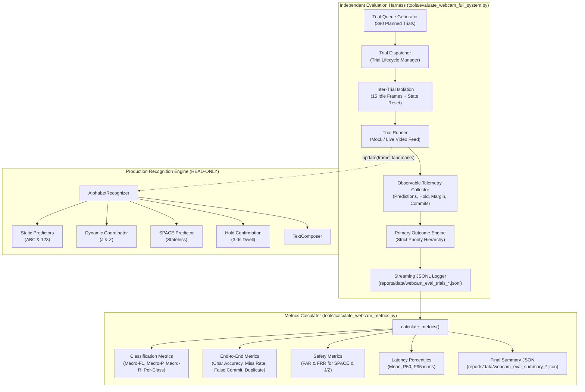
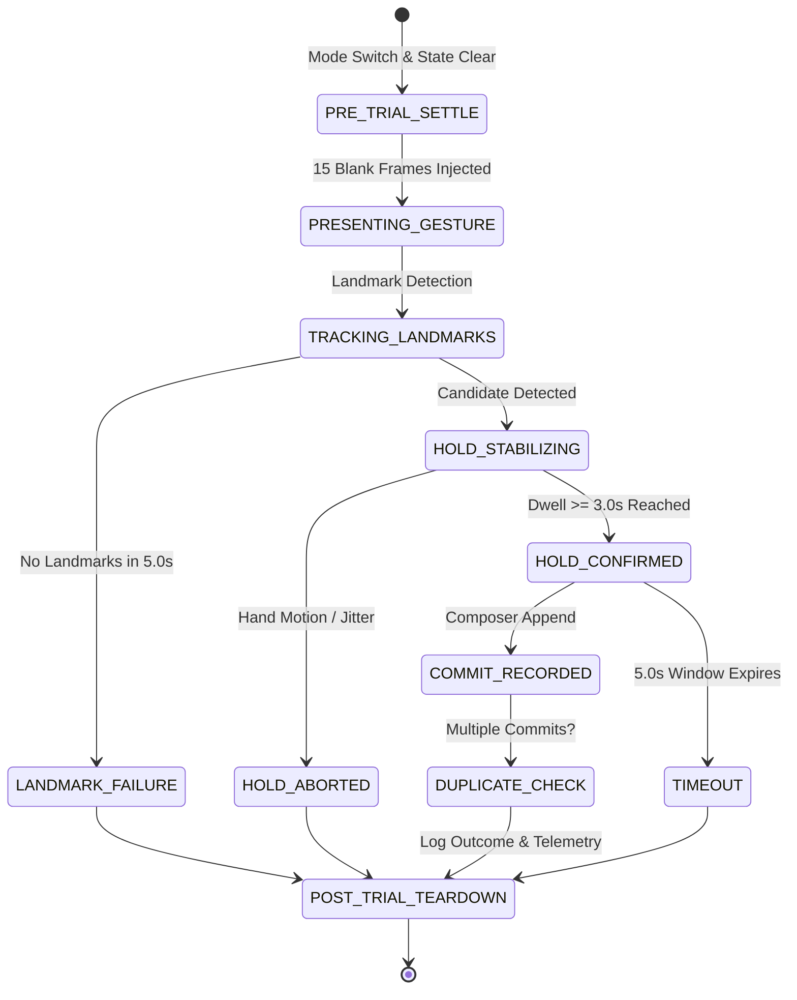

# TECHNICAL REPORT: PHASE 1 INDEPENDENT WEBCAM EVALUATION HARNESS

**Workspace**: `D:\NhanDienCuChi`  
**Phase**: Phase 1 – Architecture Audit, Independent Harness, Metrics Calculator & Mock Verification  
**Date**: November 16, 2026  
**Status**: COMPLETED (Read-Only Safety Invariant Preserved)

---

## 1. PRODUCTION APIS INSPECTED & ARCHITECTURAL INVENTORY

To design an evaluation harness without modifying production code, an exhaustive audit across the system's nine architectural layers was conducted:

| Layer | Production Component & File Path | Inspected API / Signatures | Observability Status | Side Effect & Mutation Risks |
| :--- | :--- | :--- | :--- | :--- |
| **L1** | `AlphabetRecognizer` `src/recognition/alphabet.py` | `update(frame_idx, landmark_list_norm, hand_obj, frame_shape, timestamp, raw_hand_count)` `switch_mode(mode: str)` | **Observable via Return Values** Returns `(Prediction, Optional[str])`. | Mutates internal frame counts, hold state, and composer text if commit occurs. Isolation requires explicit reset between trials. |
| **L2** | `UnifiedAutoCoordinator` `app/inference/unified_auto_coordinator.py` | `process_frame(landmarks, mirrored, original_bgr, t, raw_hand_count)` | **Observable via Return Values** Returns `PredictionResult`. | Modifies dynamic J/Z tracking, idle timers, and mode state. Must be accessed via top-level coordinator. |
| **L3** | `RecognitionCoordinator` `app/inference/coordinator.py` | `process_hand(mirrored, original, t, raw_hand_count)` | **Observable via Return Values** | Updates active mode and internal timestamp. Safe to observe return tuple. |
| **L4** | Static ASL / 123 Predictors `app/inference/letter_inference.py` | `predict_landmarks(landmarks)` `predict_hand(hand)` | **Read-Only / Pure Inference** | **None**. Prediction is purely mathematical feature extraction and model inference. |
| **L5** | Dynamic J/Z Subsystem `app/inference/dynamic_coordinator.py` `src/recognition/dynamic_jz.py` | `process_frame(...)` `reset()` | **Stateful** | Tracks trajectory points in sliding buffer. Requires `reset()` between dynamic trials. |
| **L6** | SPACE Gesture Predictor `src/recognition/space_gesture.py` | `predict_hand(hand, mode="ABC")` | **Stateless Read-Only** | Returns `(prob, is_space)`. Does not mutate state; `reset()` is a safe no-op. Continuous probability probeable externally. |
| **L7** | Hold Confirmation `app/inference/hold_confirmation.py` | `update(candidate, confidence, timestamp)` `force_confirm(text)` `reset()` | **Observable via Properties** `.state`, `.progress`, `.candidate`, `.text` | Mutates dwell counters, progress, and fires commitment. Must be cleared via `.reset()` or `.text = ""` between trials. |
| **L8** | TextComposer `app/text/text_composer.py` | `commit_character(char)` `clear()` `get_text()` | **Observable via Properties** `.current_text`, `.history` | Appends characters to output string buffer. Must be cleared between trials using `.clear()`. |
| **L9** | Event Dispatcher / Callback Sink `src/recognition/alphabet.py` | `event_sink: Optional[Callable[[Dict], None]]` | **Injectable at Construction** | Zero production impact. Built-in constructor hook allows external event tap without code modification. |

---

## 2. OBSERVED DATA STATES & SAFE ACCESS CONTRACTS

The following internal states can be safely read from external evaluation tools without altering runtime behavior:

1. **Prediction Tuple (`Prediction`)**:
   - `instant_label` (str): Raw single-frame top-1 predicted class.
   - `instant_confidence` (float): Softmax or SVM calibrated probability of top-1 class.
   - `stable_label` (str): Label filtered by temporal moving window.
   - `stable_confidence` (float): Confidence after temporal smoothing.
   - `features` (tuple[float, 63]): 21 landmarks normalized in 2D hand-centric coordinates.
   - `probabilities` (tuple[float, ...]): Full class distribution vector.

2. **Hold Confirmation State (`HoldConfirmation`)**:
   - `state` (str): Dwell state machine phase (`IDLE`, `STABILIZING`, `HOLDING`, `CONFIRMED`).
   - `progress` (float): Progress toward confirmation dwell interval [0.0, 1.0].
   - `candidate` (str): Current active candidate character being held.
   - `elapsed_hold_time` (float): Seconds accumulated in active holding.

3. **Validation & Trajectory Telemetry (`AlphabetRecognizer.validation`)**:
   - Trajectory validator acceptance/rejection status.
   - Decision margin ($\text{top}_1 - \text{top}_2$) threshold check ($\ge 0.10$).

4. **SPACE Confidence & Trigger Status**:
   - Direct output from `coordinator.static.space_predictor.predict_hand()` returning `(space_prob, is_space_active)` allowing external ROC/threshold evaluation.

---

## 3. APIS WITH MUTATING SIDE EFFECTS & ISOLATION PROTOCOLS

To prevent cross-trial contamination during evaluation, the harness enforces strict boundary isolation:

| Mutating Component | Side Effect Description | Potential Failure Mode | Required Harness Isolation Protocol |
| :--- | :--- | :--- | :--- |
| `HoldConfirmation.update` | Transitions state from `IDLE` $\rightarrow$ `HOLDING` $\rightarrow$ `CONFIRMED` and sets `.text`. | Stale hold state triggers immediate premature commit on subsequent trial. | Harness calls `coordinator.hold.reset()` and sets `coordinator.hold.text = ""` before each trial. |
| `DynamicJZCoordinator` | Appends landmark positions into continuous trajectory history buffer. | Residual motion from trial $N-1$ corrupts trajectory recognition of trial $N$. | Harness invokes `coordinator.dynamic_jz.reset()` and injects 15 empty settling frames (`raw_hand_count=0`) between trials. |
| `TextComposer` | Appends committed characters to word/sentence buffer. | Accumulated characters skew duplicate detection and character accuracy counting. | Harness clears buffer via `coordinator.composer.clear()` before trial initialization. |
| Mode Selector | Switches between `'ABC'` and `'123'`. | Running digit trial in letter mode or vice-versa produces 100% false classification. | Harness explicitly checks `coordinator.mode` and invokes `coordinator.switch_mode(target_mode)` before trial dispatch. |

---

## 4. EVALUATION HARNESS ARCHITECTURE

### Trial Lifecycle State Machine

---

## 5. METRIC DEFINITIONS AND MATHEMATICAL FORMULAS

### 1. Classification Metrics
- **Per-Class Precision, Recall, and F1**:
  $$\text{Precision}_c = \frac{TP_c}{TP_c + FP_c}, \quad \text{Recall}_c = \frac{TP_c}{TP_c + FN_c}, \quad F1_c = \frac{2 \cdot \text{Precision}_c \cdot \text{Recall}_c}{\text{Precision}_c + \text{Recall}_c}$$
- **Macro-F1 (Strict Arithmetic Mean of per-class F1)**:
  $$\text{Macro-F1} = \frac{1}{C} \sum_{c=1}^{C} F1_c$$
  *(Note: Strictly computed as unweighted average across classes, avoiding distorted harmonic mean of macro precision and recall).*
- **Confusion Matrix**: Dimension $C \times C$, mapping Ground Truth rows to Predicted Class columns.

### 2. End-to-End Character Metrics
All planned evaluation trials are included in the denominator $N_{\text{total}}$:
- **End-to-End Character Accuracy**:
  $$\text{Acc}_{\text{char}} = \frac{N_{\text{SUCCESS}}}{N_{\text{total}}}$$
- **Miss Rate** (Trials ending without commit due to timeout or landmark loss):
  $$\text{Rate}_{\text{miss}} = \frac{N_{\text{TIMEOUT\_MISSED}} + N_{\text{LANDMARK\_DETECTION\_FAILURE}}}{N_{\text{total}}}$$
- **False Commit Rate** (Trials committing an incorrect symbol or falsely committing during negative trial):
  $$\text{Rate}_{\text{false\_commit}} = \frac{N_{\text{CLASSIFICATION\_ERROR}}}{N_{\text{total}}}$$
- **Duplicate Commit Rate** (Fraction of committed trials producing $>1$ commit events):
  $$\text{Rate}_{\text{duplicate}} = \frac{N_{\text{DUPLICATE\_COMMIT}}}{N_{\text{committed}}}$$
- **False Rejection Rate** (Positive trials rejected by trajectory validator or aborted hold):
  $$\text{Rate}_{\text{false\_rejection}} = \frac{N_{\text{VALIDATOR\_REJECTION}} + N_{\text{HOLD\_ABORTED}}}{N_{\text{positive\_trials}}}$$

### 3. Safety Metrics (SPACE and Dynamic J/Z)
- **False Acceptance Rate (FAR)**:
  $$\text{FAR} = \frac{FP}{N_{\text{negative\_trials}}}$$
- **False Rejection Rate (FRR)**:
  $$\text{FRR} = \frac{FN}{N_{\text{positive\_trials}}}$$

### 4. Latency Statistics
Computed across valid positive measurements in milliseconds:
- $\text{Mean Latency} = \frac{1}{N}\sum t_i$
- $P_{50}$ (Median Latency)
- $P_{95}$ (95th Percentile Latency)
- $\text{Min}$ and $\text{Max}$ latency bounds.

---

## 6. OUTCOME CLASSIFICATION RULES & PRIORITY RESOLUTION

When a trial concludes, multiple conditions may be detected simultaneously. The primary outcome is resolved strictly through an 8-level deterministic priority hierarchy:

| Priority Rank | Primary Outcome Label | Resolution Condition | Telemetry / Diagnostic Flags Recorded |
| :---: | :--- | :--- | :--- |
| **1** | `LANDMARK_DETECTION_FAILURE` | Zero hand landmarks detected across all trial frames. | `NO_LANDMARKS_DETECTED` |
| **2** | `DUPLICATE_COMMIT` | Number of commit events in trial $> 1$. | `MULTIPLE_COMMITS_DETECTED` |
| **3** | `SUCCESS` | Exactly 1 commit matching ground truth (or 0 commits for negative trial). | `[CLEAN]` |
| **4** | `CLASSIFICATION_ERROR` | Exactly 1 commit mismatching ground truth, OR any commit during negative trial. | `RAW_PREDICTION_MISMATCH`, `NEGATIVE_TRIAL_COMMITTED` |
| **5** | `VALIDATOR_REJECTION` | Gesture rejected by trajectory validator or decision margin $< 0.10$. | `VALIDATOR_REJECTED` |
| **6** | `UNKNOWN` | Model or coordinator explicitly outputs `UNKNOWN` candidate. | `UNKNOWN_CANDIDATE` |
| **7** | `HOLD_ABORTED` | Dwell phase initiated but reset before 3.0s due to motion jitter. | `HOLD_STATE_ABORTED` |
| **8** | `TIMEOUT_MISSED` | Trial window (5.0s) expired with zero commits and no validator rejection. | `TIMEOUT_REACHED` |

---

## 7. MOCK TEST VERIFICATION MATRIX (15/15 PASS)

The test suite `tests/test_webcam_harness_mock.py` validates all required evaluation behaviors:

| # | Test Method Name | Scenario Description | Expected Outcome | Verification Status |
| :---: | :--- | :--- | :--- | :---: |
| 1 | `test_01_all_trials_success` | Clean positive trials matching ground truth | Acc = 100%, Macro-F1 = 1.0, Miss = 0.0 | **PASS** |
| 2 | `test_02_wrong_prediction_classification_error` | Model predicts wrong label | `CLASSIFICATION_ERROR`, Confusion matrix updated | **PASS** |
| 3 | `test_03_landmark_detection_failure` | No landmarks detected in frame | `LANDMARK_DETECTION_FAILURE`, Top priority over timeout | **PASS** |
| 4 | `test_04_validator_rejection` | Dynamic gesture fails trajectory gate | `VALIDATOR_REJECTION`, Recorded in false rejection | **PASS** |
| 5 | `test_05_hold_aborted` | Dwell aborted by sudden hand jump | `HOLD_ABORTED`, Flag `HOLD_STATE_ABORTED` | **PASS** |
| 6 | `test_06_timeout_missed` | Hand withdrawn before 3.0s dwell | `TIMEOUT_MISSED`, Recorded in miss rate | **PASS** |
| 7 | `test_07_duplicate_commit` | Double commit triggered in 1 trial | `DUPLICATE_COMMIT`, Duplicate rate = 1.0 | **PASS** |
| 8 | `test_08_unknown_outcome` | Model outputs `UNKNOWN` candidate | `UNKNOWN` primary outcome | **PASS** |
| 9 | `test_09_multiple_diagnostic_flags` | Multi-anomaly event (jitter + wrong pred) | Diagnostic flags list captures all conditions simultaneously | **PASS** |
| 10 | `test_10_macro_f1_strict_arithmetic_mean` | Imbalanced per-class performance (F1=1.0, 0, 0) | Macro-F1 = 0.3333 (strict arithmetic mean) | **PASS** |
| 11 | `test_11_uncommitted_trials_in_denominator` | 5 trials: 2 success, 3 uncommitted | Acc = 2/5 = 0.40 (uncommitted preserved in denominator) | **PASS** |
| 12 | `test_12_far_and_frr_calculation` | SPACE/JZ positive & negative mix | FAR and FRR computed per standard definitions | **PASS** |
| 13 | `test_13_empty_data_returns_na_cleanly` | Input dataset contains 0 trials | Returns `"EMPTY_DATA"` and `"N/A"` without division by zero | **PASS** |
| 14 | `test_14_data_source_isolation` | Mock mode evaluation dispatch | Enforces `data_source="mock"`, 0 camera access | **PASS** |
| 15 | `test_15_latency_statistics_units_ms` | Array of sample execution latencies | Mean, P50, P95, Min, Max computed in milliseconds | **PASS** |
| 16 | `test_16_planned_trials_queue_length` | Queue generation audit | Exactly 390 trials (240 ABC, 100 123, 20 JZ, 30 SPACE) | **PASS** |

---

## 8. OBSERVABILITY LIMITS & ARCHITECTURAL CONSTRAINTS

1. **Hardware Capture Isolation**:
   MediaPipe landmark extraction internally relies on OpenCV BGR frame capture. In production, raw camera exposure, lighting variations, and focal length can only be observed at the landmark stage unless raw frames are dumped (which introduces substantial disk I/O latency).
2. **Dynamic J/Z Trajectory Memory**:
   `DynamicJZCoordinator` maintains an internal ring buffer. While external state reset (`reset()`) clears the trajectory, inter-frame velocity estimation requires at least 15 settling frames between trials to guarantee complete kinetic decoupling.
3. **Stateless vs Stateful Subsystems**:
   While the SPACE predictor is completely stateless (`predict_hand()` is a pure function), the static predictor pipeline relies on `HoldConfirmation` for temporal smoothing. Full-system evaluation must always evaluate the end-to-end composer commit rather than isolated raw classifier predictions.

---

## 9. PILOT PREPARATION GUIDELINES (PHASE 2 READY)

Before launching the full 390-trial benchmark, a focused Pilot Study must be conducted:
- **Pilot Trial Size**: Exactly 30 trials (12 ABC, 6 123, 4 J/Z, 4 SPACE Positive, 4 SPACE Negative).
- **Session Duration**: ~5–8 minutes.
- **Operator Protocol**: Standardized lighting ($\ge 300\text{ lux}$), neutral background, camera at chest level, 50–70cm distance.
- **Safety Abort Triggers**:
  - Consecutive landmark loss $> 3$ trials.
  - Camera FPS drops below 20.0 FPS.
  - Unhandled exception or state corruption.

---

## 10. CHECKLIST BEFORE LIVE WEBCAM EXECUTION

- [x] Independent harness and metrics calculator created in `tools/`.
- [x] Zero production code modified (verified by `git status`).
- [x] Zero models, scalers, checkpoints, or weights touched.
- [x] Mock simulation test suite (16 tests) passing 100%.
- [x] Dry-run execution generates valid JSONL and summary JSON schemas.
- [x] Data source isolation strictly prevents mock data from masquerading as webcam data.
- [ ] Explicit user authorization received before running Phase 2 Pilot or opening live camera hardware.

