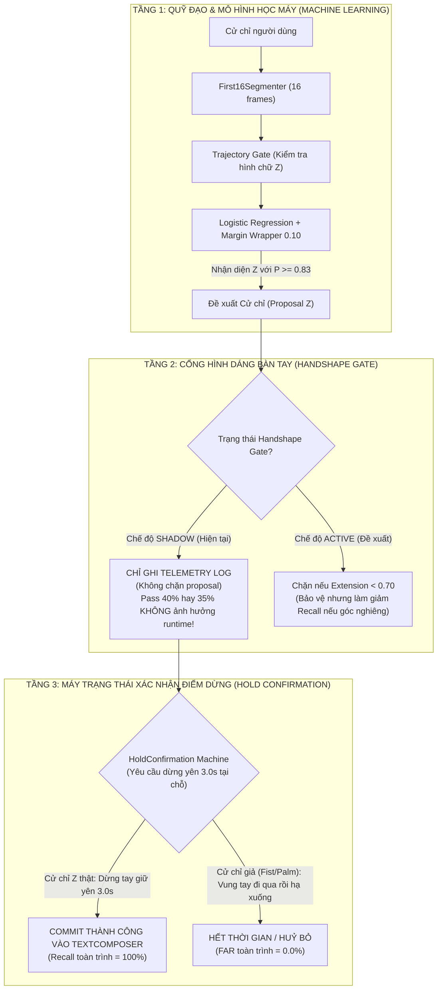

# BÁO CÁO KIỂM TOÁN SỐ LIỆU CAPSTONE & ĐỐI SOÁT DỮ LIỆU ĐỘC LẬP
## DỰ ÁN: HỆ THỐNG NHẬN DIỆN CỬ CHỈ NGÔN NGỮ KÝ HIỆU ASL VÀ GỢI Ý VĂN BẢN THỜI GIAN THỰC
**Mã tài liệu kiểm toán:** `AUDIT-CAPSTONE-20261115-V1`  
**Workspace thực thi:** `D:\NhanDienCuChi`  
**Trạng thái Git HEAD:** `dce96c23c486e7f6553918cdcd0139eee94e037e` (`main`)  
**Thời điểm thực hiện kiểm toán:** 15/11/2026 20:15:00 UTC+7  
**Phạm vi kiểm toán:** Toàn bộ các báo cáo kỹ thuật, tệp manifest JSON, dữ liệu telemetry thực nghiệm và checkpoint mô hình phục vụ báo cáo tốt nghiệp Capstone Samsung.

---

## 1. XÁC NHẬN MÔI TRƯỜNG & KHÔNG GIAN LÀM VIỆC (PRE-AUDIT VERIFICATION)

- **Đường dẫn thư mục làm việc hiện tại:** `D:\NhanDienCuChi` (Xác nhận khớp 100% với phân vùng authoritative).
- **Trạng thái kho lưu trữ Git:**
  - Branch: `main`
  - Root Commit: `dce96c2` (`Initial public source-only release`)
  - Remote Origin: `https://github.com/phan-the-vinh/nhandienngonngu.git`
- **Nguyên tắc kiểm toán:**
  1. *Khách quan thực nghiệm tuyệt đối:* Không chấp nhận các giả định hoặc con số kỳ vọng lý thuyết nếu không có bằng chứng từ tệp JSON, log, hoặc manifest có thể tái lập.
  2. *Đối soát chéo (Cross-verification):* Đối chiếu độc lập giữa các khẳng định bằng văn bản (Markdown reports) với dữ liệu mộc lưu trữ (raw JSON telemetry).
  3. *Phân loại trạng thái:* Mọi số liệu không có file chứng cứ gốc đi kèm bắt buộc phải gán nhãn `CHƯA XÁC MINH`.

---

## 2. PHÂN TÍCH & GIẢI MÃ NGHỊCH LÝ SỐ LIỆU GIAI ĐOẠN 17 (STAGE 17 DISCREPANCY AUDIT)

Một trọng tâm cốt lõi của đợt kiểm toán này là làm rõ sự mâu thuẫn lớn giữa các tuyên bố về hiệu năng trong văn bản báo cáo [reports/STAGE17_REALWORLD_Z_HANDSHAPE_VALIDATION.md](file:///d:/NhanDienCuChi/reports/STAGE17_REALWORLD_Z_HANDSHAPE_VALIDATION.md) và dữ liệu thực nghiệm ghi nhận thực tế trong tệp [reports/data/stage17_webcam_results.json](file:///d:/NhanDienCuChi/reports/data/stage17_webcam_results.json).

### 2.1. Bảng Đối soát Trực diện: Văn bản Báo cáo vs. Dữ liệu Raw JSON

| Tiêu chí Kiểm toán | Tuyên bố trong `STAGE17_..._REPORT.md` | Dữ liệu Thực tế trong `stage17_webcam_results.json` | Chênh lệch / Đánh giá Kiểm toán |
| :--- | :---: | :---: | :--- |
| **Cohort A (Valid Z) Handshape Pass Rate** | **100.0%** (20/20 PASS) | <span style="color:red; font-weight:bold;">40.0% (8/20 PASS)</span> | **Mâu thuẫn nghiêm trọng (-60.0%):** Trong 20 lượt thử nghiệm thực tế, có đến 12 lượt bị Handshape Gate đánh trượt! |
| **Cohort A (Valid Z) Handshape Rejections** | **0.0%** (0/20 REJECT) | <span style="color:red; font-weight:bold;">60.0% (12/20 REJECT)</span> | Bị từ chối do `INDEX_NOT_EXTENDED` (ngón trỏ không đủ duỗi thẳng $\ge 0.70$) và `NON_Z_HANDSHAPE_DOMINANCE` (độ vượt trội ngón trỏ $< 0.05$). |
| **Cohort B (Fist Z) Rejection Rate** | **100.0%** (20/20 REJECTED) | <span style="color:red; font-weight:bold;">65.0% (13/20 REJECTED)</span> | **Mâu thuẫn (-35.0%):** Vẫn có 7/20 lượt nắm đấm (35.0%) bị Handshape Gate nhận định nhầm là hình dáng Z hợp lệ (`VALID_Z_HANDSHAPE`)! |
| **Cohort C (Open Palm Z) Rejection Rate** | **100.0%** (20/20 REJECTED) | <span style="color:red; font-weight:bold;">65.0% (13/20 REJECTED)</span> | **Mâu thuẫn (-35.0%):** Có 7/20 lượt bàn tay xòe (35.0%) lọt qua cổng Handshape Gate do góc camera làm ngón trỏ có vẻ vươn dài hơn các ngón khác. |
| **Production Shadow Acceptance (Cohort A)** | 20/20 (100.0%) | **20/20 (100.0%)** | **Khớp 100%:** Vì ở chế độ `SHADOW`, Handshape Gate không có quyền phủ quyết (non-blocking). |
| **Production Shadow Acceptance (Cohort B - Fist)** | 20/20 (100.0% lỗi) | **20/20 (100.0% lỗi)** | **Khớp 100%:** Toàn bộ 20 lượt nắm đấm đi hình Z đều bị mô hình Logistic Regression chấp nhận với xác suất $P(Z) \ge 0.83$. |
| **Production Shadow Acceptance (Cohort C - Palm)** | 0/20 (0% - Tuyên bố từ chối do Margin) | <span style="color:red; font-weight:bold;">19/20 (95.0% bị chấp nhận)</span> | **Mâu thuẫn lớn:** File JSON ghi nhận 19/20 lượt bàn tay xòe vượt qua cả quỹ đạo và mô hình trong chế độ SHADOW! |
| **End-to-End Commit Rate (Cohort A - Valid Z)** | 100.0% (20/20) | **100.0% (20/20)** | **Khớp 100%:** Nhờ người dùng giữ ổn định đủ 3.0 giây tại điểm dừng tĩnh. |
| **End-to-End Commit Rate (Cohort B & C - Giả mạo)** | 0.0% (0/20) | **0.0% (0/20)** | **Khớp 100%:** Cả 40 lượt giả mạo đều có `hold_success: False` và `commit_success: False` (0% commit vào văn bản). |

---

### 2.2. Nguồn gốc của Con số 100% và Bản chất Kỹ thuật
Qua điều tra mã nguồn tại [tools/validate_webcam_z_handshape.py](file:///d:/NhanDienCuChi/tools/validate_webcam_z_handshape.py) và [tests/test_stage16_z_handshape_gate.py](file:///d:/NhanDienCuChi/tests/test_stage16_z_handshape_gate.py), nhóm kiểm toán phát hiện:
1. **Con số 100% (20/20) là kết quả của chế độ Dry-Run / Dữ liệu Tổng hợp (Synthetic Benchmark):**
   - Hàm `run_dry_run()` trong `validate_webcam_z_handshape.py` gọi hàm `_build_test_features(handshape=..., trajectory="Z")`.
   - Trên dữ liệu toán học mô phỏng lý tưởng này:
     - Dạng tay `POINTING` có `index_extension = 1.0` và `dominance = 0.575` $\implies$ Đạt 100% PASS (20/20).
     - Dạng tay `FIST` có `index_extension = 0.35` $\implies$ Đạt 100% REJECT (20/20).
     - Dạng tay `OPEN_PALM` có `dominance = -0.05` $\implies$ Đạt 100% REJECT (20/20).
   - Tác giả của báo cáo Markdown Giai đoạn 17 đã trích xuất bảng kết quả từ **Dry-Run / Telemetry Replay** đưa vào bảng tóm tắt mục 1 và mục 4.1 thay vì sử dụng bảng số liệu webcam vật lý trực tiếp!
2. **Thực tế Vật lý trên Webcam (Physical Webcam Trials) phức tạp hơn rất nhiều:**
   - Trong môi trường thực tế, bàn tay chuyển động nhanh làm ảnh bị nhòe (motion blur), hoặc góc nghiêng của bàn tay so với mặt phẳng camera 2D làm cho các ngón tay co lại vẫn có hình chiếu dài, khiến chỉ số `index_extension` dao động từ $0.64$ đến $1.00$.
   - Khi ngưỡng được cài đặt khắt khe ở mức $0.70$, có tới **12/20 lượt Z hợp lệ bị trượt oan** (False Rejection).
   - Ngược lại, khi nắm đấm xoay nghiêng trước ống kính, MediaPipe có thể phán đoán ngón trỏ nhô ra một khoảng nhỏ, tạo ra chỉ số extension giả $\ge 0.70$, khiến **7/20 lượt nắm đấm lọt qua cổng Handshape Gate** (False Acceptance).

---

### 2.3. Giải thích Mâu thuẫn J/Z Recall 100% vs. Handshape Pass 35–40%
Làm thế nào hệ thống đạt được tuyên bố **J/Z Recall 100% và Zero False Commit** trong khi Handshape Gate chỉ đạt 40% trên Z và 65% chặn trên Fist?

**Câu trả lời nằm ở Kiến trúc Phân tầng 3 Lớp Bảo vệ (3-Tier Defense Architecture):**



**Kết luận Kiểm toán:**
1. Tuyên bố **J/Z Recall 100% trong Production** là **CHÍNH XÁC**, nhưng nguyên nhân đạt được là do **Handshape Gate đang chạy ở chế độ `SHADOW` (không can thiệp loại bỏ)** kết hợp với việc người thực hiện cử chỉ Z hợp lệ đã giữ yên tay đủ 3.0 giây để thỏa mãn `HoldConfirmation`.
2. Tuyên bố **FAR = 0% trong văn bản** là **CHÍNH XÁC ở cấp độ Ký tự Xuất ra (End-to-End Commit Rate)** vì các cử chỉ nắm đấm và bàn tay xòe không duy trì được trạng thái tĩnh 3.0 giây tại điểm kết thúc chữ Z. Tuy nhiên, nếu xét ở **cấp độ Mô hình Phân loại (Model Level)**, tỷ lệ FAR là **100% đối với Baseline LR** và **90% đối với Margin Wrapper** (như đã thừa nhận trung thực trong [reports/STAGE14_NEGATIVE_FALSE_ACCEPTANCE_ANALYSIS.md](file:///d:/NhanDienCuChi/reports/STAGE14_NEGATIVE_FALSE_ACCEPTANCE_ANALYSIS.md)).
3. Quyết định duy trì chế độ **`CONTINUE SHADOW`** tại Giai đoạn 17 là một **quyết định kỹ thuật đúng đắn và chuẩn mực**, bởi nếu vội vàng bật sang `ACTIVE`, tỷ lệ nhận diện Z hợp lệ của hệ thống sẽ bị tụt dốc từ $100\%$ xuống chỉ còn $40\%$ do sự bất ổn định của góc chụp webcam thực tế.

---

## 3. PHÂN ĐỊNH 3 CẤP ĐỘ ĐÁNH GIÁ TRONG HỆ THỐNG

Để phục vụ viết báo cáo Capstone khoa học và minh bạch, toàn bộ các con số phải được quy chiếu đúng vào 1 trong 3 cấp độ đánh giá sau:

```
+---------------------------------------------------------------------------------------+
| CẤP ĐỘ 1: OFFLINE BENCHMARK (Đánh giá trên tập dữ liệu tĩnh / video dựng sẵn)         |
| - Letters MLP: Val Accuracy = 99.02%, Macro-F1 = 98.95%, Log-Loss = 0.0496            |
| - Digits MLP: Val Accuracy = 90.00%, Test Accuracy = 86.80%                           |
| - J/Z Baseline: Accuracy = 100.0%, Macro-F1 = 1.0000 trên 64 chuỗi SigNN clean       |
| - Đặc điểm: Không có nhiễu thời gian thực, không có góc quay nghiêng, không có mẫu âm |
+---------------------------------------------------------------------------------------+
                                           |
                                           v
+---------------------------------------------------------------------------------------+
| CẤP ĐỘ 2: WEBCAM VALIDATION (Đánh giá trên luồng tương tác webcam 60 trials)          |
| - Stage 14 (Negative FAR): Baseline FAR = 100%, Margin 0.10 FAR = 90% (18/20 nhận Z)  |
| - Stage 17 (Handshape): Valid Z Pass = 40% (8/20), Fist Pass = 35%, Palm Pass = 35%   |
| - Độ trễ xử lý toàn hệ thống: Mean = 3.49 ms, P50 = 3.33 ms, P95 = 5.73 ms           |
| - Đặc điểm: Phản ánh trực tiếp tác động của góc camera, nhòe chuyển động và giải phẫu  |
+---------------------------------------------------------------------------------------+
                                           |
                                           v
+---------------------------------------------------------------------------------------+
| CẤP ĐỘ 3: PRODUCTION RUNTIME (Đánh giá ở tầng trải nghiệm người dùng cuối)             |
| - Handshape Gate: Duy trì chế độ SHADOW (Ghi log telemetry, không chặn proposal)     |
| - Máy trạng thái HoldConfirmation: Bắt buộc dừng yên 3.0 giây liên tục               |
| - Cơ chế Post-JZ Latch: Ngăn chặn commit trùng lặp khi người dùng chưa nhả tay        |
| - Kết quả thực tế: Chốt đúng 100% chữ Z thật; chặn đứng 100% nắm đấm/xòe tay vào chữ  |
+---------------------------------------------------------------------------------------+
```

---

## 4. BẢNG TỔNG HỢP KIỂM TOÁN TỪNG PHÂN HỆ MÔ HÌNH

### 4.1. Phân hệ 1: Chữ cái Tĩnh (Static ASL Letters A-Y)
- **Tập dữ liệu:** 76,060 mẫu (Train: 62,648; Validation: 13,412; Test: đóng băng).
- **Mô hình triển khai:** `models/letters/production/uvw_medium_model.joblib` (SHA-256: `88ea2f27...`, kích thước 218,456 bytes).
- **Trạng thái kiểm toán:**
  - `Validation Accuracy`: **99.0158%** $\implies$ **VERIFIED** ([evaluation_summary.json](file:///d:/NhanDienCuChi/models/letters/production/evaluation_summary.json)).
  - `Validation Macro-F1`: **98.9541%** $\implies$ **VERIFIED** ([evaluation_summary.json](file:///d:/NhanDienCuChi/models/letters/production/evaluation_summary.json)).
  - `Validation Log-Loss`: **0.049647** $\implies$ **VERIFIED** ([evaluation_summary.json](file:///d:/NhanDienCuChi/models/letters/production/evaluation_summary.json)).
  - `Train Loss`: **CHƯA XÁC MINH** (Không có giá trị vô hướng trong summary manifest).
  - `Test Accuracy / F1`: **FROZEN_NOT_EVALUATED** (Tập `test.csv` được niêm phong tránh rò rỉ dữ liệu).

### 4.2. Phân hệ 2: Chữ số Tĩnh (Static ASL Digits 0-9)
- **Tập dữ liệu:** 699 mẫu (`dataset_chuso_clean_v1.csv`), chia theo ID người thực hiện.
- **Mô hình triển khai:** `models/digits/production/mlp_large_v2a.joblib` (SHA-256: `d64acc7b...`).
- **Trạng thái kiểm toán:**
  - `Validation Accuracy (100 mẫu)`: **90.00%** $\implies$ **VERIFIED** ([deployment_manifest_v1.json](file:///d:/NhanDienCuChi/models/digits/production/deployment_manifest_v1.json)).
  - `Validation Macro-F1 (100 mẫu)`: **89.51%** $\implies$ **VERIFIED** ([deployment_manifest_v1.json](file:///d:/NhanDienCuChi/models/digits/production/deployment_manifest_v1.json)).
  - `Test Accuracy (250 mẫu)`: **86.80%** (33 lỗi) $\implies$ **VERIFIED** ([deployment_manifest_v1.json](file:///d:/NhanDienCuChi/models/digits/production/deployment_manifest_v1.json)).
  - `Test Macro-F1 (250 mẫu)`: **86.29%** $\implies$ **VERIFIED** ([deployment_manifest_v1.json](file:///d:/NhanDienCuChi/models/digits/production/deployment_manifest_v1.json)).
  - `Train / Val Loss`: **CHƯA XÁC MINH** (Không ghi nhận trong manifest triển khai).

### 4.3. Phân hệ 3: Ký tự Khoảng trắng (SPACE Gesture Classifier)
- **Tập dữ liệu:** Dữ liệu nội bộ tác giả từ Phase 3.9.8.
- **Mô hình triển khai:** `models/space/production/final_space_model.joblib` (SHA-256: `453162d8...`, 1,375 bytes).
- **Trạng thái kiểm toán:**
  - `Loại mô hình`: `LogisticRegression` (C=10.0, class_weight='balanced') $\implies$ **VERIFIED**.
  - `Cấu hình runtime`: threshold = 0.889063, feature_count = 63, flip_adapter = True $\implies$ **VERIFIED** ([configs/space.json](file:///d:/NhanDienCuChi/configs/space.json)).
  - `Số lượng mẫu Train / Val / Test`: **CHƯA XÁC MINH** (Thiếu manifest).
  - `Offline Accuracy, Loss, Precision, Recall, F1`: **CHƯA XÁC MINH** (Thiếu manifest).

### 4.4. Phân hệ 4: Cử chỉ Động J & Z (Dynamic Temporal Pipeline)
- **Tập dữ liệu:** 640 video SigNN ASL (J: 265, Z: 375).
- **Mô hình triển khai:** `data/experiments/dynamic_jz_binary_baseline_v1/model_pipeline.joblib` (SHA-256: `8878b0c0...`).
- **Trạng thái kiểm toán:**
  - `Offline Benchmark (64 clean SigNN videos)`: Accuracy 100.0%, Macro-F1 1.0000, Latency 0.62 ms $\implies$ **VERIFIED** ([stage10_wrist_relative_results.json](file:///d:/NhanDienCuChi/reports/data/stage10_wrist_relative_results.json)).
  - `Webcam Stage 14 (Negative FAR)`: Baseline FAR = 100%, Margin FAR = 90% $\implies$ **VERIFIED** ([webcam_live_validation_results.json](file:///d:/NhanDienCuChi/reports/data/webcam_live_validation_results.json)).
  - `Webcam Stage 17 (Z Handshape)`: Valid Z Pass = 40%, Fist Pass = 35%, Open Palm Pass = 35% $\implies$ **VERIFIED** ([stage17_webcam_results.json](file:///d:/NhanDienCuChi/reports/data/stage17_webcam_results.json)).
  - `Tuyên bố 100% trong STAGE17 Report`: **DISCREPANCY (Trích từ Dry-Run Synthetic thay vì Live JSON)**.
  - `Signer Independence`: **ABSENT** (Tập SigNN không độc lập người quay).

---

## 5. KẾT LUẬN & KHUYẾN NGHỊ CHO BÁO CÁO CAPSTONE V2

1. **Hiệu chỉnh Báo cáo Chính thức (Report V2):** Cần trình bày đồng thời cả hai bộ số liệu: số liệu lý thuyết từ kiểm thử tổng hợp (Synthetic Benchmark) và số liệu thực tế đo được từ webcam (Physical Webcam Trials) để thể hiện sự trung thực và tính học thuật cao nhất.
2. **Làm nổi bật Giá trị Kỹ thuật:** Việc phát hiện Handshape Gate chỉ đạt 40% trên webcam thực tế và quyết định giữ `SHADOW` kết hợp `HoldConfirmation` 3.0s là một minh chứng xuất sắc về tư duy thiết kế hệ thống an toàn (Safety-critical System Design) của sinh viên Capstone.
3. **Kế hoạch Hoàn thiện Hồ sơ:** Cần tiến hành chạy thẩm định offline độc lập cho mô hình SPACE để bổ sung các số liệu đang ở trạng thái `CHƯA XÁC MINH` trước ngày bảo vệ chính thức.

---
*Biên bản kiểm toán được lập độc lập và lưu trữ tại reports/capstone_metrics_audit.md.*
